# Learning to See in the Dark

## 一、论文基本信息

- **论文类型**：RAW图像去噪／极低照度成像
- **发表信息**：CVPR 2018；arXiv:1805.01934v1（2018 年 5 月）
- **作者**：Chen Chen、Qifeng Chen、Jia Xu、Vladlen Koltun
- **作者单位**：UIUC；Intel Labs
- **论文链接**：[arXiv PDF](https://arxiv.org/pdf/1805.01934v1)
- **代码仓库**：[cchen156/Learning-to-See-in-the-Dark](https://github.com/cchen156/Learning-to-See-in-the-Dark)

## 二、摘要总结

极低照度的短曝光成像受制于极少的光子数和极低信噪比。提高 ISO 会同时放大噪声；延长曝光可提高信号，但会带来运动或抖动模糊，难以满足视频级采集。论文提出将短曝光 RAW 图像直接映射为长曝光质量的 sRGB 图像，用端到端全卷积网络联合完成白平衡、去马赛克、降噪、色彩校正与亮度增强，而不是先经过传统 ISP 再做后处理。

为支撑真实数据研究，作者构建了 SID 数据集：5,094 张真实短曝光 RAW 图像，每张均对应高质量长曝光参考图。默认模型为 U-Net；它接收经颜色阵列打包、黑电平校正和曝光倍率放大的 RAW 数据，输出 12 通道半分辨率结果，再经 sub-pixel 层重排为全分辨率 RGB。实验表明，方法在最困难的 Sony ×300 数据上主观质量显著超过传统 ISP 加 BM3D，以及使用 8 帧完美对齐图像的 burst 去噪。

## 三、研究背景

### 3.1 已有研究进展

低光增强常依赖提高 ISO、延长曝光、直方图均衡、Retinex、去噪和锐化。传统去噪通常假设较温和或合成噪声；burst 方法虽然能汇聚多帧信号，却高度依赖对齐并增加处理复杂度。极端低照度下，传统 ISP 在去马赛克、色彩变换与量化过程中已可能放大或固化噪声，因此仅在最终 sRGB 上去噪并不足够。

### 3.2 具体科学问题

论文回答的问题是：能否只用一张真实极暗、短曝光的 RAW 图像，恢复出亮度可用、颜色正确、噪声受控的 sRGB 图像？作者的答案是把 RAW-to-sRGB 的整条管线作为联合重建问题，而不是多个独立后处理模块的串联。

## 四、研究方法

### 4.1 数据来源和范围

SID 包含 5,094 张短曝光输入与 424 张不同的长曝光参考图。Sony α7S II 使用全画幅 Bayer 传感器，Fujifilm X-T2 使用 APS-C X-Trans 传感器；前者图像尺寸为 4240×2832，后者为 6000×4000。输入曝光为 1/30 至 1/10 秒，参考图曝光是其 100、250 或 300 倍，约 10 至 30 秒。室外场景照度约为 0.2 至 5 lux，室内约为 0.03 至 0.3 lux；每个条件约 20% 用于测试、10% 用于验证。

**表 1：SID 的采集条件与数据量。**

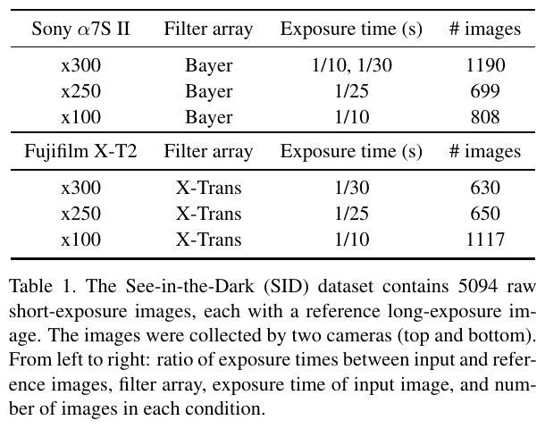

表中可见 Sony 与 Fuji 各覆盖 ×100、×250、×300 三档曝光比；两种不同的颜色阵列让论文能够检验方法是否依赖 Bayer 结构。长曝光参考图仍可能有轻微噪声，但作者将目标定义为获得感知质量高的图像，而不是严格消除一切噪声。

**图 2：SID 中的室内外样例。**

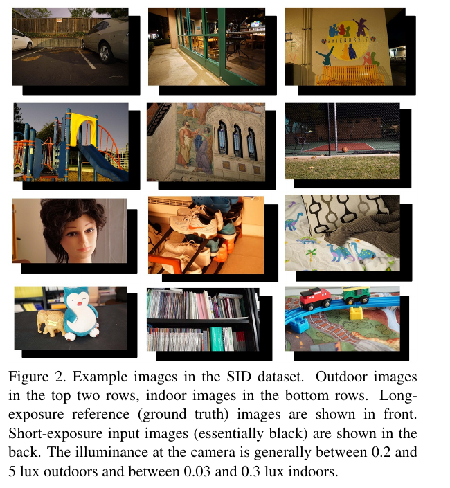

每一对中前方是长曝光参考、后方是近乎全黑的短曝光输入。它直观说明该任务不同于常规低光增强：输入中可见信息非常有限，且真实噪声、色偏和颜色采样问题同时存在。

### 4.2 RAW 输入、网络与输出 RGB

对 Bayer RAW，作者将相邻像素按 CFA 位置打包到 4 个通道，将空间尺寸变为原来的一半。对 X-Trans RAW，作者将 6×6 的原始颜色布局经邻近元素交换后表示为 9 个通道，而非直接使用 36 通道。打包后，先减去黑电平，再乘以由曝光差确定的放大倍率：

$$
x_{net}=(x_{raw}-b)\times r
$$

这里，黑电平校正移除传感器偏置，倍率相当于用户指定的虚拟 ISO；它控制输出亮度，也将极弱信号放到适合网络处理的数值范围。

**图 3：本文 RAW-to-sRGB 管线与传统管线的区别。**

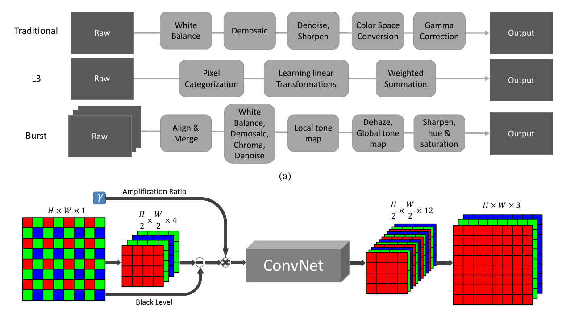

传统 ISP 依次执行白平衡、去马赛克、去噪、颜色转换和伽马校正；burst 管线还需配准与融合。本文把打包后的 RAW 直接输入全卷积网络，令网络联合学习这些过程。默认主干为 U-Net：下采样获得上下文，上采样与跳跃连接恢复细节；作者也比较 CAN，但最终选用 U-Net。

网络的输出尺寸为半分辨率 12 通道：

$$
\frac{H}{2}\times\frac{W}{2}\times12
$$

12 可以拆为 RGB 三个颜色值与 2×2 个空间子像素：

$$
12=3\times2\times2
$$

最后的 sub-pixel 或 PixelShuffle 层只做无参数的通道—空间重排：每个半分辨率位置的 12 个值对应原分辨率 2×2 小块中四个像素各自的 RGB，得到最终输出：

$$
\frac{H}{2}\times\frac{W}{2}\times12\xrightarrow{\operatorname{PixelShuffle}(2)}H\times W\times3
$$

因此，12 通道不是 12 种颜色；去噪、去马赛克与颜色恢复已在 U-Net 预测这 12 个值时完成，PixelShuffle 仅将结果放回正确像素位置。

### 4.3 训练策略与推理

每个相机训练一个独立模型。输入为短曝光 RAW，监督为 libraw 处理得到的对应长曝光 sRGB；使用 Adam 与 L1 损失：

$$
\mathcal{L}=\left\|\hat{y}_{sRGB}-y_{ref}\right\|_1
$$

每次随机裁剪 512×512 图像块，并做随机翻转与旋转；学习率由 0.0001 在第 2,000 个 epoch 后降为 0.00001，训练共 4,000 个 epoch。推理时，给定单帧 RAW 和指定倍率，模型直接输出 sRGB，并在图像内自适应完成盲式噪声抑制与色彩变换。

**图 4：倍率对输出亮度的影响。**

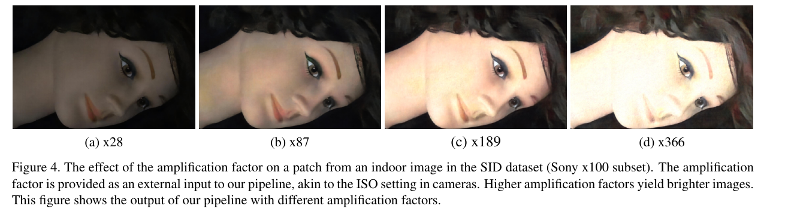

从 ×28 到 ×366，输出逐步变亮。倍率是显式输入，而非网络自动估计；这带来亮度可控性，也是论文后续指出的局限。

## 五、图表分析

### 5.1 任务难度与视觉比较

**图 1：极低照度下的动机示例。**

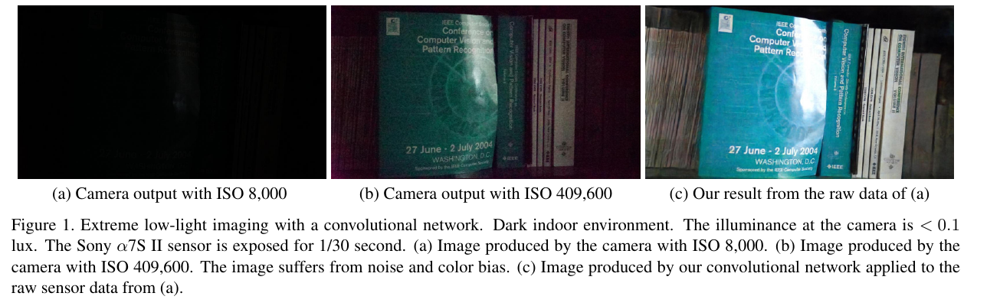

在低于 0.1 lux、1/30 秒下，ISO 8,000 的相机输出几乎全黑；ISO 409,600 虽可见内容，但噪声和色偏非常严重。使用同一低 ISO RAW 的网络结果同时恢复了书脊结构、亮度和更合理的色彩，说明关键不只是增亮，而是从 RAW 中联合恢复信号。

**图 5：Fuji X-T2 的传统管线对比。**

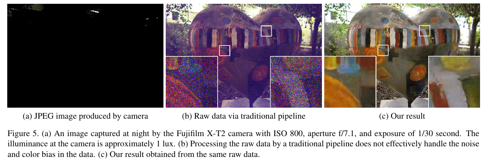

传统管线处理同一 RAW 后保留强烈彩色噪点和色偏；本文结果在保持局部纹理的同时显著降低噪声。该图也说明方法并不限于 Bayer，能处理 X-Trans 传感器。

**图 6：跨相机泛化的定性结果。**

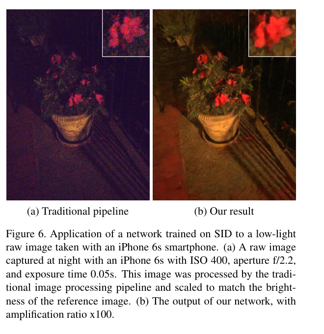

作者将 Sony 数据训练的网络应用于 iPhone 6s 的 Bayer RAW。传统流程仍有显著噪声与色偏，网络输出拥有更好的对比度和颜色。该结果是初步泛化证据，而非严格的跨传感器定量评测。

**图 7：与 BM3D 的比较。**

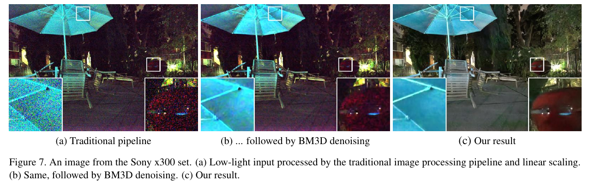

BM3D 需外部指定噪声强度：参数偏小会残留噪声，偏大则会过平滑；真实低光噪声还具有空间非均匀与颜色相关性。本文模型直接在 RAW 域恢复，因而能同步修复噪声和传统 ISP 输出的色偏。

### 5.2 感知测试与受控消融

**表 2：盲测偏好率。**

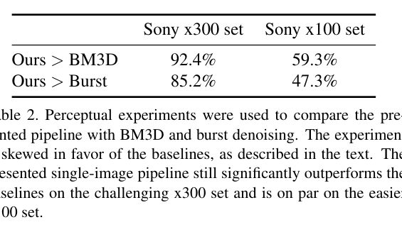

作者让 10 位 Mechanical Turk 工作者完成 1,180 次随机 A/B 比较。在最困难的 Sony ×300 集，本文结果相对 BM3D 的偏好率为 92.4%，相对 8 帧完美对齐 burst 的偏好率为 85.2%。在较易的 ×100 集，优势明显减小，表明方法最主要的价值是处理极端信号匮乏条件。

**表 3：受控实验。**

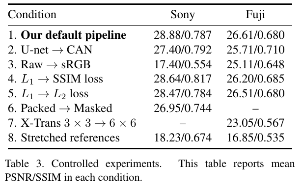

默认 U-Net 加 RAW 输入取得 Sony 28.88/0.787、Fuji 26.61/0.680 的平均 PSNR/SSIM。最显著的消融是将输入从 RAW 换为传统管线生成的 sRGB：Sony PSNR 从 28.88 降至 17.40，说明 RAW 域处理是核心。将 U-Net 换成 CAN 会降低 PSNR；使用 L2 或 SSIM 损失仅带来相近结果；Bayer 的 packing 优于 masking，X-Trans 的 9 通道布局优于直接 6×6、36 通道布局。

**图 8：U-Net 与 CAN。**

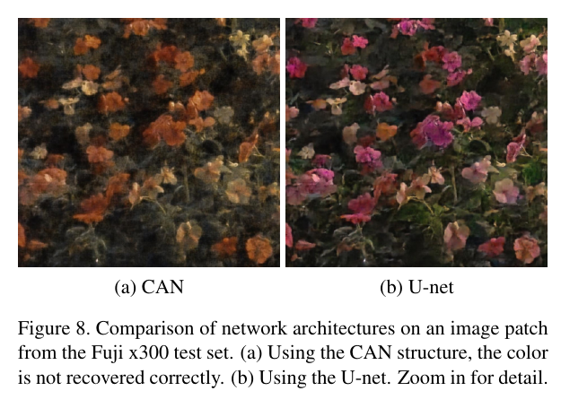

CAN 结果在花朵区域出现色彩恢复不准的问题；U-Net 的颜色和纹理更可信。这与表 3 中 U-Net 的更高 PSNR 一致，也解释了论文选择 U-Net 作为默认架构的原因。

**图 9：为什么将直方图拉伸移出网络。**

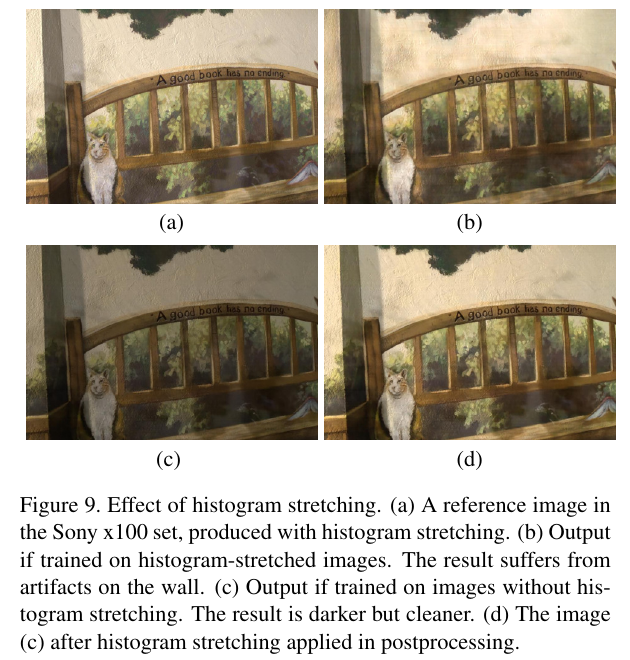

若训练目标已做直方图拉伸，网络需要学习全图统计变换，测试时墙面会出现伪影。改用未拉伸参考训练，结果虽更暗却更干净；再独立做后处理，可兼顾稳定性与亮度。这说明卷积网络对全局直方图操作的学习并不稳健。

**图 10：极端条件下的失败案例。**

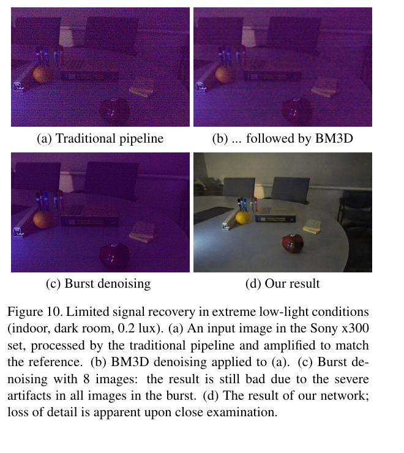

在 0.2 lux 的暗室中，传统处理、BM3D 和 8 帧 burst 均难以恢复有效图像。本文输出明显更可用，但仔细观察仍有细节缺失。这说明学习方法不能从完全不存在的光子观测中凭空恢复真实内容。

## 六、主要发现

1. 在极低照度条件下，单帧 RAW-to-sRGB 联合恢复优于“传统 ISP 后去噪”。
2. 在 Sony ×300 集，主观质量显著优于 BM3D 和理想化的 8 帧 burst 中值去噪。
3. RAW 输入、颜色阵列的合理打包和 U-Net 多尺度结构均是性能关键。
4. 端到端学习直方图拉伸会引入伪影，更适合作为独立后处理。

## 七、核心贡献

- 提出极低照度单帧 RAW-to-sRGB 的端到端学习范式。
- 发布真实短曝光 RAW—长曝光参考配对的 SID 数据集。
- 以一个可训练网络联合替代传统 ISP 的多个关键阶段。
- 系统研究了输入颜色空间、网络结构、损失、RAW 布局与后处理的影响。

## 八、研究局限

- SID 主要是静态场景，未解决人和动态物体。
- 需要按传感器训练专用模型，跨传感器泛化仅有初步验证。
- 放大倍率由外部指定，尚不具备自动曝光或 Auto ISO 能力。
- 未处理 HDR tone mapping，亮部可能饱和。
- 全分辨率处理耗时约 0.38 秒（Sony）和 0.66 秒（Fuji），不满足实时高分辨率视频。
- 在极端低光下，仍会发生真实细节丢失。

## 九、论文总结

论文的核心贡献不是单独提出一个去噪网络，而是证明在传统 ISP 之前的 RAW 域联合恢复，对于极低照度成像至关重要。它以真实配对数据把去马赛克、降噪、色彩和亮度恢复统一为一个学习问题，并奠定了后续学习式 ISP 与 RAW 图像去噪研究常用的实验范式。对工程实践的启示是：若目标是极低照度的可用图像，应优先保留 RAW 信息并联合建模传感器噪声与颜色阵列，而不是只在已处理的 sRGB 上叠加去噪模块。
