# Beyond the Ground Truth: Enhanced Supervision for Image Restoration

## 一、论文基本信息

- **论文类型**：图像恢复
- **会议**：CVPR 2026
- **作者**：Donghun Ryou、Inju Ha、Sanghyeok Chu、Bohyung Han
- **单位**：Seoul National University，Computer Vision Laboratory（ECE/IPAI）
- **论文链接**：[arXiv:2512.03932](https://arxiv.org/abs/2512.03932)
- **项目主页**：[Beyond the Ground Truth](https://hij1112.github.io/beyond-the-ground-truth/)
- **代码**：[GitHub](https://github.com/dhryougit/Beyond-the-Ground-Truth)

## 二、摘要总结

真实图像恢复数据集的参考标签并不总是理想清晰图：去模糊标签可能残留相机抖动，真实去噪标签则可能因多帧平均而变软。本文认为这类次优 Ground Truth 会成为恢复器感知质量的上限。方法先以一步扩散超分模型为原始标签生成多个候选变体，再在频域内自适应地融合原标签与候选变体，构造兼具语义保真与细节清晰度的增强标签。随后训练轻量输出精修网络 ORNet，使其能够外挂到已有恢复器之后，无需修改或重训底座模型。实验覆盖 GoPro 去模糊、SIDD 去噪以及多个分布外设置；作者报告无参考质量指标、OCR/人脸一致性和用户研究均支持其感知质量收益。核心思想不是直接用生成式超分替代标签，而是让原标签主导可信结构，再选择性吸收超分候选中的频率细节。

## 三、研究背景

传统监督恢复通常以像素损失拟合给定标签。当标签仍含噪、含模糊或缺乏高频时，模型即使在 PSNR、SSIM 上表现良好，也容易输出偏平滑的结果。扩散模型能改善感知细节，但直接用于恢复输出会引入额外推理代价，并可能生成不存在的纹理、文字或颜色。本文因此把生成模型用于**提升监督标签**，而不是将其直接作为恢复器。

## 四、研究方法

### 4.1 数据与候选标签构造

训练联合使用 GoPro 去模糊和 SIDD 真实去噪数据。对每张原始 GT，先以双三次插值放大，再用 OSEDiff 生成 2 倍、3 倍、4 倍超分结果，最后缩回原分辨率，得到三个候选标签。原文没有将这些候选直接作为监督，因为它们可能改变语义结构或色调。

### 4.2 频率掩码生成器的真实输入与输出

图 2 给出了完整数据流。这里需要特别区分“掩码网络的输入”与“后续参与融合的图像”。根据论文公式和官方代码，CFMG **不同时输入四张图像**；它只接收原始 GT、原始 GT 的频谱幅度和增强强度。官方实现将三者拼接为 7 通道输入：RGB 三通道、FFT 对数幅度三通道、条件图一通道。三个超分变体只在 CFMG 输出权重后进入 FFT 融合。

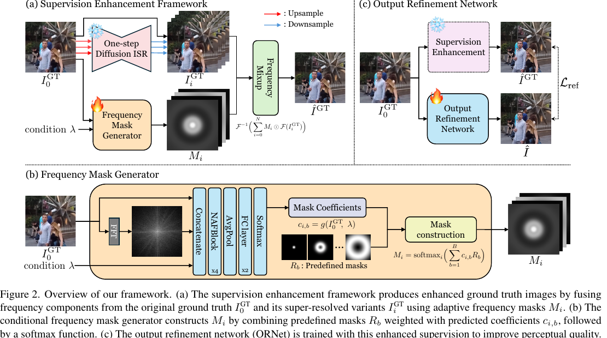

对第 b 个环形高斯频带，论文定义如下：

$$
(R_b)_{h,w}=\exp\left(-\frac{(d(h,w)-\mu_b)^2}{2\sigma_b^2}\right)
$$

该式在频谱平面上生成一个以中心为圆心的平滑环带。距离函数表示频谱坐标距中心直流分量的距离；高斯中心决定该环覆盖低、中或高频，带宽决定频带过渡的平滑程度。论文以 25 个基掩码覆盖完整频率范围，并在低频布置更密的频带。它们是频率控制的结构先验，避免直接预测逐频点的无约束掩码。

CFMG 由 4 个 NAFBlock、全局平均池化和两层全连接层组成。它对一张原始 GT 一次前向传播，输出四个来源在 25 个频带上的系数：

$$
c_{i,b}=g(I^{GT}_0,\lambda)
$$

该式的计算目标是，从原 GT 的空间内容、频谱幅度和控制强度中预测融合策略。下标 i 表示四个来源中的一个：原 GT、2 倍、3 倍、4 倍超分变体；下标 b 表示 25 个高斯频带。代码中两层全连接层输出 100 个数并重排为批量大小×4×25；即四个来源的系数是联合预测的，而不是对四张图分别运行网络。

### 4.3 从频带系数到频域融合权重

官方代码先沿“来源”维度对每个频带的四个系数做 Softmax，再与对应高斯基掩码相乘并在频带维求和。可抽象为：

$$
S_i(h,w)=\sum_{b=1}^{25}p_{i,b}R_b(h,w)
$$

该式将每来源 25 个全局频带系数展开为一张频谱得分图。系数表示该来源偏好哪个频带；高斯环将这一偏好平滑地扩展到频谱坐标。由于基掩码只依赖到频谱中心的半径，当前实现主要做径向频率选择，不显式区分同一半径的方向。

随后，代码再次沿来源维度做 Softmax：

$$
M_i(h,w)=\frac{\exp(S_i(h,w))}{\sum_{j=0}^{3}\exp(S_j(h,w))}
$$

该式把四个来源在每个频谱位置的得分变成最终权重。固定任意频谱位置时，四个权重和为 1；一个来源权重提高会压低其他来源的相对贡献，因而不会无约束叠加多个来源的高频能量。

### 4.4 频谱的计算与“区域自适应”边界

每个 RGB 通道均沿图像高、宽进行二维 FFT：

$$
X(u,v)=\sum_{x=0}^{H-1}\sum_{y=0}^{W-1}I(x,y)\exp\left(-2\pi\mathrm{i}\left(\frac{ux}{H}+\frac{vy}{W}\right)\right)
$$

该式将空间域像素转换为复数频谱。幅度表示某类尺度、方向的变化有多强，相位决定这些结构在图像中的位置。CFMG 的条件输入仅使用频谱的对数幅度：

$$
A(u,v)=\log_{10}(|X(u,v)|+1)
$$

该式压缩动态范围，避免强低频主导神经网络；完整复数频谱仍会在后续融合时保留，因此空间结构的相位信息不会被丢弃。

当前 CFMG 的权重定义在频谱坐标上，而非原图像素坐标上。它不会显式预测“左上角用超分图、右下角用原图”的局部空间门控。同一张图不同区域仍可能看起来增强不同：平滑天空主要含低频，文字和头发含更多高频；当模型增强高频时，后者自然受影响更大。这是内容频率组成不同导致的间接差异，不是区域独立权重。

### 4.5 最终增强标签与训练目标

在获得掩码后，原 GT 和三个超分候选才同时参与频谱融合：

$$
\hat I^{GT}=\mathcal{F}^{-1}\left(\sum_{i=0}^{3}M_i\odot\mathcal{F}(I^{GT}_i)\right)
$$

该式对每个来源的完整复数频谱施加来源权重、相加并逆变换得到增强标签。低频通常更多保留原 GT 的颜色、整体轮廓与语义；中高频可选择性引入候选图的边缘和纹理。它不是像素域透明度叠加，也不是把某张超分图整体替换进去。

掩码网络同时受保真与感知目标约束：

$$
\mathcal{L}_{recon}=\left\|\hat I^{GT}-I^{GT}_0\right\|_2^2
$$

该损失限制增强标签偏离原 GT，保护结构、颜色与语义一致性。

$$
\mathcal{L}_{percep}=-\sum_k\operatorname{IQA}_k(\hat I^{GT})
$$

该项最大化 MUSIQ、MANIQA、TOPIQ 等无参考质量指标，推动清晰度和自然度提升。

$$
\mathcal{L}=(1-\lambda)\mathcal{L}_{recon}+\lambda\mathcal{L}_{percep}
$$

该式用增强强度平衡保真与感知质量。训练时随机采样增强强度；默认评测使用 0.3。数值过大虽然通常提高无参考感知指标，却可能带来颜色偏移与语义幻觉。

### 4.6 ORNet 输出精修

作者固定已有恢复器，将轻量 U-Net 式 ORNet 接在其输出后。ORNet 有 4 个编码块、1 个中间块、4 个解码块，基本单元为 NAFBlock，约 4.5M 参数、20G MACs。其训练把接近原 GT 的恢复输出映射到增强 GT：

$$
\hat I=R_\theta(R_\phi(I^{LQ}),\lambda)
$$

该式表示先由任意预训练恢复器产生初步结果，再由 ORNet 根据增强强度进行精修。它避免为每一种恢复骨干重新训练一套增强监督模型。

## 五、图表分析

### 方法与定性图

图 1 显示增强 GT 在文字和人物局部更清晰，同时保持原图主体结构。

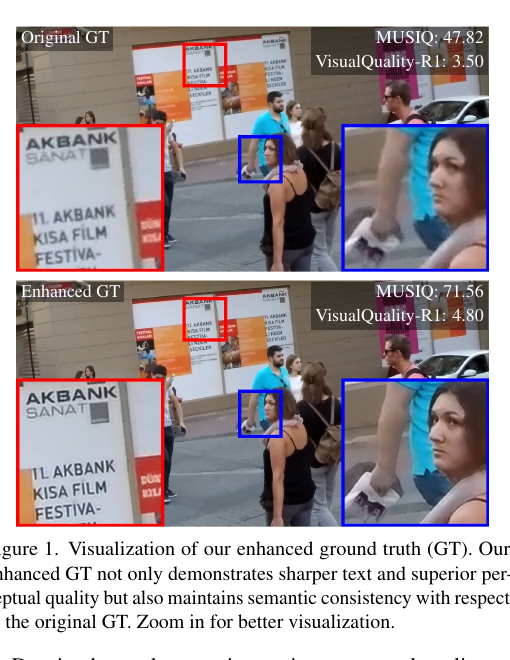

图 3、图 4 显示 ORNet 分别应用于去模糊和去噪结果时，对细结构与残余退化的改善。

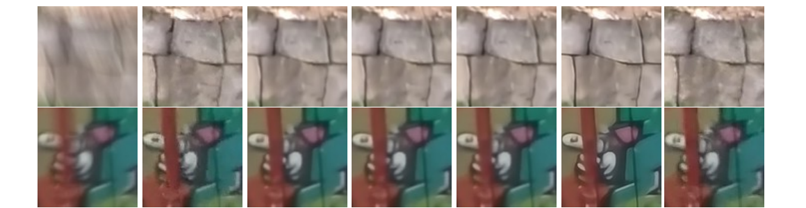

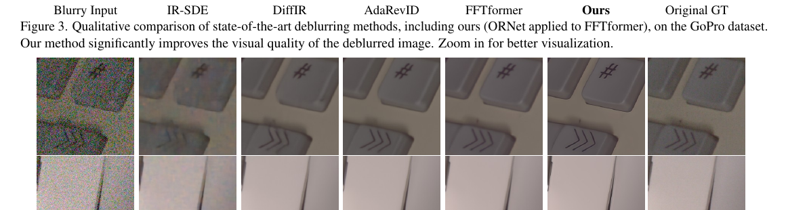

图 5 支持环形频带设计：直接逐点预测频域或空间域掩码更易不规则，基掩码约束带来更平滑的频率选择。

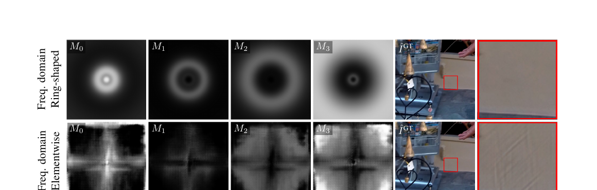

图 6、图 7、图 8 分别从标签缺陷、语义/幻觉、用户偏好角度支持该方法。

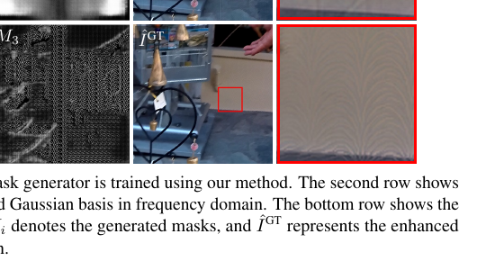

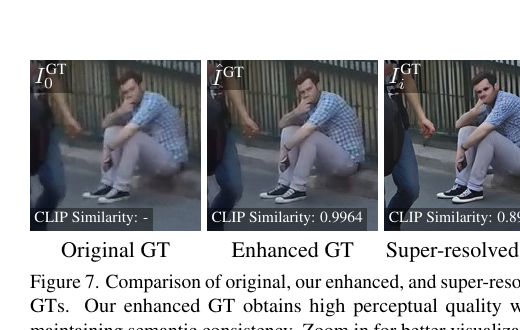

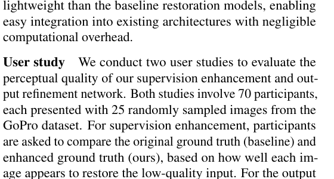

### 补充材料图

图 9 至图 19 覆盖基掩码、NAFBlock、增强样例、不同倍率候选、频率组成、OOD 结果、频带数量与增强强度控制。它们共同说明：25 个频带已足够，混合多个倍率优于只用单一倍率，且过强增强会增加幻觉风险。

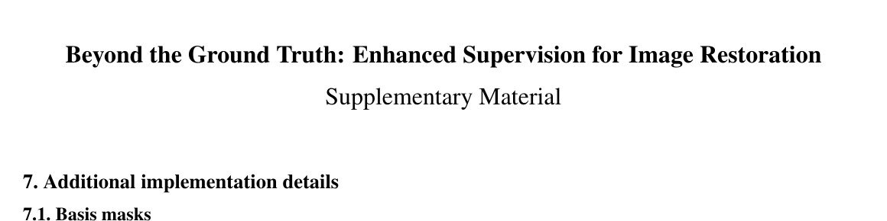

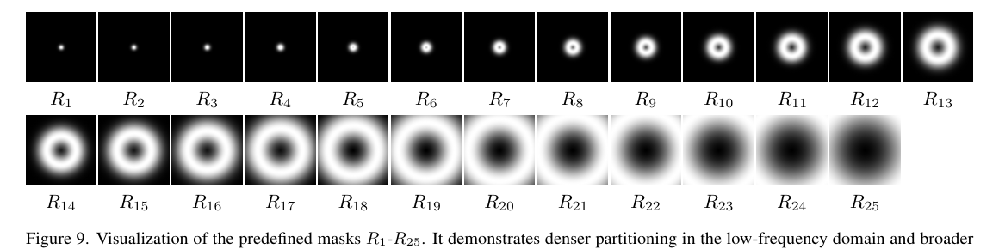

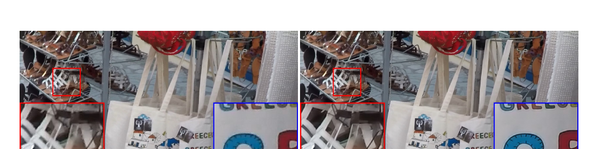

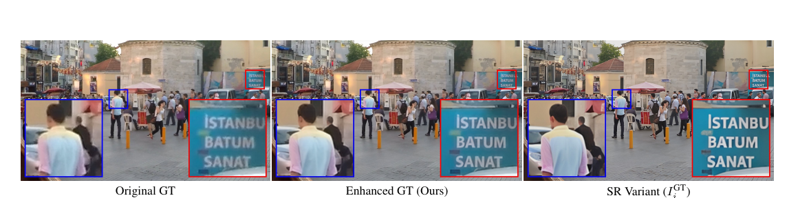

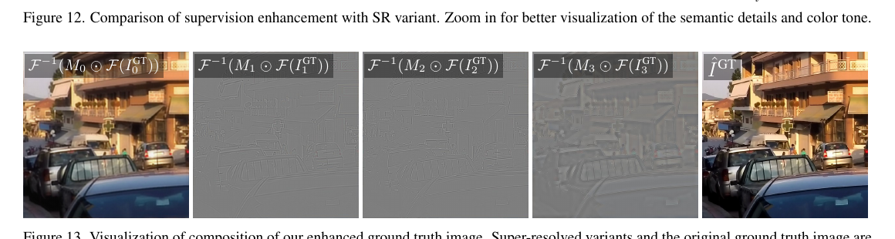

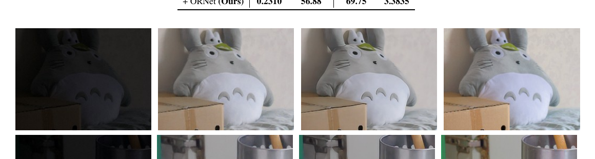

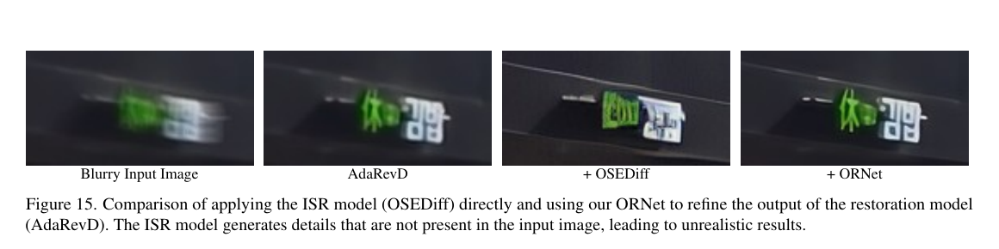

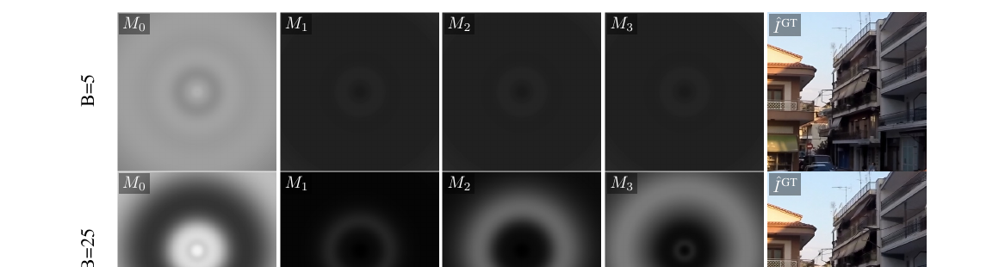

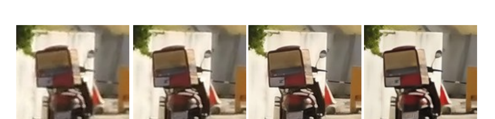

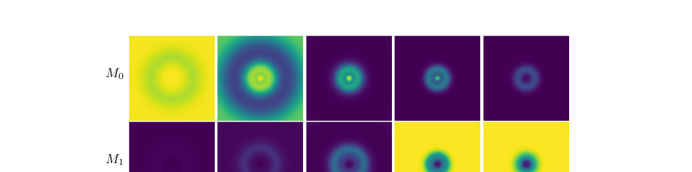

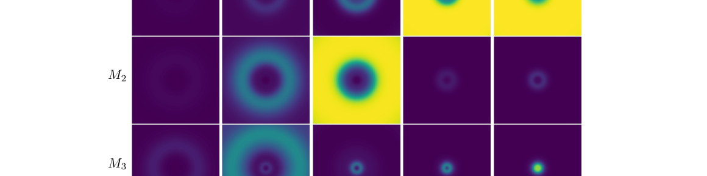

### 实验表格

表 1 显示 ORNet 在 GoPro 和 SIDD 上显著提升 MUSIQ、MANIQA、TOPIQ、LIQE 等无参考指标；表 2、表 3 显示在额外模糊、额外噪声的 OOD 条件下，感知指标和参考指标均有改善。

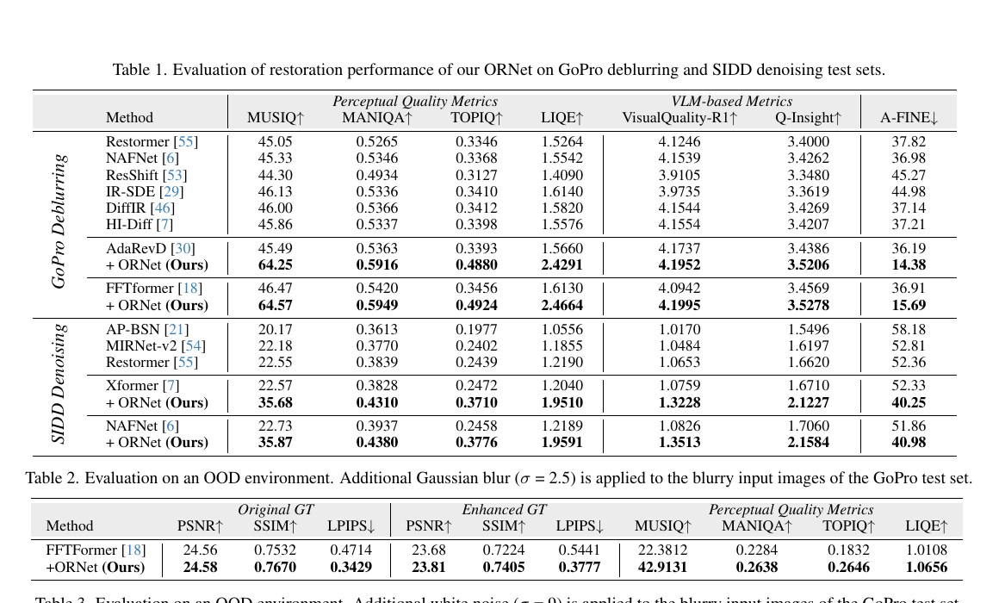

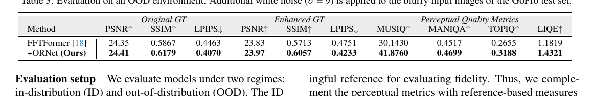

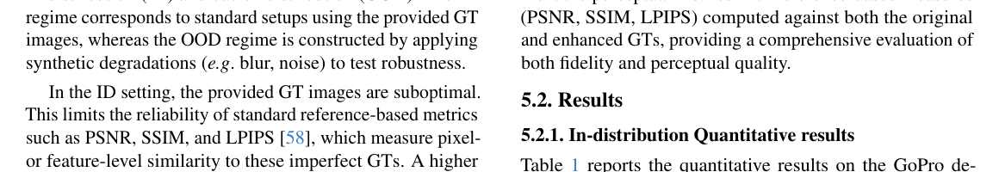

表 4 表明直接微调 FFTformer 虽有效，但不如外挂 ORNet 且需按骨干重复训练；表 5、表 6 分别支持语义一致性和轻量性。

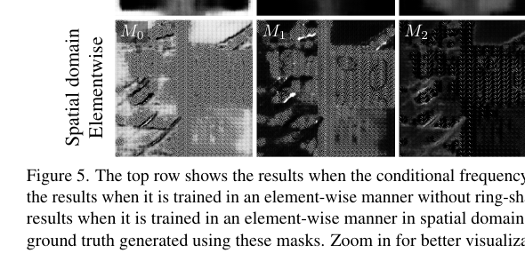

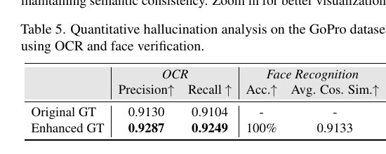

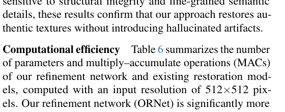

补充表覆盖 HIDE、LOL、GyroBlur 的泛化，单倍率候选消融，以及不同增强强度下的完整结果。

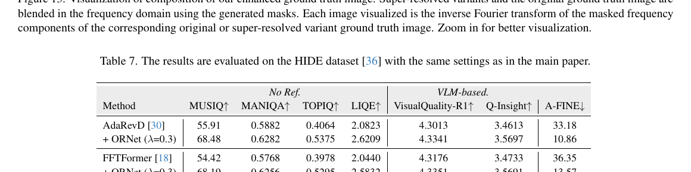

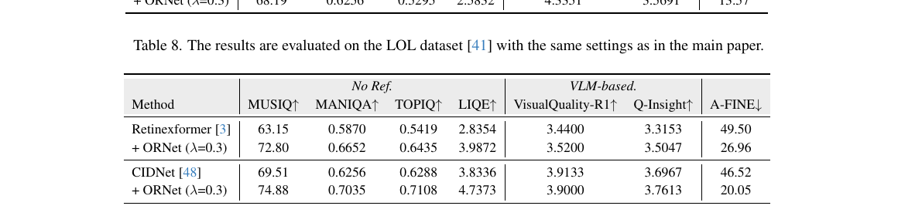

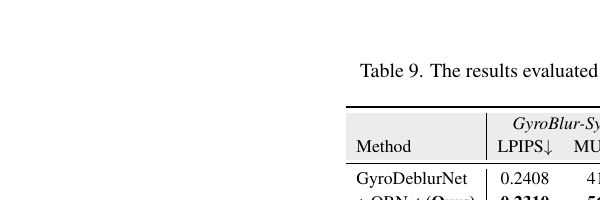

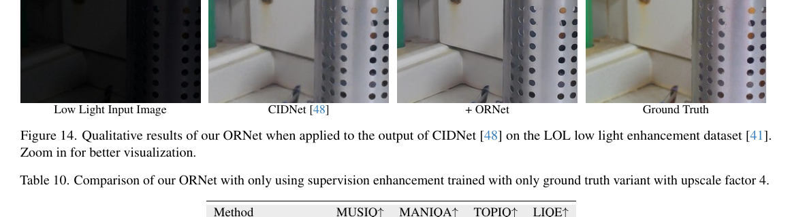

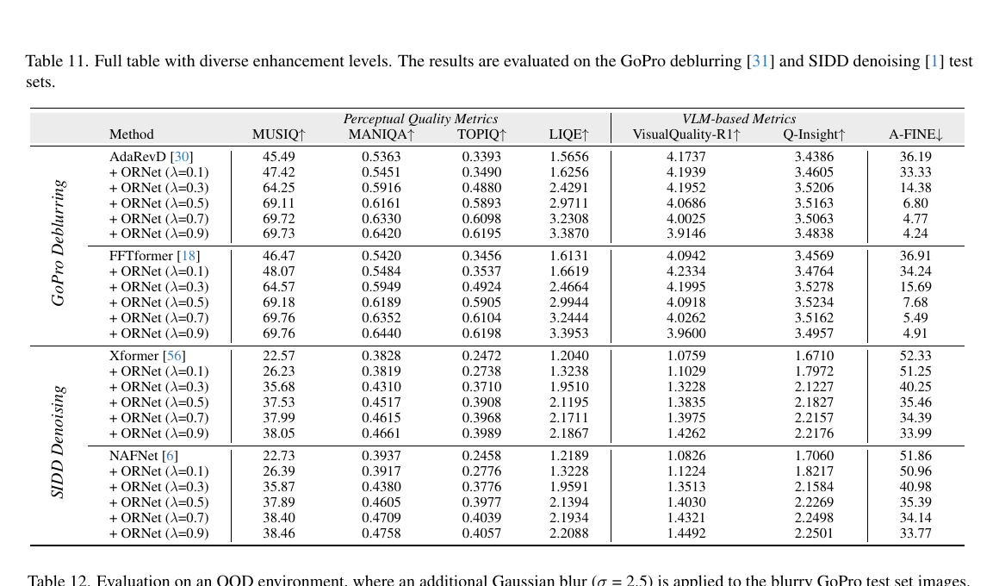

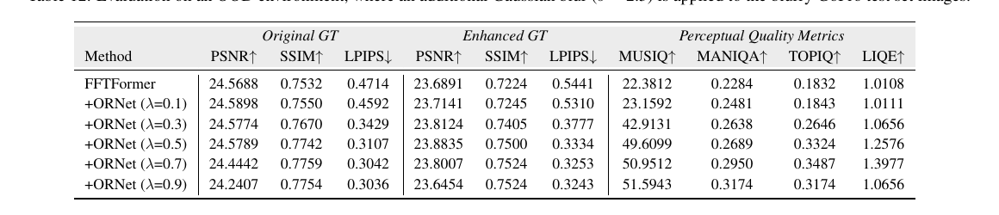

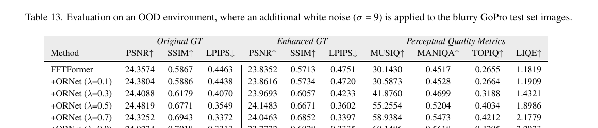

## 六、主要发现

- 次优标签会限制恢复器的感知上限；提升监督标签本身能够带来一致收益。
- 频域环形基掩码使原 GT 与超分候选的融合更平滑、可解释，并减弱直接生成式超分的幻觉风险。
- ORNet 在不同去模糊、去噪骨干上可即插即用，并在 HIDE、LOL、GyroBlur 等未见数据或任务上保持收益。
- 更强的增强不总是更好；作者的结果支持采用较保守的增强强度，以平衡自然度、保真与语义一致性。

## 七、核心贡献

1. 将真实恢复数据中的次优 Ground Truth 明确为监督瓶颈，并提出先提升标签再训练恢复精修器的范式。
2. 提出由原 GT 条件驱动的频域混合：25 个环形高斯频带将四个来源的频率贡献限制为平滑、归一化的分配。
3. 提出轻量、模型无关的 ORNet，避免为每个恢复骨干重复训练。
4. 以无参考指标、用户研究、OCR、脸部验证及 OOD 测试共同评估感知收益和保真性。

## 八、研究局限

- 当前官方实现不显式输入三个超分候选来评估其局部可靠性；权重主要是由原 GT 驱动的全局径向频率策略。
- 掩码不是空间位置自适应门控，不能直接做到不同图像区域分别信任不同候选来源。
- 无参考 IQA 指标不能完整保证语义真实性；增强强度过高仍可能产生颜色或结构偏移。
- 论文未提供将频率选择扩展为“位置—方向—频率”联合自适应的机制；这可作为后续改进方向。

## 九、论文总结

本文的价值在于把生成式细节增强放在监督构造阶段，并用频域约束限制其副作用。代码实现表明，CFMG 从原标签及其频谱幅度一次性预测四个来源、25 个频带的联合分配；候选超分图只在随后提供待混合的复数频谱。这种设计稳定、轻量且适合作为现有恢复系统的附加模块，但其全局径向权重也限制了对局部候选可靠性的判断能力。

