# Checkerboard artifact free sub-pixel convolution：结构化论文阅读

## 一、论文基本信息

- **论文标题**：Checkerboard artifact free sub-pixel convolution: A note on sub-pixel convolution, resize convolution and convolution resize
- **论文类型**：图像恢复；单图像超分辨率；上采样与初始化方法
- **发表信息**：arXiv:1707.02937，v1，2017 年 7 月 10 日提交；论文未标注正式会议或期刊
- **作者**：Andrew Aitken、Christian Ledig、Lucas Theis、Jose Caballero、Zehan Wang、Wenzhe Shi
- **作者单位**：Twitter, Inc.
- **论文链接**：[arXiv 摘要页](https://arxiv.org/abs/1707.02937)；[原始 PDF](https://arxiv.org/pdf/1707.02937)
- **代码或项目主页**：论文未提供
- **论文类型目录**：图像恢复
- **论文文件夹**：`C:\Users\longmao\Desktop\PaperRead\图像恢复\Checkerboard artifact free sub-pixel convolution- A note on sub-pixel convolution, resize convolution and convolution resize_arXiv`
- **PDF 本地路径**：`C:\Users\longmao\Desktop\PaperRead\图像恢复\Checkerboard artifact free sub-pixel convolution- A note on sub-pixel convolution, resize convolution and convolution resize_arXiv\Checkerboard artifact free sub-pixel convolution- A note on sub-pixel convolution, resize convolution and convolution resize_arXiv.pdf`

## 二、摘要总结

论文讨论 CNN 上采样层中的棋盘格伪影问题。作者将问题来源区分为反卷积重叠、随机初始化和损失函数中的下采样操作：即使卷积核尺寸能够被放大倍数整除，子像素卷积的不同子卷积核组仍会独立初始化，却共同作用于同一低分辨率特征，从而给相邻高分辨率位置带来不一致的初始响应。已有的 nearest-neighbor resize convolution 能消除前两类伪影，但在相同计算复杂度下，子像素卷积拥有更多可训练参数和更强建模能力。为兼顾两者，论文提出 ICNR（initialized to convolution nearest-neighbor resize）初始化：先初始化一个普通卷积核，再将其复制到所有子卷积核组，使子像素卷积在初始化时严格等价于“卷积后最近邻放大”。因此，网络一开始没有棋盘格，同时保留了子像素卷积后续训练中的可学习上采样能力。作者在 ImageNet 350K 图像上训练 2 倍超分辨率 ResNet，并以 BSD500 的 200 张测试图评估。结果显示，ICNR 子像素卷积比普通正交初始化收敛更快、最终测试 MSE 更低，也明显优于相同计算复杂度的 NN resize convolution。论文最后把初始化关系推广到双线性或双三次等更强上采样算子，同时指出损失网络中的 stride/pooling 所造成的梯度不均匀问题仍未解决。

## 三、研究背景

### 3.1 已有研究进展

CNN 常需将低分辨率特征恢复到高分辨率，应用包括超分辨率、语义分割、光流、生成模型等。相关层被称为 deconvolution、transposed convolution、fractional convolution 或 sub-pixel convolution。常见实现主要有：

1. **子像素卷积**：在低分辨率空间做普通卷积，输出放大倍数平方个通道，再通过 periodic shuffling 重排空间位置。
2. **resize convolution**：先用最近邻插值放大特征，再在高分辨率空间用普通卷积处理。
3. **convolution resize**：先做普通卷积，再对输出做最近邻放大。

Odena 等人指出，反卷积的棋盘格来自三方面：卷积核尺寸与 stride 不匹配造成的重叠、随机初始化导致的周期性响应差异，以及损失函数中 stride 卷积或 pooling 产生的不均匀梯度。

### 3.2 具体科学问题

论文聚焦第二个问题：在不牺牲子像素卷积参数量和计算效率的情况下，如何消除随机初始化后立即出现的棋盘格伪影。作者的关键判断是：子像素卷积本身没有反卷积重叠，但各个子卷积核组被独立随机初始化，并且分别负责高分辨率输出中的不同位置子集，因此相邻位置的初始响应统计不同。

## 四、研究方法

### 4.1 数据来源和范围

- **任务**：RGB 图像 2 倍单图像超分辨率。
- **退化方式**：将 HR 图像用 bicubic resampling 按每个维度 2 倍下采样得到 LR 图像。
- **训练数据**：从 ImageNet 随机抽取 35 万张图像。
- **训练裁剪**：每个 mini-batch 从不同训练图像中随机裁剪 16 个 96×96 的 HR patch。
- **测试数据**：BSD500 测试集中的 200 张图像。
- **颜色与归一化**：输入 BGR 归一化到 [0,1]，输出 BGR 归一化到 [-1,1]。
- **适用范围**：论文只验证了 2 倍图像超分辨率，未报告更大放大倍数、真实退化或其他恢复任务上的实验。

### 4.2 研究方法和模型

#### 4.2.1 基础网络与子像素卷积

网络采用带 skip connection 的 5-block ResNet。除最后一层外，各卷积层均为 64 通道、3×3 卷积核；最后一层使用 5×5 卷积。放大倍数为 2、输出为 RGB 时，最后卷积层有 12 个输出通道，即 3 个颜色通道乘以 2² 个子像素位置。

子像素卷积先在 LR 特征上卷积，再用周期性重排将 12 个通道变成 HR RGB 图像：

$$
I^{SR}=P(W*f^{L-1}(I^{LR})+b)
$$

这里，$I^{LR}$ 和 $I^{SR}$ 分别是低分辨率输入和超分辨率输出，$f^{L-1}$ 是最后卷积层之前的网络特征，$W$ 是最后卷积核，$b$ 是偏置，$P$ 是 periodic shuffling。论文说明偏置通常初始化为 0，因此后续推导省略它。该式定义了实验中子像素卷积的实际前向计算。

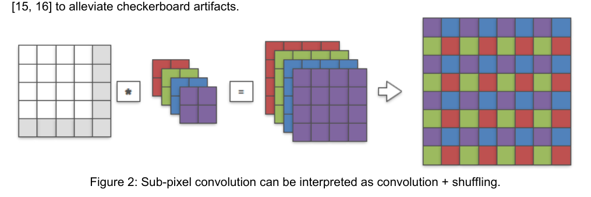

图 2 展示了数据流：LR 特征经过普通卷积产生多个通道，再将每个通道映射到 HR 网格的不同相位位置。其优点是同等计算复杂度下参数更多；但不同相位由不同子卷积核负责，初始化差异会直接呈现在空间上。

#### 4.2.2 子像素空间解释与棋盘格成因

子像素卷积也可解释为：先把 LR 特征插入零，形成 sub-pixel space，再在该空间进行卷积。两种解释通过一个空间尺寸扩大的卷积核等价：

$$
P(W*f^{L-1}(I^{LR}))=W^{sp}*S_P(f^{L-1}(I^{LR}))
$$

其中，$S_P$ 将 LR 空间变成插入空洞像素的子像素空间，$W^{sp}$ 是对应的子像素空间卷积核。2 倍放大时，实验中的 LR 卷积核尺寸为 (12,64,5,5)，映射后的 $W^{sp}$ 尺寸为 (3,64,10,10)。该等价式把“通道重排”转换成“稀疏空间卷积”，为后续分析不同子卷积核组的空间作用范围提供基础。

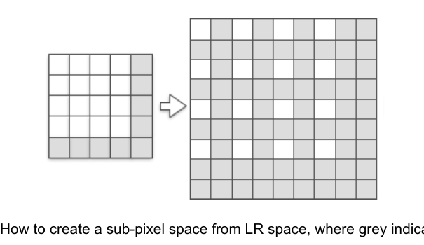

图 4 中灰色位置表示插入的零。子像素卷积的卷积只会激活与某一相位对应的部分位置，而最近邻 resize 会用复制的邻域值填满这些位置。

作者将输出通道按放大倍数平方分组，定义“sub kernel set”。对 2 倍放大而言，每个子卷积核组负责 HR 输出的一种相位子集：

$$
I^{SR}_n=W_n*f^{L-1}(I^{LR})
$$

$W_n$ 表示负责第 $n$ 个空间相位的子卷积核集合，$I^{SR}_n$ 是该集合生成的输出子集。周期重排会把所有 $I^{SR}_n$ 交错放入 HR 图像。由于每个 $W_n$ 独立初始化，却都作用于同一输入特征，相邻 HR 位置的响应会带有周期性差异，这就是随机初始化引起的棋盘格机制。图 3 的 (a)-(b) 给出子像素卷积的初始伪影，(c)-(d) 给出 NN resize 的对照。

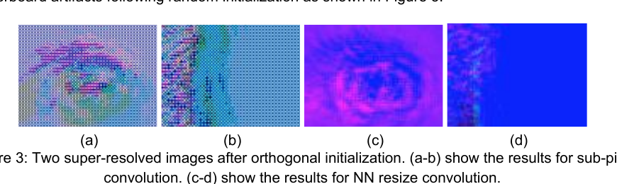

#### 4.2.3 NN resize convolution 的对照机制

最近邻 resize convolution 可以表示为先填充子像素空间，再进行卷积：

$$
I^{SR}=W^{sp}*N(f^{L-1}(I^{LR}))
$$

其中 $N$ 是最近邻放大。由于高分辨率卷积 stride 为 1，它没有反卷积重叠；并且每个 HR 输出都使用同一套卷积权重，因此随机初始化不会在不同空间相位间产生不一致。缺点是卷积不能跳过插值后的非零像素，所以在相同计算复杂度下，参数量和建模能力低于子像素卷积。

#### 4.2.4 ICNR：使子像素卷积初始化等价于 convolution resize

作者先考虑“卷积后最近邻放大”的安全基线：

$$
I^{SR}=N(W_0*f^{L-1}(I^{LR}))
$$

这里仅使用一套普通卷积核 $W_0$，其输出再被最近邻复制到 HR。该方案初始化时不会有棋盘格，但放大行为不可学习，因为所有相位都由同一输出复制得到。

ICNR 的核心思想不是在推理时永久采用该基线，而是让子像素卷积在“初始化时”与它完全相同：

$$
P(W'*f^{L-1}(I^{LR}))=N(W_0*f^{L-1}(I^{LR}))
$$

$W'$ 是需要构造的子像素卷积核。该约束只要求初始化时两条路径输出一致；训练开始后，$W'$ 的各子卷积核仍可独立更新，因此保留子像素卷积的表达能力。

对于一般的 $W'$，周期重排前的每个相位输出为：

$$
I^{SR}=P(W'*f^{L-1}(I^{LR})),\quad I^{SR}_n=W'_n*f^{L-1}(I^{LR})
$$

因此，只要把一个普通卷积核复制给全部相位子卷积核：

$$
\forall n:W'_n=W_0
$$

所有相位在初始化时都对同一输入产生相同响应，周期重排后等价于最近邻复制；同时，训练过程可以破坏这种完全相同的约束，从而学习真正的上采样映射。等价地，子像素空间核满足 $W^{sp\prime}=N(W_0)$。这就是 ICNR 初始化的实际实现：初始化 $W_0$，再将它复制到其余 sub-kernel sets，而不是分别随机初始化。

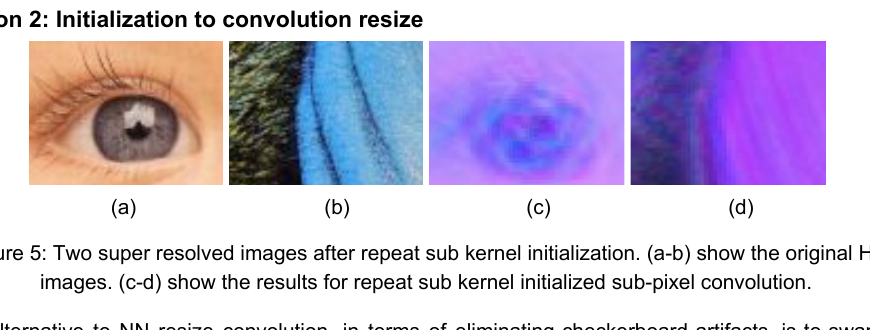

图 5 的 (a)-(b) 是原始 HR 图像，(c)-(d) 是重复 sub-kernel 初始化后的子像素卷积输出；初始结果不再出现明显棋盘格。

### 4.3 关键分析步骤

1. 对 HR 图像进行 bicubic 2 倍下采样，得到 LR 输入。
2. 用 5-block ResNet 提取 LR 特征，最后一层输出 12 个通道。
3. 分别构造三种上采样模型：普通子像素卷积、NN resize convolution、ICNR 子像素卷积。
4. 对普通子像素卷积和 resize convolution 使用正交初始化；对 ICNR 模型先初始化 $W_0$，再复制到所有相位子卷积核。
5. 使用 MSE 监督 HR 图像与 SR 图像，采用 Adam，$β_1=0.9$，学习率 $10^{-4}$，训练 $8\times10^6$ 次更新。
6. 每个训练迭代记录训练损失；测试误差每 $10^5$ 次迭代计算一次，在 BSD500 的 200 张图像上求平均。
7. 比较三种模型的收敛速度、训练 MSE、测试 MSE，并可视化 $W^{sp}$ 随迭代的变化。

## 五、图表分析

### 5.1 棋盘格问题的应用范围

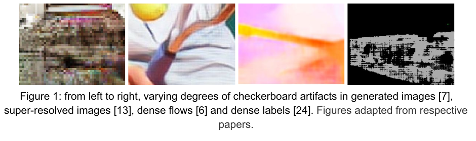

图 1 从左到右展示生成图像、超分辨率图像、稠密光流和稠密标签中的棋盘格。它说明该问题并非只影响 RGB 超分辨率，而是会污染所有依赖上采样的 dense prediction/generation 输出。图中伪影呈现出与上采样相位相关的周期性结构，支持论文将“不同子卷积核组承担不同空间相位”作为主要解释。

### 5.2 训练损失与测试损失

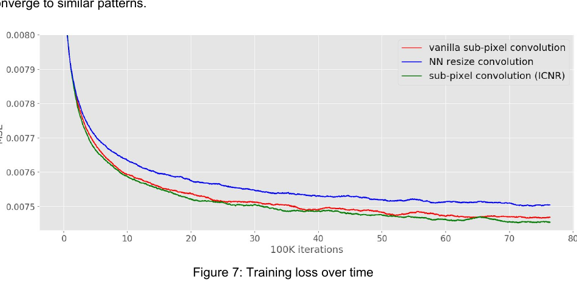

图 7 比较 vanilla sub-pixel convolution、NN resize convolution 和 ICNR。蓝色 NN resize 曲线整体更高；ICNR 绿色曲线下降更快，并在大部分训练阶段低于普通子像素卷积，说明更平滑、更一致的初始化改善了优化起点。论文未给出曲线对应的最终数值表，因此只能根据图中 MSE 纵轴和曲线相对位置进行定性比较。

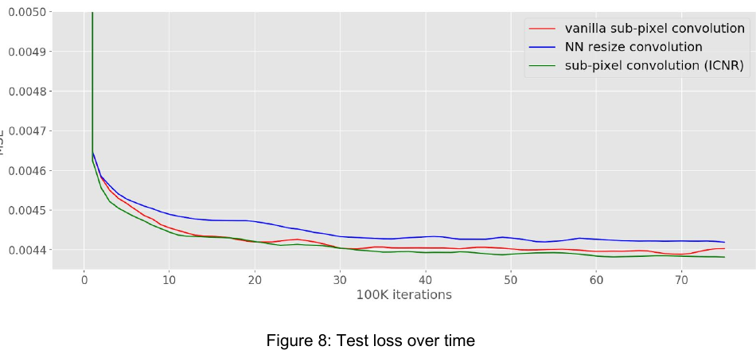

图 8 显示测试 MSE 同样遵循：NN resize 最差，普通子像素卷积居中，ICNR 通常最低。ICNR 在约 1–3 million iterations 后已达到较低测试误差，最终仍保持优势；这与作者“ICNR 收敛更快且达到更好 minimum”的结论一致。需要注意，论文没有报告 PSNR、SSIM、参数量或显著性检验，因而不能从本文直接得出更全面的感知质量结论。

### 5.3 附录卷积核演化

附录将 $W^{sp}$ 的前三个通道转成 BGR 进行可视化，比较普通子像素卷积、ICNR 子像素卷积和 resize convolution 在不同迭代阶段的 64 个卷积核。每张图中三组从上到下分别对应三种模型。

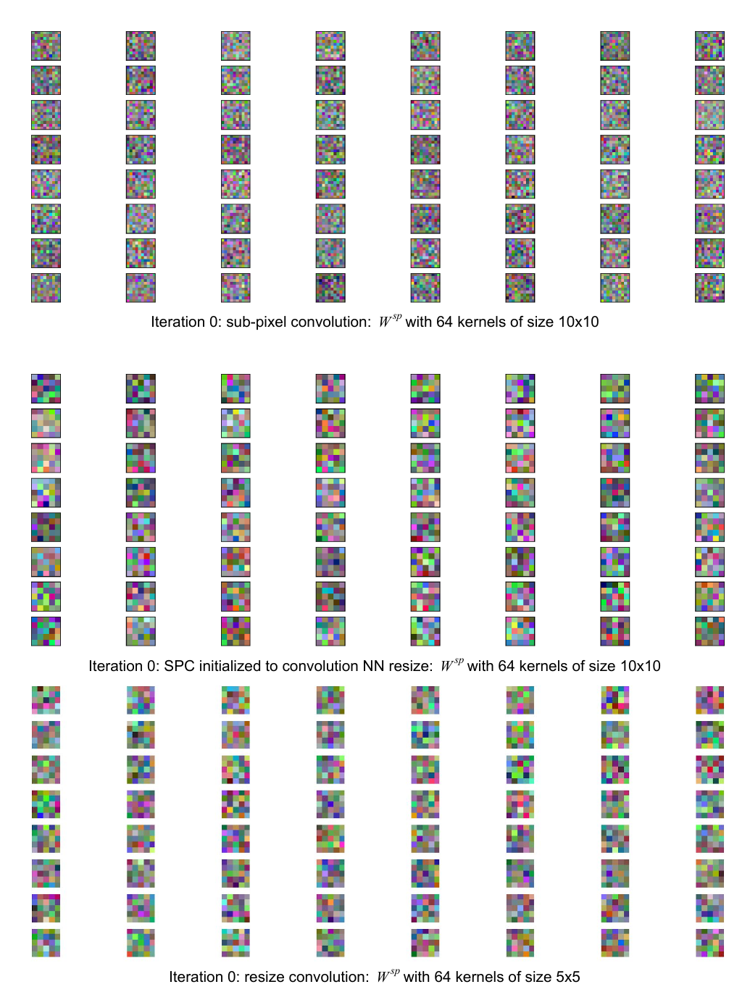

初始化时，普通子像素卷积的 10×10 核呈现明显的独立随机纹理；ICNR 的 10×10 核呈现由 5×5 核复制/扩展得到的更规则结构；resize convolution 使用 5×5 核。该现象从参数层面解释了为什么 ICNR 的初始输出更平滑。

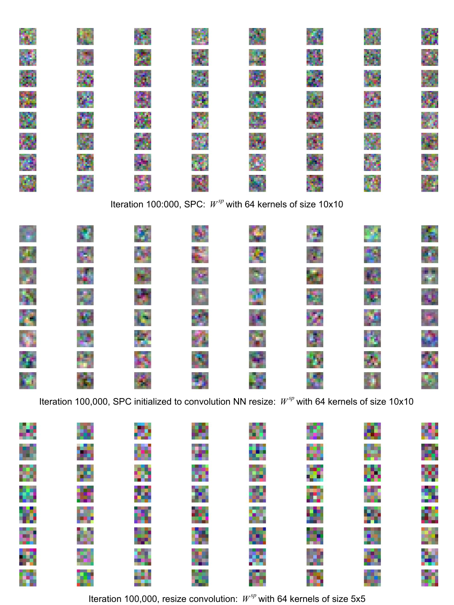

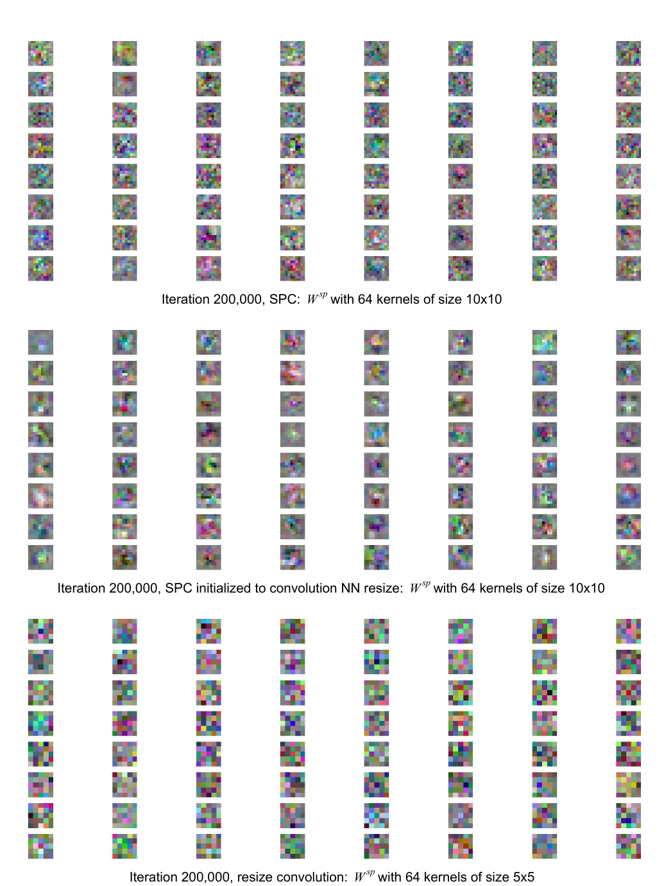

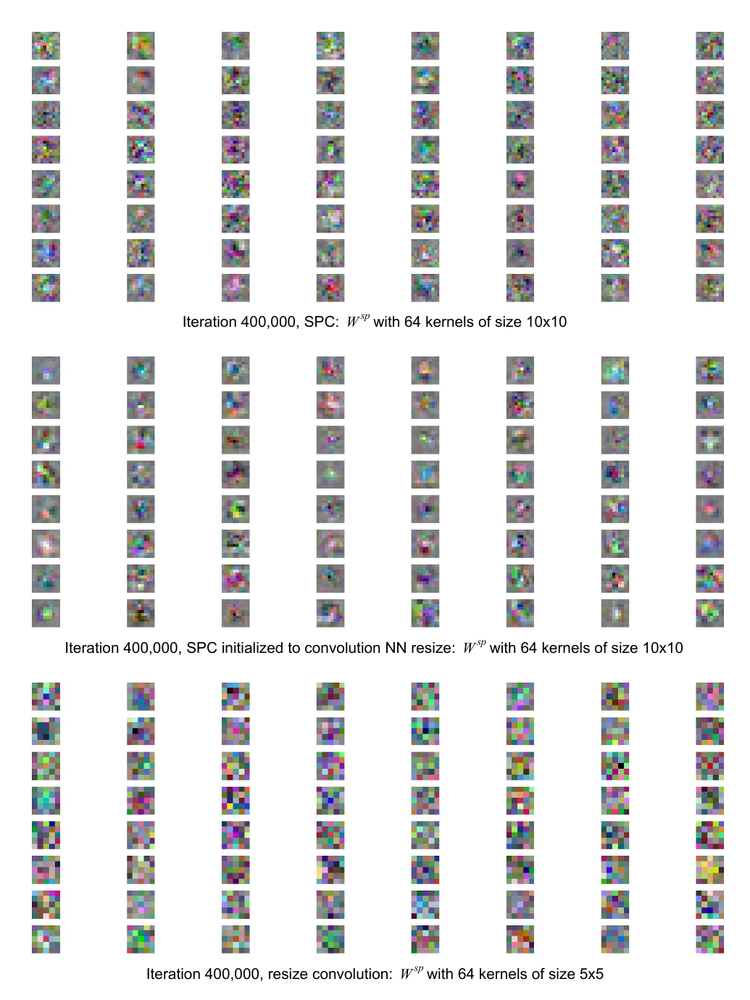

在 10 万至 40 万次迭代时，普通子像素卷积的核逐渐组织出结构，但 ICNR 仍保留较平滑、连续的初始形态，说明训练并不需要从周期性噪声中先恢复一致性。

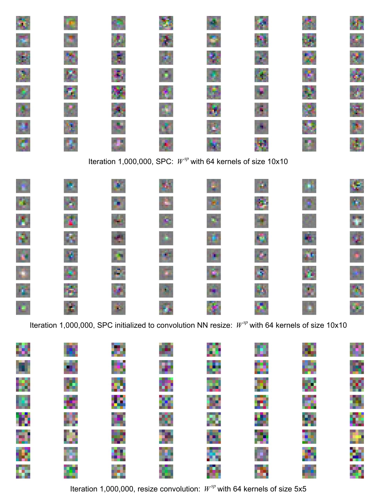

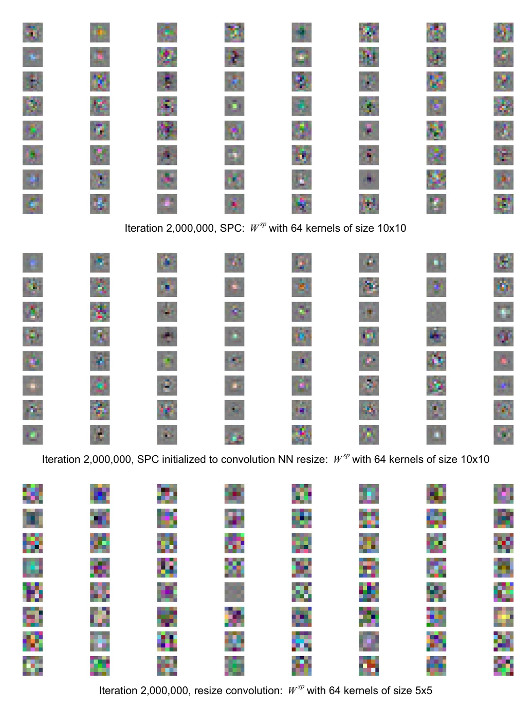

论文指出直到约 200 万次迭代，ICNR 的核通常比正交初始化更平滑；这与其更快的损失下降相互印证。

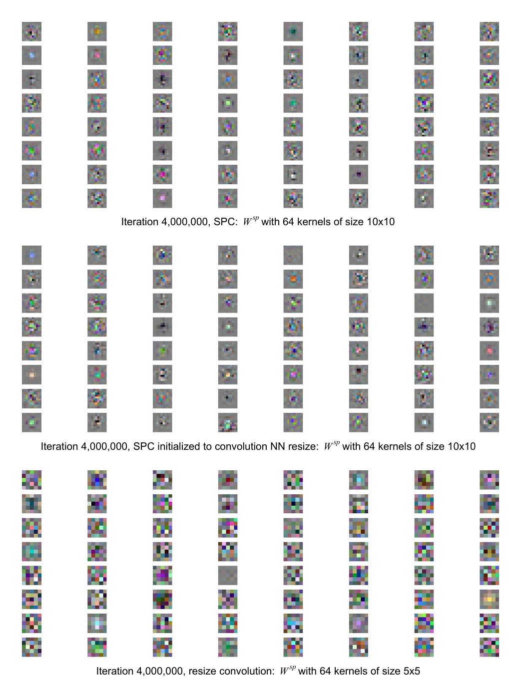

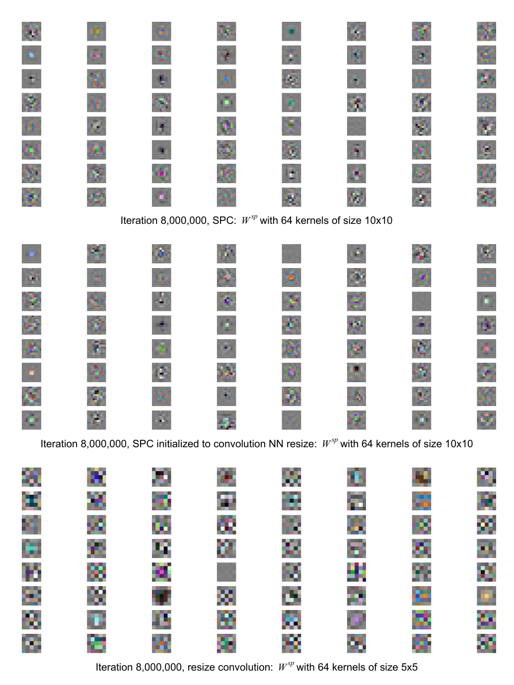

训练后期三种模型的核模式差异减小并趋于相似，表明 ICNR 主要改善优化早期和初始化阶段，并没有把最终模型永久限制在 NN resize 的函数空间内。

### 5.4 对更强 resize 算子的推广

作者进一步提出可以把最近邻算子替换为更强的上采样算子 $F$：

$$
P(W'*f^{L-1}(I^{LR}))=F(W_0*f^{L-1}(I^{LR}))
$$

该式将“初始化时复制普通卷积核”的思想推广到双线性、双三次等上采样方式。若 $F(X)=B*N(X)$，其中 $B$ 是平滑卷积核，则有：

$$
W^{sp\prime}*S_P(f^{L-1}(I^{LR}))=B*N(W_0*f^{L-1}(I^{LR}))
$$

利用最近邻 resize 的等价关系：

$$
N(W_0*f^{L-1}(I^{LR}))=N(W_0)*S_P(f^{L-1}(I^{LR}))
$$

可得：

$$
W^{sp\prime}*S_P(f^{L-1}(I^{LR}))=B*N(W_0)*S_P(f^{L-1}(I^{LR}))
$$

因此，若卷积的结合性成立，可以按下式初始化：

$$
W^{sp\prime}=B*N(W_0)
$$

其含义是先把普通核最近邻扩展，再与平滑核卷积。不过论文指出，非平凡的 $B$ 会使初始化后的子像素空间卷积核空间尺寸变大，如何高效实现仍是开放问题。

## 六、主要发现

1. 子像素卷积虽然避免了传统反卷积重叠，但随机独立初始化的 sub-kernel sets 仍会产生棋盘格。
2. ICNR 通过复制同一个普通卷积核，使子像素卷积初始化时等价于 convolution resize，因此立即消除初始化棋盘格。
3. ICNR 保留了子像素卷积的可训练上采样能力；训练后不同子核可以分化，不会被永久约束为最近邻复制。
4. 在本文的 2 倍超分辨率实验中，ICNR 比普通正交初始化收敛更快、最终测试 MSE 更低，并明显优于 NN resize convolution。
5. 论文的证据主要是曲线和可视化，没有给出详细数值表、PSNR/SSIM 或跨数据集统计，因此结论更准确地说是“在该训练设置下的优化和 MSE 优势”。

## 七、核心贡献

- **方法创新**：提出 ICNR 初始化，把无棋盘格的 convolution resize 起点迁移到可学习的子像素卷积中。
- **机制解释**：用 sub-kernel sets 和 sub-pixel space 解释随机初始化如何产生空间周期性伪影。
- **工程价值**：只需改变最后上采样层的初始化，不改网络结构、损失函数或推理流程，易于集成到超分辨率、生成和 dense prediction 模型。
- **理论/设计启发**：初始化不仅决定数值稳定性，也会决定上采样层在训练初期是否具有空间均匀性；未来可将同样的等价初始化思想推广到双线性、双三次等算子。

## 八、研究局限

- **实验范围窄**：只测试 2 倍超分辨率、ImageNet 训练和 BSD500 测试，未验证 4 倍或更大放大、其他退化模型和其他任务。
- **指标有限**：只用 MSE，未报告 PSNR、SSIM、感知质量或用户研究；无法充分判断视觉质量。
- **没有独立棋盘格指标**：论文主要用视觉图和初始化等价性说明伪影消除，未定义或统计棋盘格强度指标。
- **损失函数问题未解决**：若感知损失或 GAN 判别器包含 stride 卷积、pooling，其不均匀梯度仍可能重新引入棋盘格；论文明确将其留作开放问题。
- **推广代价不清晰**：推广到平滑上采样核 $B$ 后，$W^{sp\prime}$ 可能变大，参数量、边界处理和计算成本如何控制尚未解决。
- **复现实验信息不足**：论文未给出完整代码、随机种子、学习率调度、batch size 的全部细节或最终数值结果，独立复现可能需要补充假设。

## 九、论文总结

这篇短论文解决的是上采样层一个非常具体但广泛存在的工程问题：子像素卷积在随机初始化后会产生棋盘格。作者发现，问题根源不是子像素卷积的重叠，而是不同空间相位对应的子卷积核组独立初始化。ICNR 通过复制一个普通卷积核到所有子卷积核组，使初始化时的子像素卷积等价于先卷积再最近邻放大，从而同时获得无伪影起点、子像素卷积的参数效率和后续可学习性。实验表明，该初始化能改善训练早期的平滑性、收敛速度和测试 MSE。对当前图像恢复实践而言，ICNR 的最大价值在于改动小、解释清楚、可作为各种 pixel shuffle 上采样模块的默认初始化策略；但其对 GAN/感知损失、复杂退化和更大放大倍数的效果仍需进一步验证。
