# Reverse Convolution and Its Applications to Image Restoration

## 一、论文基本信息

- **论文标题**：Reverse Convolution and Its Applications to Image Restoration
- **论文类型**：图像恢复；神经网络基础算子；反问题求解
- **会议/时间**：ICCV 2025；arXiv v2，2025 年 8 月 15 日
- **作者**：Xuhong Huang、Shiqi Liu、Kai Zhang、Ying Tai、Jian Yang、Hui Zeng、Lei Zhang
- **作者单位**：南京大学；香港理工大学；OPPO 研究院
- **论文链接**：[arXiv](https://arxiv.org/abs/2508.09824)
- **代码仓库**：[cszn/ConverseNet](https://github.com/cszn/ConverseNet)
- **论文分类**：图像恢复

## 二、摘要总结

卷积是神经网络中最常用的特征提取算子，转置卷积则常被用于上采样，但“转置”只表示矩阵意义上的伴随操作，并不等于卷积的真正逆运算。本文围绕这一缺口提出深度可分离形式的反向卷积算子 Converse2D：给定深度卷积后的特征、卷积核和步长，将恢复原特征图的问题写成带二次正则的最小二乘问题，并在循环边界条件下推导出可由快速傅里叶变换一次求解的闭式表达。该算子支持任意通道数，可在空间上执行恢复和上采样；卷积核既可以与网络端到端学习，也可以作为已知退化核输入。为解决深度卷积没有通道混合的问题，作者将 Converse2D 与 LayerNorm、1×1 卷积、GELU 和残差连接组合成 Converse Block，再将其嵌入 DnCNN、SRResNet 和 USRNet，形成 Converse-DnCNN、Converse-SRResNet 与 Converse-USRNet。实验覆盖高斯去噪、×4 超分辨率和非盲图像去模糊。结果显示，在参数量相同的改造网络中，反向卷积通常优于深度卷积和深度转置卷积；在去噪中取得 Set12/BSD68 上 30.70/29.36 dB，在超分辨率中达到与已有上采样模块相当的结果，在非盲去模糊中也优于对应的 Conv-USRNet。论文的主要意义不是声称在所有任务上达到 SOTA，而是提供一个有明确逆问题解释、可学习、可上采样并能处理高维特征的基础算子。

## 三、研究背景

### 3.1 已有研究进展

标准卷积通过局部核聚合特征，可伴随步长实现下采样；转置卷积通常通过插零上采样后再卷积实现空间放大，但容易产生棋盘格伪影，而且不是标准卷积的数学逆。传统反卷积和 Wiener 反卷积更接近“求逆”，但通常依赖已知退化核，应用集中在图像去模糊。Plug-and-Play 和深度展开方法能够提高恢复质量，却多为迭代求解，且常直接运行在灰度或 RGB 图像域。

可逆卷积则通过形状约束、可计算 Jacobian 等条件保证严格可逆，通常服务于流模型，难以直接替换普通网络中的卷积。作者因此将目标定位为：构造一个适用于一般深度网络、支持任意通道、可一次计算的“卷积逆算子”。

论文图 1 对三者的空间关系进行了直观区分：标准卷积把较大输入映射为较小输出，转置卷积由较小输入生成较大输出，而 Reverse Convolution 是根据输出特征和卷积核反推出输入特征。

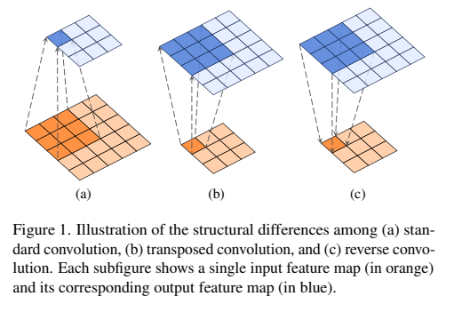

### 3.2 具体科学问题

给定深度卷积及下采样后的特征，如何在不采用迭代优化的情况下，稳定地恢复空间细节；同时，如何让该恢复算子能作为普通网络模块工作，并处理多通道特征、可学习正则强度和已知退化核条件。

## 四、研究方法

### 4.1 数据来源和范围

论文没有提出新数据集，而是沿用经典图像恢复基准与 [48] 的训练设定。去噪使用 Set12 和 BSD68，噪声为标准差 25 的高斯噪声；超分辨率使用 Set5、Set14、BSD100 和 Urban100，输入为双三次下采样图像，放大倍率为 4；去模糊使用 BSD100 与 Urban100，训练和测试包含 7×7 运动模糊核及 7×7 各向同性高斯模糊核，并加入标准差 2.55 的高斯噪声。论文明确给出数据集和退化设置，但没有在正文中重新列出完整训练图像数量、裁剪尺寸、batch size、优化器和训练轮数，而是说明沿用文献 [48] 的数据集、损失函数和学习率设置。

### 4.2 研究方法和模型

#### 4.2.1 退化模型与逆问题目标

先以单通道特征图说明方法。输入特征图经过逐通道卷积，再以步长进行下采样，得到观测特征：

$$
Y=(X\otimes K)\downarrow_s
$$

这里，输入特征为 X，卷积核为 K，逐通道卷积记为 ⊗，步长或缩放因子为 s，输出为 Y。该式定义了 Converse2D 要逆向恢复的前向过程；当 s 大于 1 时，逆算子同时承担空间上采样。

目标是从 Y、K 和 s 恢复 X：

$$
X=F(Y,K,s)
$$

该式表达的是算子接口，而不是直接可用的网络层。由于卷积会丢失频率信息、下采样会丢失空间采样点，逆问题通常不适定，因此作者接下来把它转化为正则化优化。

#### 4.2.2 带正则的最小二乘建模

首先要求恢复结果重新经过原退化过程后接近观测值：

$$
X^*=\arg\min_X\left\|Y-(X\otimes K)\downarrow_s\right\|_F^2
$$

第一项是数据一致性误差：它约束恢复出的 X 经过卷积和下采样后能够重建 Y。由于直接求解可能放大卷积核频谱中的小值并导致不稳定，作者加入关于初始估计的二次正则：

$$
X^*=\arg\min_X\left\|Y-(X\otimes K)\downarrow_s\right\|_F^2+\lambda\left\|X-X_0\right\|_F^2
$$

其中，λ 控制数据一致性与先验稳定性的平衡，X₀ 是对输入特征的初始估计。第一项保证逆解解释观测，第二项抑制病态逆问题中的异常解，并使结果不要偏离一个合理初始化。

论文比较了两种 X₀：零初始化，以及将 Y 按倍率 s 插值后的 Interp(Y,s)。后者在去噪和超分辨率中都更好，说明简单的空间先验有助于恢复高频结构和加速收敛。

#### 4.2.3 FFT 闭式解与 Converse2D

在卷积采用循环边界条件、下采样为每个 s×s 区块选择左上角像素的假设下，作者将二次优化问题转到频域求解。定义中间量：

$$
L=\overline{F_K}F_{Y\uparrow s}+\lambda F_{X_0}
$$

其中，F 表示快速傅里叶变换，F_K 是卷积核频谱，横线表示复共轭，Y↑s 是插零上采样后的观测，F_X₀ 是初始估计的频谱。L 汇总了观测项和正则先验项，供后续频域解计算使用。

完整闭式解为：

$$
X^*=F^{-1}\left(\frac{1}{\lambda}\left(L-\frac{\overline{F_K}\odot_s(F_KL)\Downarrow_s}{|F_K|^2\Downarrow_s+\lambda}\right)\right)
$$

F⁻¹ 将频域结果变回空间域；⊙s 表示对 s×s 个不同频域块逐元素乘法，⇓s 表示将这些块做区块平均，|F_K|² 是卷积核频谱幅值平方。分母中的 λ 防止频谱能量较小时除零或过度放大，因而是稳定性的核心。该式只需要一次 FFT、逐元素运算、区块拆分/平均和逆 FFT，不需要展开迭代优化。

当不进行下采样，即 s=1 时，表达式退化为更直观的 Wiener-like 形式：

$$
X^*=F^{-1}\left(\frac{\overline{F_K}F_Y+\lambda F_{X_0}}{|F_K|^2+\lambda}\right)
$$

此时每个频率位置都由观测频谱、卷积核频谱和正则先验共同决定。论文指出 K 可以和网络一起端到端学习，也可以由外部已知退化核提供；λ 也不是固定超参数，而是可训练的参数。作者将这一算子命名为 Converse2D，并给出了 PyTorch 风格实现：先上采样观测，构造 X₀ 和卷积核 OTF，计算频域乘积，再按倍率拆分频域块、平均、除以正则化分母，最后逆 FFT 并取实部。

#### 4.2.4 Converse Block：空间建模与通道混合分离

Converse2D 是逐通道操作，本身没有跨通道交互。作者因此构造 Converse Block：用 Converse2D 负责空间依赖，用 1×1 卷积负责通道混合，并加入 LayerNorm、GELU 和残差连接，整体结构借鉴 Transformer block。典型数据流可以概括为 LayerNorm → 1×1 Conv → GELU → Converse2D → GELU → 1×1 Conv → 残差，再接第二个 LayerNorm/1×1 Conv/GELU/1×1 Conv 残差子结构。

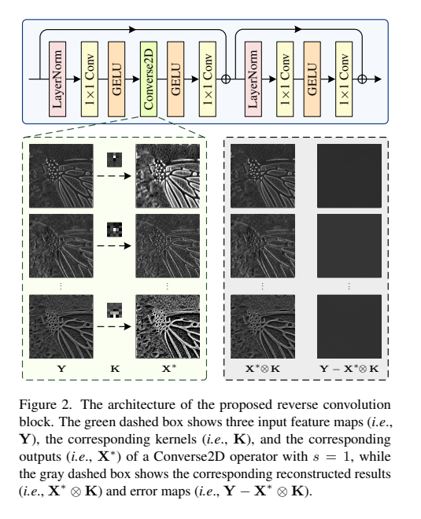

图 2 的绿色框展示输入特征 Y、对应卷积核 K 和恢复特征 X*；灰色框展示 X* 再卷积后的重建结果以及观测残差。它说明模块不只是做上采样，而是在输出约束下显式构造一个能够解释观测的逆特征。

#### 4.2.5 关键实现选择

**卷积核初始化。** 随机初始化后对核做 Softmax：

$$
K_{\mathrm{normalized}}=\mathrm{Softmax}(K)
$$

该式使核权重非负且和为 1，符合点扩散函数的基本先验，减少反演初期的不稳定。消融显示，Gaussian + Softmax 在 Set12/BSD68 上达到 30.70/29.36 dB，优于单纯 Uniform 或 Gaussian；5×5 核被选为性能和复杂度之间的折中。

**padding。** 作者比较 zero、reflect、replicate 和 circular padding。padding 尺寸影响较小，但模式影响更明显；circular padding 最好，因此默认使用循环 padding，去模糊实验中尺寸为 4。

**正则化参数。** 为适应不同通道的统计差异，论文让每个通道拥有独立的可学习正则强度，并用偏置 b 参数化：

$$
\lambda=\mathrm{Sigmoid}(b-9.0)+\epsilon
$$

其中 ε=10⁻⁵ 用于数值稳定，b 初始为 0。减去 9 使初始 λ 很小，让训练早期更强调数据一致性；训练过程中 λ 可按通道自适应调节。

**初始估计。** 去噪中使用 Y 作为 s=1 时的插值初值，超分辨率中使用 Interp(Y,s)。表 3 显示插值初始化比零初始化略好，作者将其解释为更接近目标空间结构并有助于稳定优化。

### 4.3 关键分析步骤与应用网络

#### 4.3.1 Converse-DnCNN

作者在 DnCNN 的主体中用 20 个 Converse Block 替换原有卷积结构，两端使用 1×1 卷积完成输入输出映射。训练目标和数据设定沿用经典高斯去噪流程，推理时 Converse2D 以 s=1 运行，主要作用是以逆卷积约束建模空间结构，而非改变分辨率。

#### 4.3.2 Converse-SRResNet

作者在 SRResNet 中使用 16 个 Converse Block，并在上采样路径中加入 Converse2D。网络同时保留 Interpolate 等路径，以便把低分辨率特征送入高分辨率空间。实验还单独将 SRResNet 的原上采样替换为最近邻插值、转置卷积和 Converse2D，用于判断 Converse2D 作为上采样模块的独立效果。

#### 4.3.3 Converse-USRNet：核条件非盲去模糊

作者修改 USRNet 的 data module，把三通道输入先用 1×1 卷积投影到 64 通道，再在特征域使用 Converse2D，最后映射回 3 通道；原 ResUNet 去噪器替换为包含 7 个 Converse Block 的 ConverseNet。KernelNet 用三层全连接和 GELU 将模糊核映射到 64 维，再接 1×1 卷积；该 embedding 直接作为 Converse2D 的核条件，λ 是唯一继续学习的逆算子参数。

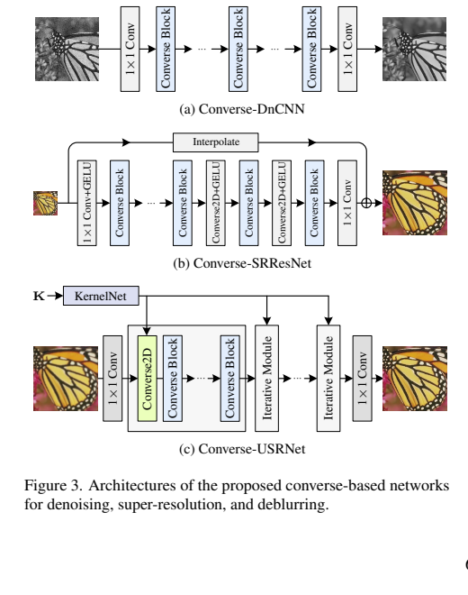

图 3 展示了三条 pipeline：去噪网络堆叠 Converse Block；超分辨率网络加入 Interpolate 和 Converse2D；去模糊网络将 KernelNet 的条件同时送入逆算子和迭代模块。该设计使已知退化核在高维特征域发挥作用，而不是只在 RGB 图像域做反卷积。

## 五、图表分析

### 5.1 实现消融：核、padding、正则与初始化

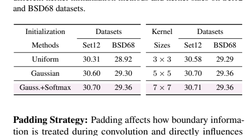

表 1 表明，Gauss.+Softmax 在 Set12/BSD68 上为 30.70/29.36 dB，优于 Uniform 的 30.31/28.92 和 Gaussian 的 30.60/29.30。核大小从 3×3 增加到 5×5 带来明显收益，7×7 仅在 Set12 上略升到 30.71，故 5×5 是更合理的默认折中。

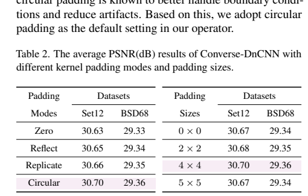

表 2 显示 padding 模式比尺寸更关键。circular 在两个数据集上均取得最佳或并列最佳结果；尺寸从 0×0 到 4×4 只带来小幅变化，说明循环边界假设而非单纯增加边框像素是主要收益来源。

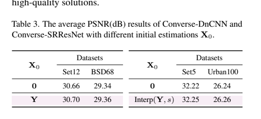

表 3 中，去噪使用 Y 作为初值时 Set12/BSD68 为 30.70/29.36 dB，超过零初始化的 30.66/29.34；超分辨率中 Interp(Y,s) 也略优于零初始化。收益不大，但方向在两类任务上是一致的。

### 5.2 高斯去噪

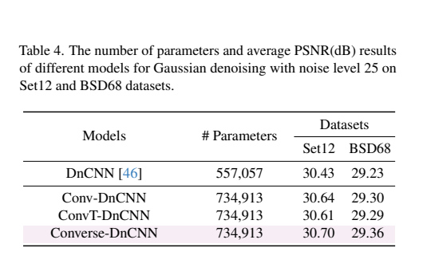

表 4 中原始 DnCNN 参数量为 557,057，改造后的 Conv-DnCNN、ConvT-DnCNN 和 Converse-DnCNN 均为 734,913。Converse-DnCNN 在 Set12/BSD68 上达到 30.70/29.36 dB，超过 Conv-DnCNN 的 30.64/29.30 和 ConvT-DnCNN 的 30.61/29.29，也超过原始 DnCNN 的 30.43/29.23。由于 Converse-DnCNN 参数更多，结果主要用于验证算子替换后的有效性，不能单独视为严格公平的参数效率比较。

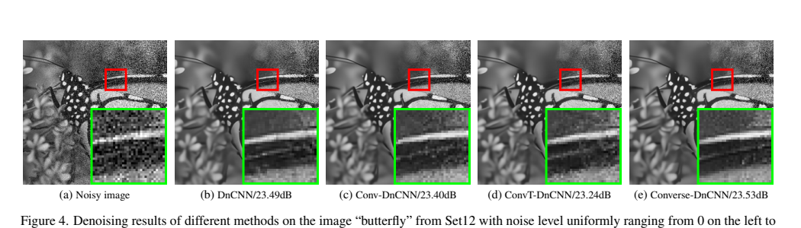

图 4 在 Set12 的 butterfly 图像上展示噪声强度从左到右变化的结果。论文强调，传统反卷积可能因边界约束不足产生边缘伪影；端到端训练的 Converse-DnCNN 在该示例中没有明显边界伪影，局部放大区域的纹理也更稳定。

### 5.3 单图像超分辨率

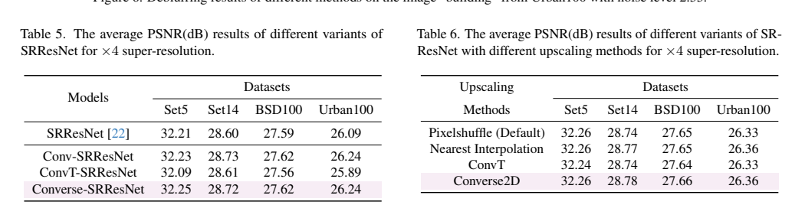

表 5 中 Converse-SRResNet 在 Set5 上为 32.25 dB，略高于 SRResNet 的 32.21；在 Set14、BSD100、Urban100 上分别为 28.72、27.62、26.24 dB，与 Conv-SRResNet 基本相当。表 6 中 Converse2D 作为 ×4 上采样方式，在四个数据集上达到 32.26/28.78/27.66/26.36 dB，与 Pixelshuffle 和最近邻插值相当或略优，说明它具备可替代上采样层的能力，但没有显示出压倒性优势。

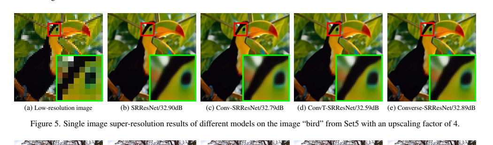

图 5 的 bird 示例显示，Converse-SRResNet 的整体观感和局部纹理与 SRResNet 接近；这与表 5 的结论一致：该算子更重要的价值是提供一种有逆问题解释的替换模块，而非在简化实验中显著刷新超分辨率指标。

### 5.4 图像去模糊

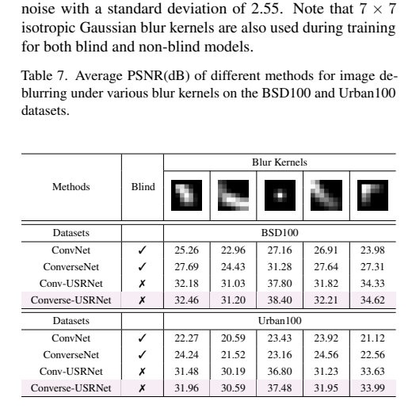

表 7 将盲去模糊和非盲去模糊分开比较。在 BSD100 上，非盲 Converse-USRNet 的五个核结果为 32.46、31.20、38.40、32.21、34.62 dB，均高于 Conv-USRNet 的 32.18、31.03、37.80、31.82、34.33；Urban100 上也从 31.48、30.19、36.80、31.23、33.63 提升到 31.96、30.59、37.48、31.95、33.99。盲设置中 ConverseNet 也明显优于 ConvNet，说明即使没有显式核输入，逆卷积结构仍提供了有利的空间恢复偏置。

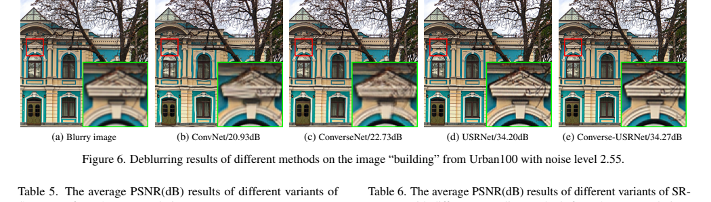

图 6 的 building 示例中，ConvNet 会使墙体等直线结构出现弯曲或几何变形，ConverseNet 能减轻该问题；拥有核条件的 Conv-USRNet 与 Converse-USRNet 都能得到更清晰且对齐的结果，其中 Converse-USRNet 的局部结构更锐利。

## 六、主要发现

1. 转置卷积并非卷积的真正逆，基于正则化最小二乘和 FFT 可以构造一个单步、可学习的深度反向卷积。
2. Converse2D 在逐通道建模空间依赖的同时，通过 1×1 卷积补足通道交互，能够作为一般网络模块嵌入不同架构。
3. 在去噪任务中，Converse-DnCNN 稳定优于深度卷积和深度转置卷积版本；在超分辨率中性能基本持平；在非盲去模糊中，核条件和多通道特征域处理带来更明显收益。
4. 实验支持三个关键实现选择：Softmax 归一化核、circular padding、插值初始化以及可学习的通道级 λ。
5. 论文的结果符合作者预期：该工作验证的是基础算子的可用性和通用性，而不是在每个恢复任务上设计完整的 SOTA 系统。

## 七、核心贡献

- **方法创新**：首次尝试把“深度卷积的逆”显式定义为可部署的 Reverse Convolution，并通过正则化二次优化得到闭式解。
- **结构创新**：将空间逆建模与通道混合解耦，形成带 LayerNorm、1×1 Conv、GELU 和残差的 Converse Block。
- **应用价值**：同一算子覆盖去噪、超分辨率和去模糊，并能替换普通卷积、转置卷积或上采样模块。
- **条件建模**：在 Converse-USRNet 中把已知模糊核映射到高维特征并直接条件化逆算子，实现特征域非盲去模糊。
- **工程启发**：FFT 闭式计算避免了传统反卷积的显式迭代，适合作为研究可学习逆算子、频域模块和退化条件网络的起点。

## 八、研究局限

- 逆算子推导依赖循环边界和特定下采样定义；真实图像边界、非均匀采样或复杂 padding 下的严格逆性质仍需进一步验证。
- Converse2D 只对 depthwise convolution 建模逆过程，通道混合仍由额外 1×1 卷积完成，因此并不是任意普通卷积的直接逆。
- 闭式解需要 FFT、频域块拆分和核 OTF 构造，论文没有系统报告运行时间、显存、吞吐量或与普通卷积的实际部署开销。
- 实验采用较简化的退化设置，噪声、模糊核和超分辨率退化范围有限；对真实噪声、空间变化模糊、压缩伪影和复杂 RAW 成像退化的泛化尚未证明。
- 论文没有提供完整的训练超参数和全面的计算量消融，且去噪模型参数量高于原始 DnCNN，部分性能增益可能同时来自容量变化。
- 超分辨率结果主要体现“可替换且不降性能”，算子本身尚未展示出稳定的显著收益；未来需要更大规模模型、更多退化和更严格的效率对比。

## 九、论文总结

本文提出 Converse2D，用正则化最小二乘的 FFT 闭式解显式近似深度卷积和下采样的逆过程，再以 Converse Block 将空间逆建模与通道混合组合起来。Converse-DnCNN、Converse-SRResNet 和 Converse-USRNet 的实验表明，该模块能够作为卷积、转置卷积和上采样的通用替代，并在去噪和核条件去模糊中取得一定优势。论文真正的核心价值在于把“可学习逆算子”从传统图像反卷积中抽象出来，变成可以嵌入现代深度网络的基础组件；其后续潜力包括扩展到更大视觉模型、生成任务以及复杂退化下的图像恢复。
