# Fast Image Super-Resolution via Consistency Rectified Flow

## 一、论文基本信息

- **论文类型**：图像超分
- **会议**：ICCV 2025，pp. 11755-11765
- **作者**：Jiaqi Xu、Wenbo Li、Haoze Sun、Fan Li、Zhixin Wang、Long Peng、Jingjing Ren、Haoran Yang、Xiaowei Hu、Renjing Pei、Pheng-Ann Heng
- **作者单位**：香港中文大学、华为诺亚方舟实验室、香港科技大学（广州）、华南理工大学
- **论文链接**：[ICCV Open Access](https://openaccess.thecvf.com/content/ICCV2025/html/Xu_Fast_Image_Super-Resolution_via_Consistency_Rectified_Flow_ICCV_2025_paper.html)，[arXiv](https://arxiv.org/abs/2605.12377)
- **项目页**：[jiaqixuac/FlowSR](https://github.com/jiaqixuac/FlowSR)

项目页不含官方训练代码。作者说明受公司开源政策限制，官方训练实现无法公开，页面指向的是社区维护的仅推理复现。因此，下文对损失和实现的描述以论文为准；论文未披露的代码细节均明确标记。

## 二、摘要总结

真实图像超分需要从包含模糊、噪声、压缩伪影等未知退化的低分辨率图像恢复高分辨率内容。扩散式方法拥有强生成先验，却常需数十至数百次采样；单步蒸馏方法则容易从噪声或加噪低分辨率状态起步，削弱输入图像本身的结构约束。FlowSR 将超分重写为从上采样 LR 图像直接到 HR 图像的 Rectified Flow，使生成路径保持直线且始终与输入内容相连。

为使一步推理继承多步恢复质量，论文在 SR Flow 上进行一致性蒸馏。作者指出，普通一致性蒸馏只要求不同时间点映射到相同终点，教师或 EMA 目标网络一旦存在偏差，学生可能会稳定地收敛到错误终点。FlowSR 因而引入 HR 正则化：既对齐学生与蒸馏目标，也要求教师一步产生的扰动中间状态直接恢复真实 HR。快慢双时间调度再结合粗时间跨度和细粒度流场约束，以提升一步部署时的鲁棒性。实验显示，该方法以单步实现较强的真实场景感知质量和较低延迟。

## 三、研究背景

### 3.1 已有研究进展

StableSR、DiffBIR、SeeSR 和 PASD 等方法使用扩散或文本到图像先验来合成自然纹理，但迭代采样成本高。ResShift 通过残差偏移缩短过程，SinSR、OSEDiff 与 DoSSR 则使用蒸馏或对抗训练压缩为一步。论文认为，前者仍受限于采样速度，后者未充分兼顾多步生成先验和输入结构保留。

### 3.2 具体科学问题

论文关注的问题是：如何从保留真实 LR 结构的起点出发构造快速生成流，并把多步恢复能力蒸馏到一步，同时防止蒸馏目标偏离真实 HR。

## 四、研究方法

### 4.1 数据来源和范围

训练数据为 LSDIR 和 FFHQ 的前 1 万张人脸图像。LR-HR 对由 Real-ESRGAN 的退化管线合成。Qwen2-VL 为 HR 图像生成正向质量描述、为 LR 图像生成负向质量描述；测试采用 RealSR、DRealSR，并在补充材料报告 DIV2K-Val。论文未说明具体退化参数、硬件配置、GPU 数量及训练时长。

### 4.2 SR Rectified Flow：直接连接 LR 与 HR

作者将 HR 定义为时间零端点、上采样到 HR 尺寸的 LR 定义为时间一端点，构造线性路径：

$$
X_t=(1-t)X_{\mathrm{HR}}+tX_{\mathrm{LR}}
$$

该式在 HR 与 LR 间插值。与先把 LR 破坏为噪声的扩散过程不同，路径上的每个状态保留输入内容关联，使网络主要学习逆转退化和补充高频细节。

速度网络拟合该路径方向：

$$
\mathcal{L}_{\mathrm{vector}}=\mathbb{E}_{t,X_t}\left\|v_\theta(X_t,t)-(X_{\mathrm{LR}}-X_{\mathrm{HR}})\right\|_2^2
$$

该目标把网络输出限制为从 HR 指向 LR 的速度。推理时从 LR 向反方向数值积分到 HR；一步推理即在时间一预测一次速度并直接回到时间零。多步积分仍可用来提高视觉质量。

**图 1：整体思想。** 上半部分表示四步 SR Flow 的高质量恢复如何蒸馏到一步；下半部分展示同一路径上多个时间点经一致性函数汇聚至 HR 端点。

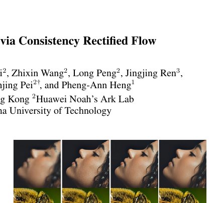

### 4.3 一致性蒸馏与 HR 正则化

预训练 SR Flow 作为教师。对较晚时刻的状态，教师用一步 Euler 更新估计较早时刻状态：

$$
\hat{X}_t^\phi=X_{t'}-\Delta t\cdot v_\phi(X_{t'},t')
$$

其中教师参数控制教师网络，较晚时间与较早时间相差一个采样间隔。该状态是教师实际生成的扰动样本，后续用于构造蒸馏目标。

学生的一致性函数定义为：

$$
f_\theta(X_t,t)=X_t-t\cdot v_\theta(X_t,t)
$$

它把任意时间点的状态直接映射到 HR 端。一步推理时，LR 图像直接输入该函数；训练时该函数则将不同时间点的预测统一到相同端点。

普通一致性蒸馏的形式为：

$$
\mathcal{L}_{\mathrm{cd}}=\mathbb{E}\left[d\left(f_\theta(X_{t'},t'),f_{\theta^-}(\hat{X}_t^\phi,t)\right)\right]
$$

这里目标网络由学生参数的 EMA 得到。该式约束学生预测与目标网络的蒸馏预测一致，但不能保证共同终点是真实 HR。

FlowSR 将真实 HR 加入该约束：

$$
\mathcal{L}_{\mathrm{hrcd}}=\mathbb{E}\left[d\left(f_\theta(X_{t'},t'),f_{\theta^-}(\hat{X}_t^\phi,t)\right)+d\left(f_\theta(\hat{X}_t^\phi,t),X_0\right)\right]
$$

第一项维持跨时间点一致性，第二项将由教师生成的扰动状态直接拉回真实 HR。它抑制教师近似误差累积，并让模型适应分布偏移。

**图 2：训练流程。** 图中同时存在流损失支路和一致性学习支路；教师、EMA 目标网络、HR 正则化、GAN 与质量对齐共同作用。论文说明一个 batch 被拆为两组，分别计算流损失和一致性损失。

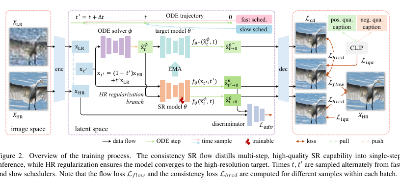

**图 3：HR 正则化的作用。** 普通蒸馏的目标可能偏离真 HR，红色 HR 对齐支路将学生输出重新锚定到真实图像。

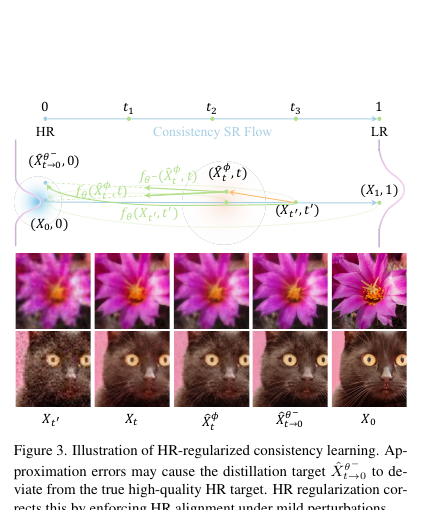

### 4.4 快慢时间调度

快调度器使用较少时间步，论文默认使用 4 步，以提供接近单步部署的大跨度跳跃；慢调度器使用 1000 步，提供细粒度中间流场监督。每次训练先随机选一类调度器采样较晚时刻，再用另一类调度器在相邻区间采样较早时刻。这样既不失去局部对齐，又让模型见到较大的时间跳跃和教师产生的轻微扰动。论文认为这能提升面对分布偏移的稳健性。

### 4.5 图像空间流损失、GAN 与质量对齐

模型以 Stable Diffusion 2.1-base 为骨干，VAE 负责编码/解码，U-Net 在潜空间预测速度。作者发现仅在潜空间监督会导致一步与四步采样间的保真度-视觉质量权衡不稳定，故将预测的 HR 潜变量解码到图像空间，再使用：

$$
\mathcal{L}_{\mathrm{flow}}=\left\|\hat{X}_{\mathrm{HR}}-X_{\mathrm{HR}}\right\|_2^2+\lambda_p\operatorname{LPIPS}(\hat{X}_{\mathrm{HR}},X_{\mathrm{HR}})
$$

像素 L2 保证重建保真，LPIPS 保证感知相似；论文将 LPIPS 权重设为 2。论文只称其为标准 LPIPS，未公开 LPIPS 内部采用 AlexNet、VGG 或 SqueezeNet。

GAN 在带扩散噪声的潜空间实现：用预训练扩散模型作为特征提取器，并附加多个判别器头。论文给出判别器 hinge 目标：

$$
\mathcal{L}_{D}=\mathbb{E}\left[\max(0,1-D(x_{\mathrm{HR}}))+\max(0,1+D(\hat{x}_{\mathrm{HR}}))\right]
$$

真实 HR 潜变量被推动到高分，生成潜变量被推动到低分。论文未公开判别头数、层级和噪声时间采样。按标准 hinge GAN，生成器通常使用负判别分数作为对抗项；论文将该项统称为对抗损失，但官方仓库无代码可核对生成器侧的精确实现。

质量对齐项使用 CLIP ViT-L/14，将 Qwen2-VL 得到的 HR 正质量文本和 LR 负质量文本与生成图像作对比：

$$
\mathcal{L}_{\mathrm{iqa}}=-\log\frac{\exp(\operatorname{sim}(\hat{X},c_{\mathrm{pos}}))}{\exp(\operatorname{sim}(\hat{X},c_{\mathrm{pos}}))+\exp(\operatorname{sim}(\hat{X},c_{\mathrm{neg}}))}
$$

该式令输出更接近“清晰、细节丰富”等正质量描述，远离“模糊、有噪声”等负描述。它不是 LPIPS 的组成部分。

联合目标为：

$$
\mathcal{L}=\mathcal{L}_{\mathrm{flow}}+\lambda_{\mathrm{cd}}\mathcal{L}_{\mathrm{hrcd}}+\lambda_{\mathrm{adv}}\mathcal{L}_{\mathrm{adv}}+\lambda_{\mathrm{iqa}}\mathcal{L}_{\mathrm{iqa}}
$$

论文设一致性、GAN、质量对齐权重分别为 0.1、0.05、0.1。先训练 SR Flow 10k iterations，再进行 20k iterations 一致性训练；LoRA 秩为 32，学习率为 2e-5，patch 为 512×512，batch size 为 16。

## 五、图表分析

### 5.1 主结果与定性对比

**表 1：RealSR 与 DRealSR 主结果。** FlowSR 在 RealSR 的 LPIPS、DISTS、FID 等感知指标很强；在 DRealSR 上，PSNR 为 28.50，CLIPIQA 为 0.7074。它不是每项像素保真指标的绝对最佳，但以一步实现较均衡的感知质量。

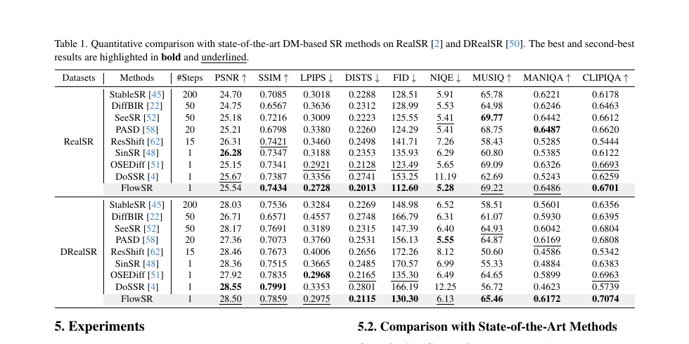

**图 4：真实图像定性对比。** 多步扩散法可能合成丰富但不准确的纹理，其他单步方法常较模糊；作者展示 FlowSR 在堤岸、织物等局部保持更可信的结构。

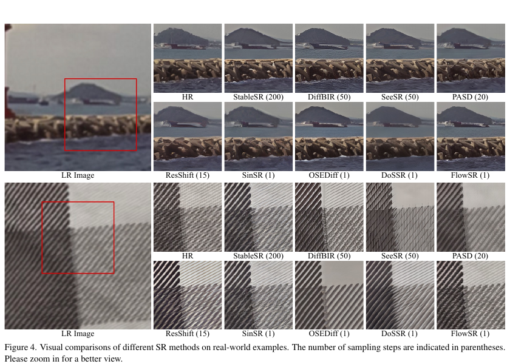

### 5.2 流路径消融

**图 5 与表 2：SR Flow 的端点设计。** 直接 LR→HR 的路径在单步和四步下都优于 Noise→HR 和 noised LR→HR。DRealSR 单步中，SR Flow 的 PSNR/MUSIQ 为 28.65/62.53；加噪 LR 路径为 28.03/60.64。多步增加通常提升 MUSIQ、略降低 PSNR。

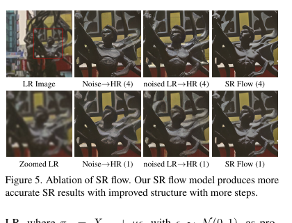

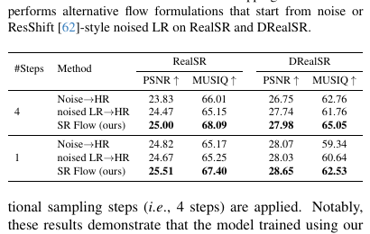

### 5.3 一致性、调度与损失消融

**图 6 与表 3：一致性学习。** 单独加入普通一致性蒸馏虽可降低 LPIPS，却可能降低无参考质量；一步条件下，加入 HR 正则化一致性后 MUSIQ 从基础 SR Flow 的 62.53 提升至 64.77，CLIPIQA 提升至 0.6748。

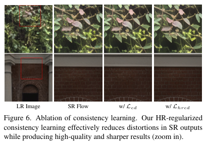

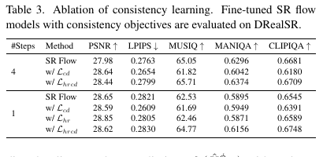

**图 7 与表 4、表 5：训练项和调度器。** 快慢调度默认快端 4 步，取得 MUSIQ 64.77，高于慢调度单独训练的 62.72。去掉 HR 一致性、GAN 或质量对齐均会降低部分无参考质量指标；三项协同决定最终视觉效果。

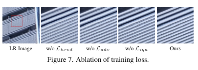

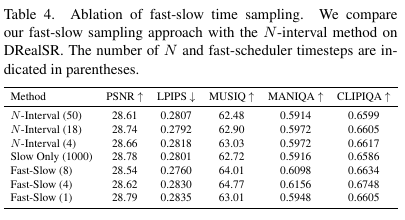

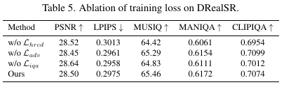

### 5.4 补充实验

**图 8：时间偏移与采样。** SD3 风格时间偏移总体优于均匀时间；论文最终选用 SD3 时间偏移和 lognorm(-2.0, 2.0) 采样，以兼顾一步保真度和少步视觉质量。

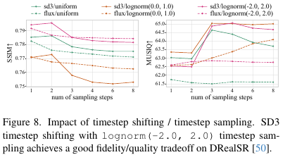

**表 6：DIV2K-Val。** FlowSR 在单步模型中表现突出，DISTS 为 0.1847，FID 为 24.52；但在部分无参考质量指标上，多步 PASD 仍有优势。

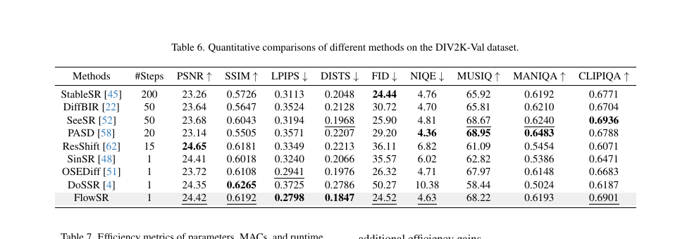

**表 7：效率。** 对 128×128 LR 的 4× 超分，FlowSR 的 982M 参数、2148G MACs、0.14 秒推理接近其他单步 SD 方法，显著快于 20-200 步方法。

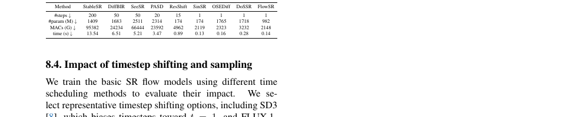

**图 9、图 10、图 11：补充定性结果。** 三组补充图覆盖建筑、人物、动物、织物、物体和自然场景。作者的主张是 FlowSR 更少产生过度合成纹理，并能在一步中保留结构；这些图是定性证据，不等同于对所有失真类型的泛化保证。

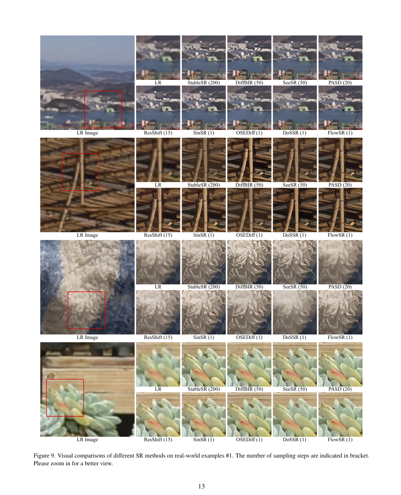

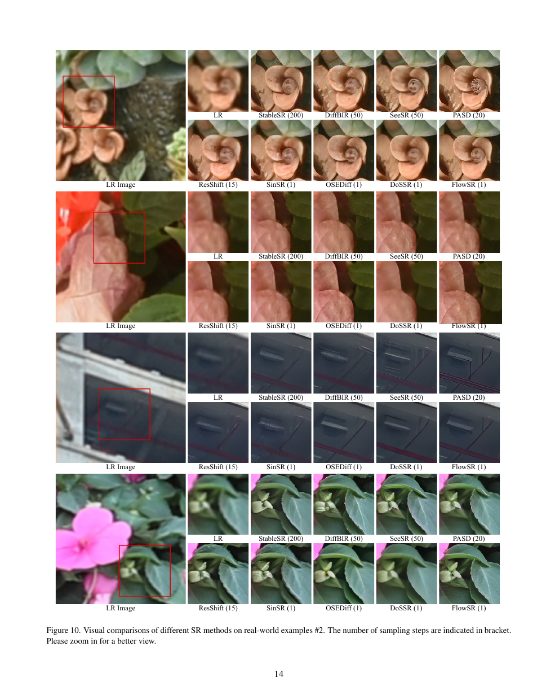

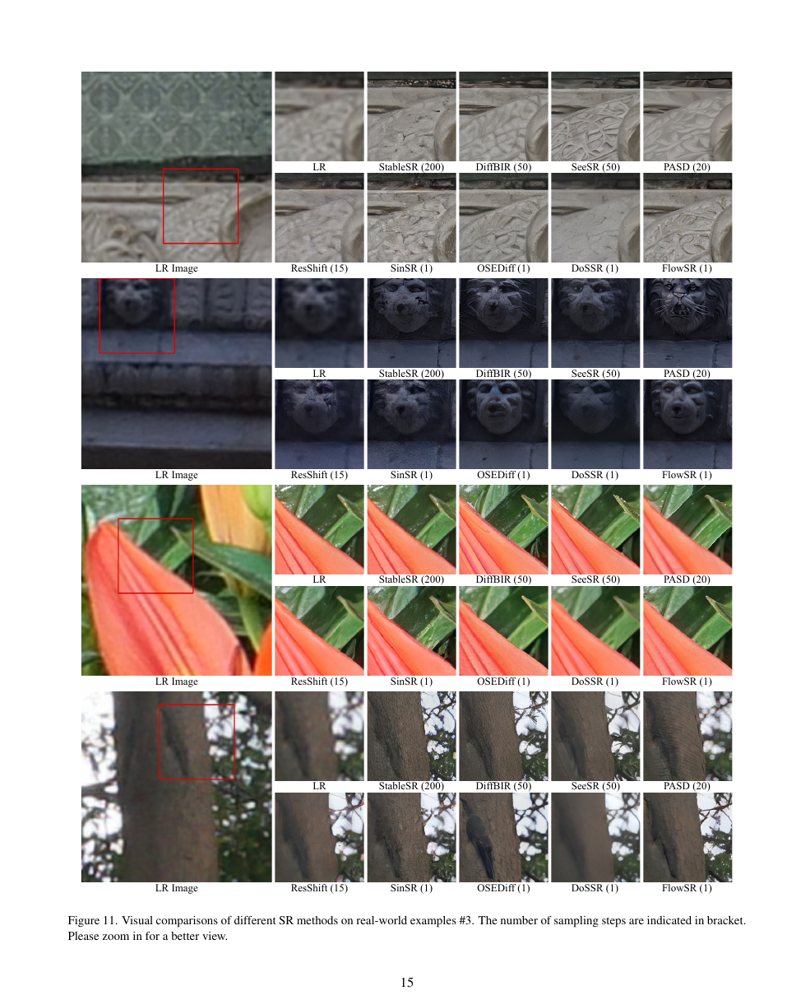

## 六、主要发现

1. 直接构造 LR 到 HR 的直线路径优于从噪声或加噪 LR 起步，尤其有利于单步恢复。
2. 一致性约束并不等于准确性；HR 正则化是抵抗教师误差传播、提升无参考感知质量的关键。
3. 快慢调度同时满足大跨度部署目标与细粒度流场学习，4 步快调度是论文选择的折中点。
4. FlowSR 的主要优势是一步速度下的感知质量-保真度平衡，而非每项像素指标均最优。

## 七、核心贡献

1. 提出面向真实超分的 LR→HR Rectified Flow。
2. 提出 HR-regularized consistency learning，显式校正蒸馏终点漂移。
3. 提出快慢双时间调度。
4. 在图像空间联合流损失、LPIPS、潜空间 GAN 和 CLIP 质量对齐。

## 八、研究局限

- 作者未在 SD3、FLUX 等更先进文本到图像骨干上验证。
- 骨干仍有 982M 参数，单步不代表低资源端侧部署无压力。
- 训练配对由合成退化生成，真实退化泛化仍需更广泛验证。
- LPIPS backbone、GAN 判别器细节、退化参数和硬件设置未公开，复现存在不确定性。
- 不涉及视频时序一致性、超大图像显存与极端退化情形。

## 九、论文总结

FlowSR 将真实超分视为保留 LR 内容的直线生成流，并通过 HR 正则化一致性蒸馏将多步恢复能力压缩到一步。论文的关键洞见是：普通一致性会让模型输出彼此相同，却不能保证结果正确；因此必须把真实 HR 重新放回蒸馏目标。结合快慢调度、图像空间重建、纹理对抗与质量语义约束后，模型在单步速度下获得有竞争力的真实图像超分效果。
