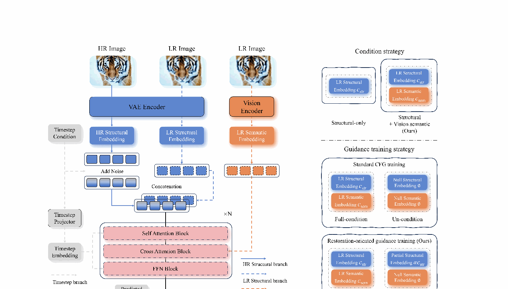
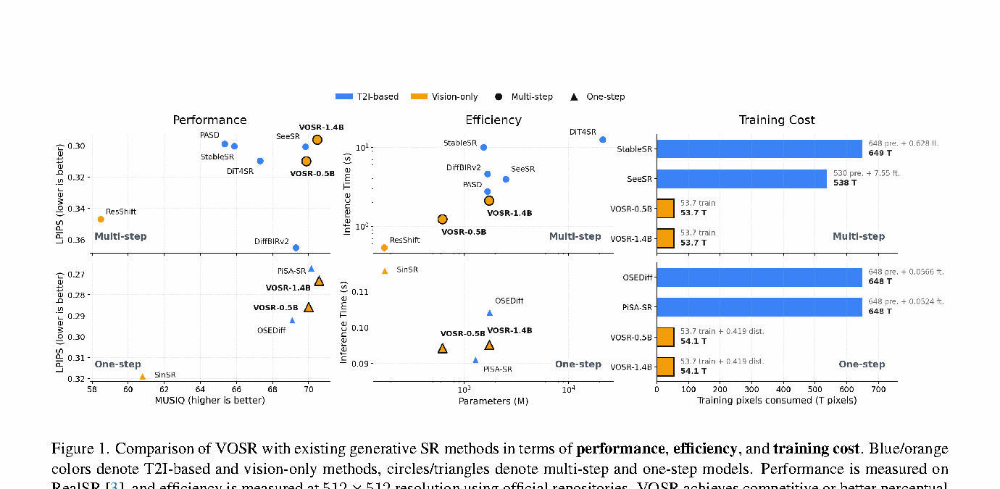
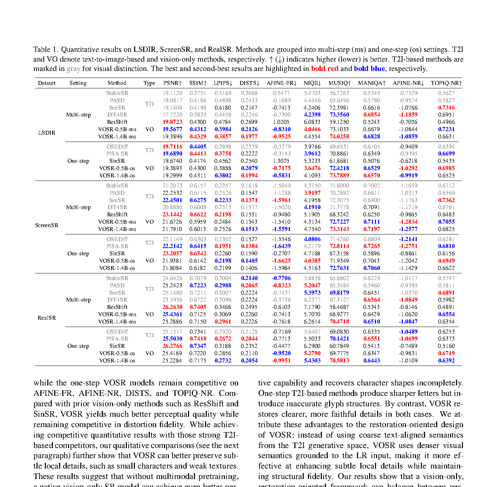
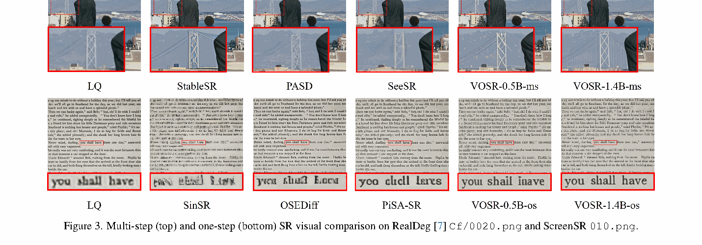
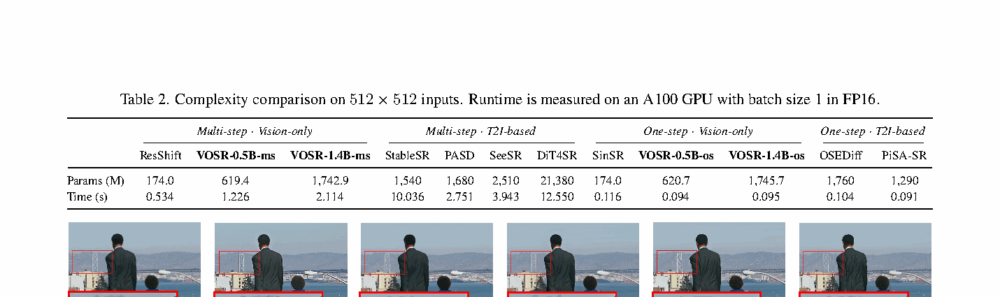
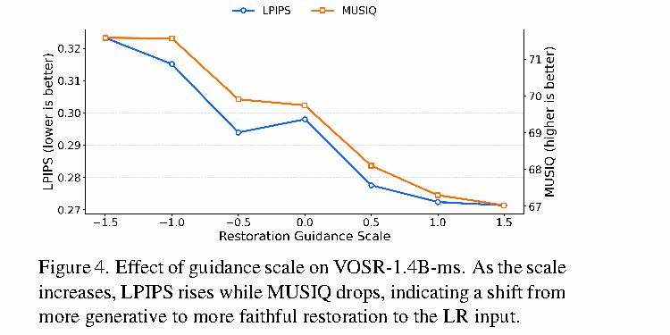

# VOSR: A Vision-Only Generative Model for Image Super-Resolution

## 一、论文基本信息

- **论文类型**：图像超分（生成式真实世界图像超分）
- **会议**：CVPR 2026，pp. 16311–16321
- **作者**：Rongyuan Wu、Lingchen Sun、Zhengqiang Zhang、Xiangtao Kong、Jixin Zhao、Shihao Wang、Lei Zhang
- **作者单位**：香港理工大学；OPPO Research Institute
- **发表时间**：2026 年 6 月
- **论文链接**：[CVF Open Access](https://openaccess.thecvf.com/content/CVPR2026/html/Wu_VOSR_A_Vision-Only_Generative_Model_for_Image_Super-Resolution_CVPR_2026_paper.html)
- **代码与模型**：[https://github.com/cswry/VOSR](https://github.com/cswry/VOSR)

## 二、摘要总结

近期生成式超分常把在海量图文对上预训练的文生图扩散模型适配为超分器。这类方法有强图像先验，但其生成路径原本面向通用文生图：文本或文本对齐语义通常空间定位较粗，且昂贵的多模态预训练并不天然适合要求“与低清输入一致”的恢复任务。VOSR 追问：只用视觉数据、从头训练的模型，能否达到文生图超分的效果？

论文提出 Vision-Only Super-Resolution。它从 LR 图像构造两种互补条件：由 VAE 得到、与像素位置对齐的结构条件负责守住布局和内容；由预训练视觉编码器得到的高层视觉语义，经交叉注意力帮助模型在严重退化下判断合理细节。作者还重构了 classifier-free guidance：不用完全看不到 LR 的“无条件分支”，而使用仍保留弱 LR 结构、但删除高层语义的“部分条件分支”。因此，指导的方向是在弱锚定和强锚定恢复之间变化，而不是在无条件生成与条件恢复之间变化。

VOSR 先训练多步的潜空间流匹配模型，再采用面向恢复的一步蒸馏。约一亿张经筛选网络图片经 Real-ESRGAN 退化后构成训练对；核心扩散模型的训练像素消耗约为代表性文生图超分方法的十分之一。在 LSDIR、RealSR 和新建 ScreenSR 上，VOSR 显著超过既有纯视觉生成式超分，且在多项感知指标上可与文生图路线竞争；视觉例子也显示它更能保住桥索、细小文字等局部结构。

## 三、研究背景

### 3.1 已有研究进展

传统 CNN、Transformer 超分多优化像素损失，PSNR 和 SSIM 较好但纹理容易平滑；GAN 改善锐利度，却可能不稳定且引入伪影。SR3、SRDiff、ResShift 等纯视觉扩散方法直接以 LR 为条件，任务形式与恢复一致，但在强退化下缺少高层语义判断。另一条路线把 Stable Diffusion 等文生图基础模型用于超分，借助 prompt、Adapter 或 ControlNet 类控制获得强感知细节；代价是预训练和部署很重，且文本对齐语义对精细局部结构并不总是可靠。

### 3.2 具体科学问题

作者的判断是：纯视觉路线的问题不是“没有文本”，而是语义抽象不足、CFG 的辅助分支不适合从头训练的恢复模型。论文的目标是构建一个始终锚定 LR、同时具有视觉语义、感知质量、输入忠实度与实际效率的生成式超分系统。

## 四、研究方法

### 4.1 数据来源、建模范围与总体流程

训练集来自经质量和多样性筛选的网络图像：论文采用梯度、图像熵、分辨率过滤，以及类别级去重与均衡，最终约一亿张图。然后以 Real-ESRGAN 退化管线合成 LR–HR 对；模型只在这些合成对上训练。LSDIR 验证集含 250 张图，LSDIR 与 RealSR 采用 512×512 GT 与 128×128 LR 的四倍超分协议；ScreenSR 是作者通过屏幕再拍摄建立的真实配对集，其 LR 与 GT 均为 512×512。设备、采集及 GT 质量细节在补充材料中，主文未给出完整数值。

给定 HR 图像，VOSR 在 VAE 潜空间中做连续时间流匹配：

$$
z_0=E(I_{HR}),\quad z_1\sim\mathcal{N}(0,I),\quad z_t=(1-t)z_0+tz_1
$$

该式先将 HR 编码为干净潜变量，再从标准高斯分布采样噪声端点，并把二者线性连成时间轨迹。中间潜变量是扩散 Transformer 的状态；推理时从可直接采样的噪声端点沿预测速度回到 HR 端点。这里的高斯噪声负责定义统一且简单的**生成起点**，LR 并未被替代，而是作为决定“生成什么”的条件输入。

真实速度目标为：

$$
v_t=z_1-z_0
$$

该速度是上述直线路径在任意时间的常量导数。网络学习从带噪潜变量预测它，从而在数值积分时逐步恢复 HR 潜变量。论文选择该噪声到图像的 flow-matching 路径，而没有直接让状态从 LR 潜变量出发；后者也是可行设计，但会将未知退化本身混入生成起点，使路径更依赖退化类型。VOSR 将“随机起点”和“LR 恢复约束”分离，以保留生成能力和统一采样机制。

图 2 左侧是主干：HR 与 LR 分别经 VAE，HR 潜变量加噪成为状态；LR 结构 token 与状态 token 拼接，并以视觉语义 cross-attention 补充上下文。右侧对照标准 CFG 的全条件/无条件训练与本文的全条件/部分条件训练，是全文方法的核心差异。

### 4.2 视觉语义条件

**动机。** 单独的 LR 结构在重退化下可能对应多种合理 HR，例如模糊文字、动物纹理或细杆结构；仅凭局部低频无法判断其语义。VOSR 不转写为文本，而从同一 LR 图像抽取视觉语义，避免文本对齐空间过粗的问题。

**结构分支。** 使用与 HR 相同的 VAE 编码器得到结构条件：

$$
c_{str}=E(I_{LR})
$$

该条件与 HR 潜空间对齐，作为空间 token 输入 Transformer，主要提供位置、轮廓和内容锚点；它不会单独决定缺失的高频细节。

**语义分支。** 预训练视觉编码器（DINO）从 LR 提取语义条件：

$$
c_{sem}=V(I_{LR})
$$

该式的输出是视觉域高层特征。扩散 Transformer 以带噪 HR 潜变量和时间嵌入为主输入，将结构条件作为空间对齐潜变量注入、将语义条件通过 cross-attention 注入；所以结构分支守住“在哪里、是什么布局”，语义分支帮助判断“应生成哪类细节”。0.5B 版本使用 DINOv2-Base，1.4B 版本使用 DINOv2-Large；视觉编码器在该框架中是预训练组件，主文未说明其是否在训练中更新。

### 4.3 恢复导向指导

标准 CFG 在训练中交替全条件与完全无条件分支。作者认为，若从头训练 SR，完全删除 LR 后，辅助分支必须同时学会通用图像生成；全条件分支则独自承担 LR 可控性。这种职责分裂会造成无条件参考质量差，反而削弱指导。

因此，VOSR 的全条件预测和部分条件预测定义为：

$$
v_{cond}=v_\theta(z_t,t,c_{str},c_{sem}),\quad v_{pcond}=v_\theta(z_t,t,\alpha c_{str},\varnothing)
$$

全条件分支同时有 LR 结构和视觉语义；部分条件分支删除语义，仅保留缩放后的结构，其中结构保留因子位于零和一之间。训练时随机采样这两种模式并共享同一网络，故部分条件分支仍是输入锚定的恢复器，而非无条件图像生成器；论文未披露该因子的具体值和两分支采样概率。

多步模型用速度回归训练：

$$
\mathcal{L}_{ms}=\mathbb{E}_{z_0,z_1,t,\kappa}\left[\left\|v_\theta(z_t,t,\kappa)-v_t\right\|_2^2\right]
$$

条件模式可以是完整条件，也可以是部分条件。该损失让同一个速度场模型都能对两种条件强度给出正确的去噪方向；这正是后续以两次预测组合指导速度的训练基础。

推理时采用：

$$
v_{cfg}=v_{pcond}+s(v_{cond}-v_{pcond})
$$

此式从弱结构锚定、无语义的预测出发，再沿“更完整结构和语义”的方向移动。指导系数为零时就是部分条件，系数为一时就是完整条件；较小系数留出更多合理纹理的生成自由度，较大系数更强调输入一致性。它与典型 T2I-SR 的 CFG 相反：后者通常两支均保留 LR 控制，放大的是额外语义先验；本文同时增强 LR 锚定与语义，因此更大系数偏向保真。

### 4.4 一步蒸馏

多步模型虽然质量好，但迭代采样慢。学生写作：

$$
f_\theta(z_t,t,r,\kappa)
$$

其中目标时间使一个模型可表达局部预测与跨时间压缩预测；条件接口仍是完整条件或部分条件。作者先用教师两支预测构造恢复导向目标：

$$
v^{guide}_{tea}=v_{pcond}+\omega(v_{cond}-v_{pcond})
$$

蒸馏时的指导权重与部署时的指导系数不同。该教师速度将 4.3 的“弱锚定到强锚定”恢复方向原样传给学生，而不是蒸馏一个无条件生成器。

学生的共享基础损失为：

$$
\mathcal{L}_{base}=\mathbb{E}_{z_0,\epsilon,t,\kappa}\left[\left\|f_\theta(z_t,t,r=t,\kappa)-v^{guide}_{tea}\right\|_2^2\right]
$$

它在不压缩时间跨度时直接匹配教师的恢复导向速度。论文再比较两种节省显存的轨迹压缩正则：shortcut 风格的中点一致性与 recursive-consistency 风格；两者都保持条件接口和基础损失不变，只改变跨时间辅助损失，且均避免多耦合网络或 JVP。作者报告 recursive-consistency 在感知质量和结构忠实度间更好，因此用于主结果。

补充材料中，shortcut 变体把从时间 t 直接压缩到 r 的预测与经中点 s 的两段预测平均值对齐：

$$
\mathcal{L}_{short-cons}=\left\|u_{t\to r}-\operatorname{sg}\left((u_{t\to s}+u_{s\to r})/2\right)\right\|_2^2
$$

这里 stop-gradient 的两段目标不反向更新，要求压缩预测与分段轨迹一致。递归一致性变体则先由教师指导步走到中间时间、再用分离的多步 ODE rollout 构建目标；其校正项及裁剪细节只在补充材料给出，主文没有展开全部公式。

### 4.5 实现细节与推理行为

骨干是 LightningDiT。VOSR-0.5B 使用 SD2.1 VAE，并配合重训的轻量解码器降低峰值显存；VOSR-1.4B 使用 16 通道 latent VAE，以缓解传统 4 通道压缩造成的不可逆信息损失。多步模型用 25 步采样；每个尺度均给出多步后缀 `-ms` 和对应一步后缀 `-os`。学习率、batch size、训练轮数、退化参数以及具体 ODE 求解器，主文未说明。

## 五、图表分析

### 5.1 训练成本、质量与效率（图 1）

图 1 用 RealSR 感知性能、512×512 推理速度和总训练像素消耗比较方法；圆点/三角形分别表示多步/一步，蓝色是 T2I，橙色是视觉方法。VOSR 在多步和一步设置中均位于较有利的质量—速度区域：多步版本快于多种 T2I 方法，一步版本接近近期一步 T2I 系统。训练成本只统计核心扩散模块的预训练像素，复用的 VAE 和语义编码器不计入；“约十分之一”的结论应按这一口径理解。

### 5.2 定量结果（表 1）

表 1 同时报告失真指标、全参考感知指标和无参考感知指标。LSDIR 多步下，1.4B VOSR 在 LPIPS、DISTS、AFINE-FR、MUSIQ 最优，0.5B 在 NIQE 最优；一步下，0.5B 在 NIQE、AFINE-NR、TOPIQ-NR 最优。真实数据上，1.4B 多步在 ScreenSR 的 MUSIQ、MANIQA 最优，在 RealSR 的 LPIPS、MUSIQ 最优。它没有一味追求最高 PSNR：RealSR 上 ResShift PSNR 更高，但 VOSR 的多项感知指标更强，体现生成式超分的失真—感知取舍。

### 5.3 视觉比较（图 3）

上半部分的桥塔和缆线很容易被过平滑；作者展示 VOSR 恢复的细结构比多步 T2I 比较方法更完整。下半部分的小字符中，SinSR 生成能力不足导致字形不完整，部分一步 T2I 方法虽锐利却产生错误字形；VOSR 更接近参考结构。该图是代表性案例，支持“更少局部幻觉”的论断，但不能替代表 1 的总体统计。

### 5.4 模型复杂度（表 2）

在 A100、FP16、batch size 为 1 的测量条件下，1.4B 多步 VOSR 为 2.114 秒，快于 PASD 的 2.751 秒、SeeSR 的 3.943 秒、StableSR 的 10.036 秒和 DiT4SR 的 12.550 秒。一步 0.5B 与 1.4B 分别为 0.094 秒、0.095 秒，快于 OSEDiff 的 0.104 秒，并与 PiSA-SR 的 0.091 秒接近。时间不包含预加载和保存，不能直接外推到端到端服务延迟。

### 5.5 指导系数行为（图 4）

随着指导系数增加，LPIPS 上升、MUSIQ 降低；论文将其解读为从更生成式的结果移动到更忠实 LR 的结果。这恰好验证 4.3 的设计：增大系数会更接近全条件预测。它与 T2I-SR 常见的“增大 CFG、加强语义先验、增强感知真实感”趋势不同。

## 六、主要发现

1. 视觉语义和恢复导向指导使纯视觉 VOSR 明显优于 ResShift、SinSR 等既有纯视觉基线。
2. 在多个合成和真实基准的感知指标上，VOSR 可与代表性 T2I-SR 竞争，且常有更好的细微结构忠实度。
3. 1.4B 多步模型保持强质量，0.5B/1.4B 一步模型约 0.1 秒即可生成 512×512 输出，说明该设计可兼顾部署。
4. 论文不是声称所有指标全面最优，而是强调感知质量、保真、速度与训练成本的平衡。

## 七、核心贡献

1. 提出不依赖图文监督或文生图主干的生成式超分框架，证明高质量生成式 SR 可以从纯视觉训练获得。
2. 将空间对齐结构条件与 DINO 视觉语义结合，以视觉域语义缓解重退化下的 HR 多解性。
3. 提出以部分条件替代无条件分支的恢复导向 CFG，使指导尺度成为生成自由度与 LR 忠实度的可调旋钮。
4. 通过内存友好的一步蒸馏，在保持相同恢复条件定义的前提下压缩多步采样。
5. 构建 ScreenSR 真实配对评测集；主文说明其具有更高质量参考和更多样内容，完整采集说明在补充材料。

## 八、研究局限

论文明确承认其训练数据规模和模型容量仍小于基于 10B 级或更大 T2I 基础模型的方案。更具体地说，虽然扩散模型从头训练且没有图文监督，DINO 与 VAE 仍是外部预训练组件；“vision-only”不等于整个系统所有部件都从零训练。训练对由单一 Real-ESRGAN 合成管线构建，面对未覆盖的真实退化仍存在域偏移风险。ScreenSR 的采集细节、用户研究和蒸馏的完整实现主要在补充材料，复现者仍需查阅附录与代码。最后，较低 LPIPS 或较好无参考分数并不能保证所有样例不产生不一致细节，实际应用仍需依据任务选择指导系数。

## 九、论文总结

VOSR 的核心不是简单地“去掉文本”，而是将生成式超分的生成起点、LR 约束和语义判断重新分工：高斯噪声提供统一可采样的潜空间起点；LR 结构与 DINO 特征决定恢复内容；部分条件 CFG 在生成性和保真之间调节。实验说明这一路线在较低核心训练成本下已能与大规模 T2I-SR 相抗衡。对图像恢复工程的启示是：当输入本身是强约束，优先构造空间落地的视觉条件和恢复导向的生成轨迹，可能比直接迁移一个通用多模态生成器更合适。
