# DDT: Decoupled Diffusion Transformer

## 一、论文基本信息

- **论文标题**：DDT: Decoupled Diffusion Transformer
- **论文类型**：扩散模型；类条件图像生成
- **作者**：Shuai Wang、Zhi Tian、Weilin Huang、Limin Wang
- **作者单位**：南京大学；ByteDance Seed Vision
- **发表信息**：arXiv:2504.05741，v2，2025 年 4 月 9 日
- **论文链接**：[arXiv](https://arxiv.org/abs/2504.05741)
- **代码仓库**：[MCG-NJU/DDT](https://github.com/MCG-NJU/DDT)
- **本地 PDF**：`DDT- Decoupled Diffusion Transformer_arXiv.pdf`

## 二、摘要总结

扩散 Transformer 具有优良的图像生成质量，却常需很长训练和大量采样步。本文认为，传统 DiT/SiT 式网络在每一个去噪步均由同一批模块同时完成两件互相牵制的工作：从高噪输入中提取低频语义结构，以及恢复高频纹理细节。前者会抑制高频成分，后者却需要表达高频信息，因而形成优化矛盾。论文提出 DDT，将其显式拆为条件编码器和速度解码器：条件编码器从带噪潜变量、时间步及类别标签提取语义自条件；速度解码器结合带噪潜变量与自条件预测线性流匹配中的速度场。编码器使用 DINOv2 表征对齐，解码器使用流匹配损失，二者共同使相邻时间步的自条件既有稳定语义又保持必要的时间相关性。

这一解耦还带来推理收益。相邻时间步的自条件高度相似时，编码器并不需要每一步重算；作者用统计动态规划选择有限重算时间步，在降低计算量的同时尽量避免质量下降。ImageNet 256×256 上，DDT-XL/2 在 256 个 epoch、区间 classifier-free guidance 下达到 1.31 FID，论文称相对既有扩散 Transformer 约快四倍收敛；训练至 400 epoch 时为 1.26 FID。ImageNet 512×512 上，模型微调 500K 步达到 1.28 FID。消融还表明，随着模型规模增大，向语义编码器分配更高层数比例更有效。

## 三、研究背景

### 3.1 已有研究进展

DiT 将 Transformer 用于扩散模型，SiT 则采用线性流匹配建模。它们具备良好扩展性，但训练收敛较慢。相关提速研究包括高效注意力、时间步采样或重加权，以及利用视觉教师表征的 REPA、RCG、DoD。REPA 能增强语义表征，但仍未改变同一网络同时做语义编码与细节预测的结构。

### 3.2 具体科学问题

论文关注的不是单纯增加参数，而是：传统扩散 Transformer 的计算应优先投入语义编码还是高频细节解码？若真正瓶颈位于高噪阶段的语义建立，就应把网络容量从同构的去噪主干中拆分出来，优先扩展专职编码器。

## 四、研究方法

### 4.1 数据来源、潜空间与训练设置

训练与主评测使用 ImageNet 256×256 类条件生成；512×512 实验从 256×256 训练结果继续微调。模型不直接在 RGB 图像空间运行，而是在预训练 `SD-VAE-f8d4-ft-ema` 的潜空间训练：VAE 降采样倍率为 8，潜变量通道数为 4。

因此，DDT 内部的“编码器—解码器”**不是** VAE 编码器和 VAE 解码器。完整链路是“图像经预训练 VAE 编码为潜变量 → DDT 在潜变量上生成 → 预训练 VAE 解码为图像”。DDT 的条件编码器负责语义自条件，速度解码器负责预测速度；VAE 仍保留在扩散网络之外。

训练使用 AdamW，基础学习率为 0.0001、权重衰减为 0、批量大小为 256、恒定学习率；不使用 warm-up 和梯度裁剪。默认采样器是 250 步 Euler-ODE。B/2、L/2、XL/2 分别有 12、24、28 层，隐藏维度分别为 768、1024、1152。论文还构建了含 SwiGLU、RoPE、RMSNorm 与 lognormal 时间步采样的 Improved Baseline，以避免把普通工程技巧的提升误判为 DDT 的结构贡献。

### 4.2 初步分析：定位传统网络瓶颈

在本文的线性流匹配约定中，时间步为 0 表示纯噪声，时间步增大表示样本逐步接近干净图像。图 3 展示了由低频轮廓、语义布局逐渐补齐至高频纹理与边缘的过程。

**图 3：频率由低到高的生成过程。**

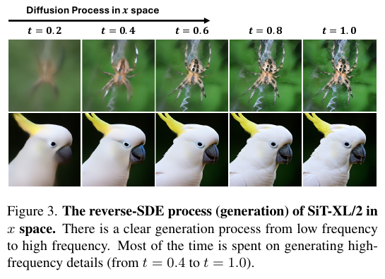

作者引用已有频谱结论，说明在该噪声日程下，潜变量中能够保留的最高频率随时间增大而提升：

$$
f_{\max}(t)>\min\left(\left(\frac{t}{1-t}\right)^2,K_{\mathrm{freq}}\right)
$$

该式刻画当前潜变量的可恢复频率上限。时间越接近干净图像，低频语义越容易辨认，但待补全的高频残差也越多。于是高噪阶段的主要难题是建立低频语义，低噪阶段的主要难题是恢复高频细节；传统同构 Transformer 必须同时承担二者，形成优化牵制。

为判断哪一项更构成实际瓶颈，作者在固定 SiT-XL/2 与二阶 Adams-like 求解器的前提下，改变时间步分配，让更多计算落在不同噪声区间。判断准则是：更多计算若应给高噪阶段，瓶颈就是语义编码；若应给低噪阶段，瓶颈则是细节解码。

**图 4：把更多采样计算分给高噪阶段会改善 FID。**

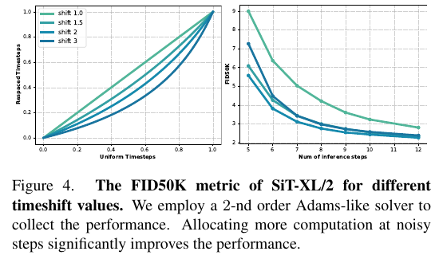

结果显示，更多高噪阶段计算优于均匀分配。论文据此推断，当前扩散 Transformer 的首要限制是高噪输入下的低频语义编码能力，并以此导向“更大编码器、较小解码器”的 DDT。

### 4.3 条件编码器

条件编码器接收带噪潜变量、时间步与类别标签。带噪潜变量先被切成 token；时间和类别嵌入通过 AdaLN-Zero 注入各个交替的 Attention 与 FFN block。编码器不使用长跳连，输出语义自条件：

$$
\mathbf{z}_{t}=\mathrm{Encoder}(\mathbf{x}_{t},t,y)
$$

该式的输出是当前时间步的自条件。它应保留图像的低频结构、类别语义和当前去噪上下文，随后交给速度解码器；其目标不是直接预测最终图像或速度。

**图 1：DDT 与传统扩散 Transformer 的结构对照。**

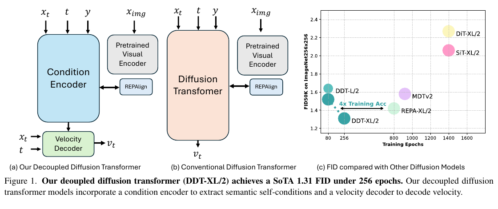

图中左侧的 DDT 将原本单一的扩散 Transformer 主干分为条件编码器与速度解码器。预训练视觉编码器只用于 REPA 风格的对齐监督，不参与生成时的图像 VAE 编解码。

为使相邻时间步的自条件在语义上稳定，作者将编码器第 i 层特征经可学习投影后与 DINOv2 教师表征对齐：

$$
\mathcal{L}_{\mathrm{enc}}=1-\cos\left(\mathbf{r}_{*},h_{\phi}(\mathbf{h}_{i})\right)
$$

该损失最小化投影后中间特征与 DINOv2 语义特征的余弦距离。对于同一张干净训练图像的不同加噪版本，它们对应的教师语义目标相同，因此编码器被推动到相近的语义方向；但这并不要求每次输出逐元素相同：余弦损失只约束方向，且解码器的速度损失仍会保留与当前时间步有关的信息。论文未说明采用哪一层或哪些层进行该对齐，也未给出该损失与速度损失的显式权重。

### 4.4 速度解码器与训练目标

速度解码器使用与编码器相似的 Attention-FFN block。它接收带噪潜变量、时间步以及自条件；类别信息被假定已经包含在自条件中，因此不再单独输入：

$$
\mathbf{v}_{t}=\mathrm{Decoder}(\mathbf{x}_{t},t,\mathbf{z}_{t})
$$

该式将任务分工明确化：编码器提供语义锚点，解码器以此为条件预测流匹配的速度。自条件也通过 AdaLN-Zero 注入解码器，使条件与解码过程深度耦合。

$$
\mathcal{L}_{\mathrm{dec}}=\mathbb{E}\left[\int_{0}^{1}\left\|\left(\mathbf{x}_{\mathrm{data}}-\boldsymbol{\epsilon}\right)-\mathbf{v}_{t}\right\|^{2}\mathrm{d}t\right]
$$

该式让预测速度接近干净潜变量与高斯噪声之差，是线性流匹配训练目标。解码器的梯度会反向传给条件编码器，构成对编码器的间接监督；因此条件编码器学习的是“语义稳定、但可随时间平滑变化”的表征，而非时间完全不变的固定向量。

### 4.5 编码器共享与统计动态规划

若自条件在相邻时间步相似，推理时可复用上次的编码器输出，仅在少数时间步重算编码器。设总采样步数为 N，编码器只计算 K 次，重算时间步集合为 Φ：

$$
\mathbf{z}_{t}=\begin{cases}\mathbf{z}_{t-\Delta t},&t\notin\Phi\\\mathrm{Encoder}(\mathbf{x}_{t},t,y),&t\in\Phi\end{cases}
$$

该策略将不在重算集合内的当前自条件替换为上一次已算条件；共享比例由总步数与 K 的比值决定。均匀共享每隔固定步数重算一次，简单但没有考虑不同阶段表征变化速度不同。

作者先统计各时间步自条件的两两余弦相似度，构建相似度矩阵，再以动态规划选出重算点：

$$
\mathbf{C}^{k}_{i}=\min_{j=0}^{i}\left\{\mathbf{C}^{k-1}_{j}-\sum_{l=j}^{i}\mathbf{S}[j,l]\right\}
$$

该状态转移表示：当第 k 个重算点放在第 i 步时，从任一前一重算点到第 i 步的复用区间中，选择累计相似度代价最小的路径。回溯路径即可得到重算集合。原文的路径公式下标存在不一致，工程实现应依上述状态定义核对，而不宜逐字照抄。

**图 5：相邻时间步自条件具有高余弦相似度。**

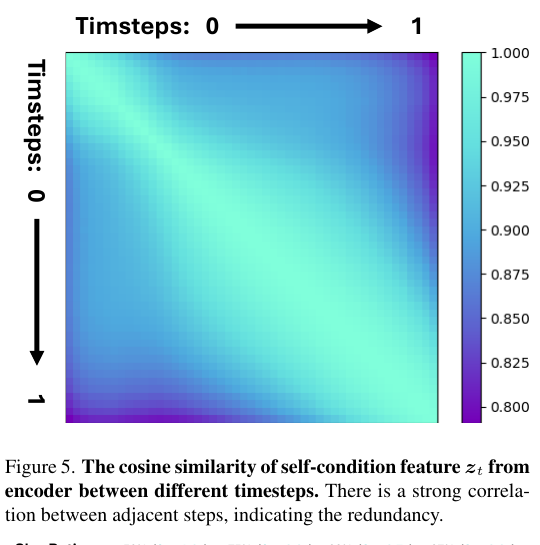

相似度矩阵的对角线附近尤其高，说明局部复用具有合理性；但远离对角线时相关性降低，因此不能无限制缓存。

**图 6：不同共享率下的生成样本。**

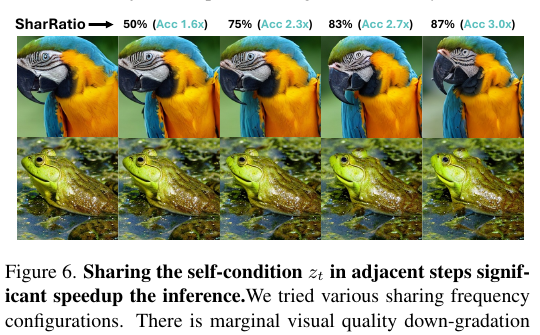

图中共享率升高后仍能保持总体内容与视觉质量；配合定量表格可见，合理范围内的质量代价较小。

### 4.6 关键流程总结

训练阶段依次为：图像经固定 VAE 变为潜变量；随机采样时间步并加入噪声；条件编码器产生自条件并做 DINOv2 表征对齐；速度解码器以自条件为条件预测速度；以流匹配误差训练整个 DDT。推理阶段从噪声潜变量开始，用 Euler-ODE 更新潜变量；每步运行速度解码器，编码器则按均匀策略或统计动态规划策略选择性重算；最终由固定 VAE 解码为 RGB 图像。

## 五、图表分析与实验

### 5.1 生成样例与 CFG 区间

**图 2：ImageNet 256×256 与 512×512 样例。**

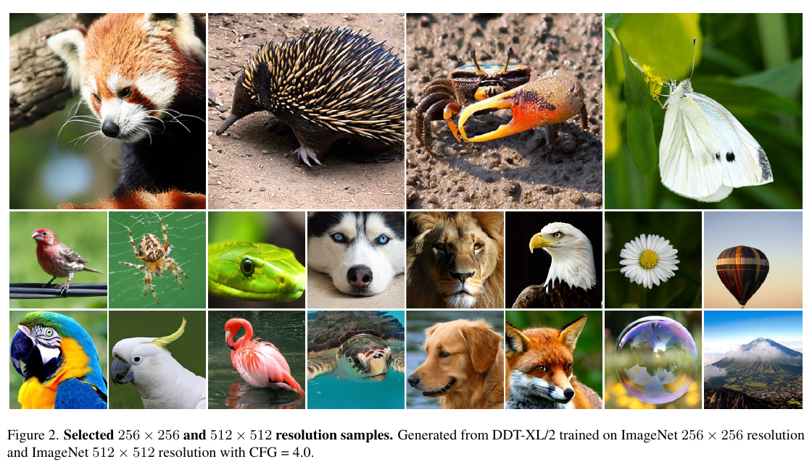

样例覆盖动物、物体与场景，展示两种分辨率下的类别条件生成质量。它说明 DDT 的结构改变没有破坏生成多样性，但图像样例只提供定性证据，最终结论仍应以 FID、Precision 与 Recall 为准。

**图 9：CFG 强度与施加区间的关系。**

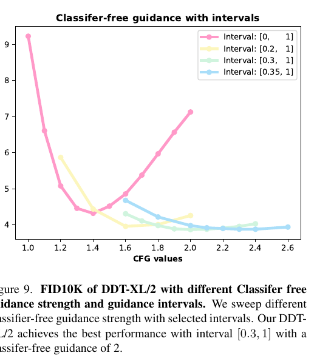

作者扫描不同 CFG 强度与区间。全程施加 CFG 在强度较大时会明显恶化；区间为 0.3 到 1 的设置在强度约 2 附近最优。这解释了 256×256 最终结果使用区间 CFG 和强度 2 的原因；512×512 最终表中使用的强度为 3。

### 5.2 同训练预算的结构比较

**表 2：400K 步、无 CFG 的不同规模比较。**

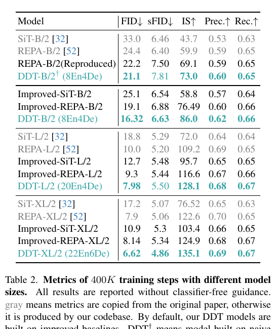

在统一 400K 步、无 CFG 的口径下，DDT-B/2 的 FID 为 16.32，优于 Improved-REPA-B/2 的 19.10；DDT-L/2 为 7.98，优于 9.30；DDT-XL/2 为 6.62，优于 8.14。说明提升并非仅来自 CFG，也不只是改良 Transformer 微观设计。论文的 DDT-B/2 标记为 8En4De，L/2 为 20En4De，XL/2 为 22En6De，体现编码器占比随规模升高。

### 5.3 系统级比较

**表 1：ImageNet 256×256 类条件生成。**

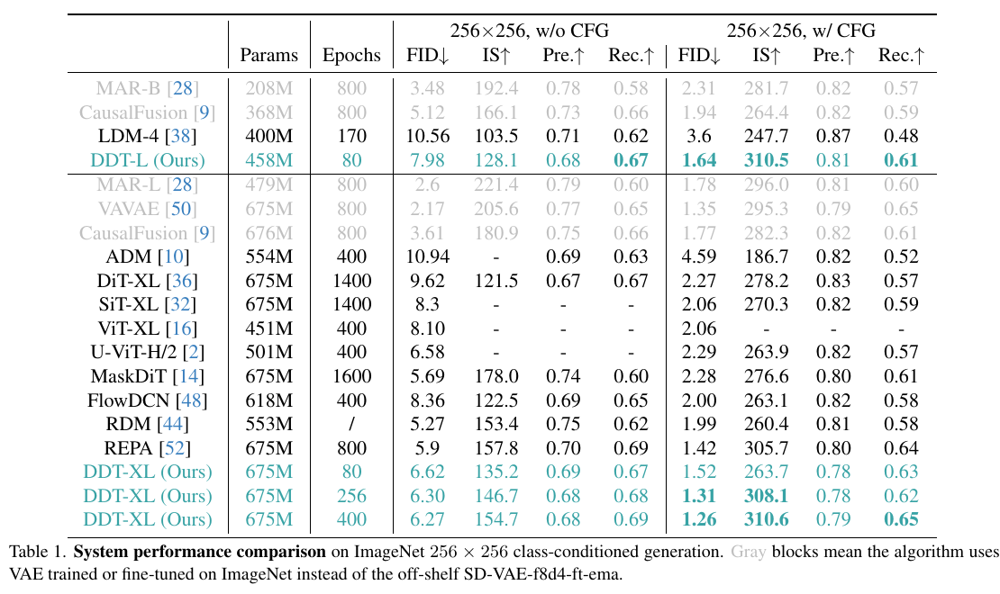

DDT-XL/2 在 80、256、400 epoch 的无 CFG FID 分别为 6.62、6.30、6.27；使用 CFG 后分别为 1.52、1.31、1.26。256 epoch 的 1.31 是论文重点结果，并优于表中 REPA 的 1.42。注意表中部分其他方法使用了在 ImageNet 上训练或微调的 VAE，论文用灰色块标出；DDT 使用现成 SD-VAE。作者还指出该 VAE 的 ImageNet 256×256 重建 FID 约为 1.20，因此 1.26 已接近潜空间编解码器上限。

**表 3：ImageNet 512×512 类条件生成。**

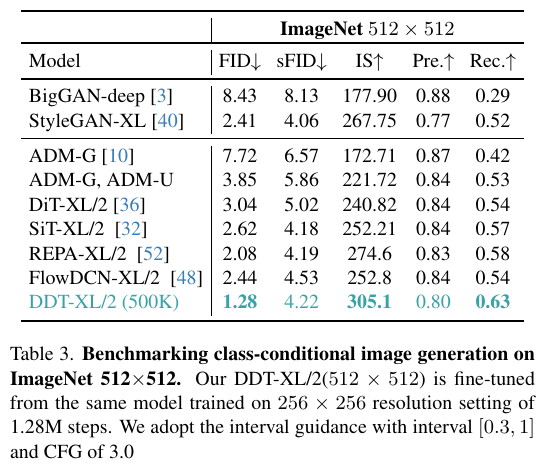

DDT-XL/2 从 256×256 模型初始化，在 512×512 微调 500K 步后达到 1.28 FID，优于 REPA-XL/2 的 2.08；IS 为 305.1、Recall 为 0.63。正文还报告 100K 微调步时的 1.90 FID，因此 1.90 与表中 1.28 是不同训练预算，不能混为同一结果。DDT 的 Precision 为 0.80，略低于部分基线，而 Recall 更高，表明覆盖度提升但保真度指标存在权衡。

### 5.4 编码器共享加速

**表 4：共享比例、速度与质量。**

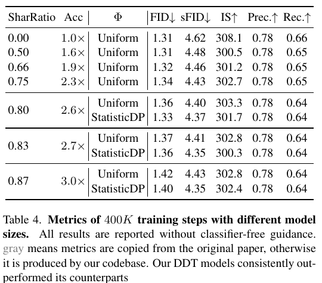

不共享时 FID 为 1.31。共享 50% 时速度达到 1.6 倍，FID 仍为 1.31；共享 75% 时约 2.3 倍，均匀策略 FID 为 1.34，统计动态规划为 1.33；共享 83% 时约 2.7 倍，二者为 1.37 与 1.36；共享 87% 时达到 3 倍，但 FID 恶化至 1.42 与 1.40。统计动态规划始终略优于均匀重算，证明重算预算应集中到表示变化更剧烈的时间段。

### 5.5 编码器—解码器比例消融

**图 7：B/2 模型的层数比例。**

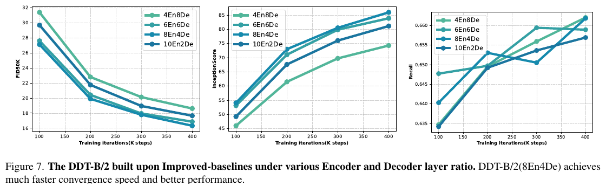

总层数为 12 时，8 个编码层加 4 个解码层兼顾最低 FID、较高 IS 与 Recall；继续增至 10 个编码层、2 个解码层并未更好，说明解码能力仍不能被过度压缩。

**图 8：L/2 模型的层数比例。**

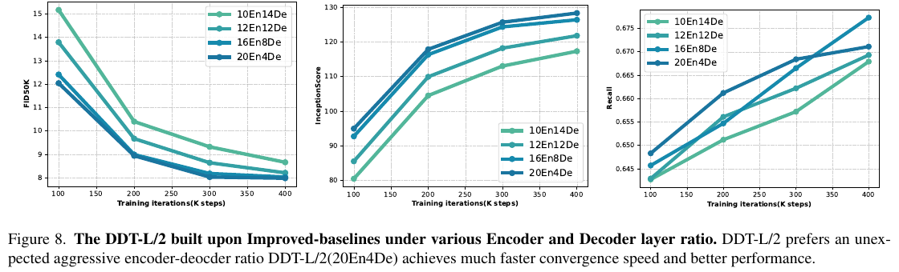

总层数为 24 时，最优点转为 20 个编码层加 4 个解码层。相较 B/2，最佳配比更偏向编码器，支撑“模型越大，越值得优先扩大高噪语义编码容量”的缩放规律。

### 5.6 解码器结构消融

**表 5：DDT-B/2 中不同解码器 block。**

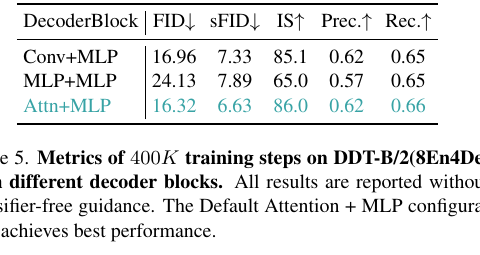

Attention+MLP 最佳，FID 为 16.32；Conv+MLP 为 16.96，差距不大；MLP+MLP 为 24.13，明显较弱。结果说明解耦后解码器可一定程度轻量化，但仍需要 Attention 或卷积所提供的空间与 token 交互，纯 MLP 难以充分恢复高频细节。

## 六、主要发现

1. 传统扩散 Transformer 的主要瓶颈被作者定位为高噪阶段的低频语义编码，而非单纯高频解码能力不足。
2. 将语义自条件编码与速度预测解耦，能在相同训练预算下稳定优于改良 REPA 基线。
3. 规模扩大时，最佳层数分配更偏向编码器；XL/2 使用 22 个编码层和 6 个解码层。
4. 自条件的局部时间一致性可转换为缓存与共享，使推理在合理质量损失下达到约 1.6 至 3.0 倍加速。

## 七、核心贡献

1. 提出 DDT，以专职条件编码器和速度解码器显式拆分低频语义提取与高频速度预测。
2. 结合 DINOv2 表征对齐和流匹配训练，使自条件语义稳定且可服务于速度预测。
3. 将自条件共享表述为重算时间步选择问题，并用统计动态规划寻找更优重算策略。
4. 给出“随模型增大，编码器占比也应增大”的经验性架构缩放证据。

## 八、研究局限

- 验证集中在 ImageNet 类条件生成，未覆盖文本生成图像、视频、长序列或其他视觉域。
- 依赖 DINOv2 教师表征；教师选择、额外训练成本、目标层选择及损失权重均缺少充分消融。
- 统计动态规划需要预先统计时间步间相似度，论文未充分说明统计数据、跨采样器泛化与运行时开销。
- “低频对应语义、高频对应细节”是有效分析视角，但并非对所有自然图像语义的严格充分描述。
- 最优系统结果依赖区间 CFG；共享率、CFG、求解器和图像分辨率之间的耦合尚未系统展开。

## 九、论文总结

DDT 的核心价值是将扩散 Transformer 中长期混合的语义编码与速度解码职责拆开。论文先用频率过程与时间步重分配实验将瓶颈定位到高噪阶段的语义建立，再设计更大容量的条件编码器、较小速度解码器，并用教师表征对齐使条件在相邻时间步稳定。该稳定性不仅改进收敛和 FID，还使编码器输出可被缓存复用。对后续工程的启发是：扩散模型的推理优化可以不只依赖减少求解步数，也可以围绕可复用的语义中间状态设计缓存；对后续研究的启发是，应在更复杂的文生图、视频与多模态场景验证该解耦和共享机制的可扩展性。
