# HRDiT：无需训练的高分辨率 DiT 图像生成

## 一、论文基本信息

- **标题**：HRDiT: Training-Free High-Resolution Image Generation with Off-the-Shelf Diffusion Transformer Models
- **论文类型**：扩散模型；高分辨率文生图
- **会议**：ECCV 2026（已接收）
- **arXiv**：2608.07003，2026 年 8 月 7 日提交
- **作者**：Yu Xue、Haoxuan Qu、Zhuoling Li、Hongbin Xu、Jianxiong Yin、Simon See、Hossein Rahmani、Jun Liu
- **单位**：Lancaster University、South China University of Technology、NVIDIA AI Tech Centre
- **论文链接**：[arXiv](https://arxiv.org/abs/2608.07003)
- **代码**：[官方 GitHub](https://github.com/zylwithxy/HRDiT)

## 二、摘要总结

高分辨率文生图若重新训练生成器，通常需要大量高分辨率数据与算力。免训练方法可直接复用现成的文生图扩散模型，但已有工作主要面向 U-Net；FLUX、Stable Diffusion 3 等 Diffusion Transformer 在高分辨率外推时仍会产生空间紊乱且推理极慢。HRDiT 将问题归为位置表达不足和全局注意力成本爆炸。其空间位置对齐模块通过 Bundle 将大量原始坐标压缩为较少的 bundle 坐标，再借助 Slide 的多组滑动边界恢复细粒度位置差异；其头自适应注意力剪枝模块则为不同注意力头分配不同窗口范围，以在给定计算预算内最小化预计画质损失。方法不更新主模型权重。在 FLUX.1-dev 与 Stable Diffusion 3 Medium 的 2K、4K、8K 实验中，HRDiT 均取得更好的图像指标和更低的同骨干推理时间。以 FLUX 4K 为例，FID 从直接外推的 75.68 降至 64.91，单图延迟从 203 秒降至 116 秒。

## 三、研究背景

### 3.1 已有研究进展

高分辨率生成可分为训练式和免训练式路线。前者为目标分辨率重新优化生成器；后者通过修改采样过程、特征尺度或网络计算，使原本仅在有限分辨率训练的模型外推。DemoFusion、DiffuseHigh、HiFlow 主要修改采样过程；FreeScale、HiDiffusion 等主要围绕 U-Net；I-Max 面向部分 DiT。本文的切入点是：DiT 虽在标准分辨率上强大，但缺少同时处理空间一致性与推理效率的通用免训练外推方案。

### 3.2 具体科学问题

直接输入更大尺寸噪声会让视觉 token 数大幅增加。一方面，固定位置编码难以保持所有空间位置对的可辨别性，导致对象重复或结构错位；另一方面，全局多头注意力的成本随 token 数近似二次增长。论文报告，在 8K 下，FLUX 和 SD3 的注意力计算均占总生成时间超过 90%。

## 四、研究方法

### 4.1 数据来源和范围

HRDiT 不训练或微调生成器。实验使用 FLUX.1-dev 与 Stable Diffusion 3 Medium；从 LAION-5B 随机抽取 1,000 条文本描述做评测，并使用 10,000 张真实图像计算 FID、KID 及其局部 patch 版本。测试覆盖 2K、4K、8K。论文未报告在其他 DiT、视频生成模型或领域特化图像数据上的完整验证。

### 4.2 统一的位置编码形式与空间紊乱分析

作者将不同 DiT 的位置编码抽象为：token 内容与 token 位置共同生成查询、键和值。

$$
\mathbf{q_i}=g_q(\mathbf{x_i},f^{tok}_{pe}(i)),\mathbf{k_i}=g_k(\mathbf{x_i},f^{tok}_{pe}(i)),\mathbf{v_i}=g_v(\mathbf{x_i},f^{tok}_{pe}(i))
$$

该式的计算目标是将空间位置注入注意力。输入隐藏 token 与位置编码共同决定查询、键和值；FLUX 的 RoPE 和 SD3 的正弦位置编码都可表示为此形式。高分辨率下，位置编码若不能充分区分位置，后续注意力便会混淆不同空间区域。

作者进一步将 token 对的注意力贡献表示为：

$$
\mathbf{c_{i,j}}=g(\mathbf{x_i},\mathbf{x_j},f_{pe}(i,j))
$$

该式把查询、键、值和 softmax 等完整注意力过程吸收到函数中，突出成对位置信号的作用。它是后续分析位置关系可区分性、以及 SPA 替换原注意力贡献的基础。

作者给出可区分位置关系数的上界：

$$
h(T)\leq\lambda\cdot\Big(\sup_{S_{pe}}|g(\mathbf{x_i},\mathbf{x_j},f_{pe}(i,j))|\Big)^{2\xi}
$$

其中，左侧表示经过注意力计算后可区分的位置关系类别数，视觉 token 总数增加时待区分的位置关系集合快速扩大；右侧受固定模型函数类的伪维度限制。作者据此解释高分辨率空间紊乱：理想状态应让全部位置关系均可区分，但固定 DiT 的位置表达未必随分辨率同步扩展。此处是论文在其形式化假设下的理论分析。

### 4.3 SPA：Spatial Position Alignment

#### 4.3.1 Bundle

Bundle 不改模型权重，而是把送入位置编码的原 token 坐标改为 bundle 坐标。其一维映射为：

$$
\phi_{bundle}(i)=\begin{cases}0,&0\leq i<N_1\\\left\lceil\frac{i+1-N_1}{N}\right\rceil,&N_1\leq i<T\end{cases}
$$

该式将 token 索引映射到所属 bundle 的索引。第一个 bundle 可取不同大小，后续中间 bundle 使用固定大小。输出被输入原有位置编码函数，因而无需改变查询、键、值投影或训练任何新参数。它压缩位置编码的输入多样性，使固定位置机制面对更少的成对位置关系；代价是同一 bundle 内 token 暂时不可区分。

#### 4.3.2 Slide 与多变体注意力平均

Slide 通过改变第一个 bundle 的大小构建多种映射，使分组边界逐步平移。单个映射会丢失 bundle 内的精确位置；跨全部映射得到的 bundle-ID 组合则可区分原 token。最终，作者对各映射下的注意力输出取平均：

$$
\mathbf{c^{SPA}_{i,j}}=\frac{1}{N}\sum_{n=1}^{N}g\bigg(\mathbf{x_i},\mathbf{x_j},f_{pe}\Big(\phi_{bundle}^{(N_1=n)}(i),\phi_{bundle}^{(N_1=n)}(j)\Big)\bigg)
$$

该式以 SPA 贡献替换原 token 对贡献。每个分支拥有较小的位置关系集合，多个分支合并后恢复细粒度位置差异。论文指出，各分支可并行；FLUX 4K 的完整注意力延迟仅由约 203 秒增至 212 秒。

**图 3：Bundle 和 Slide 的一维示意。**

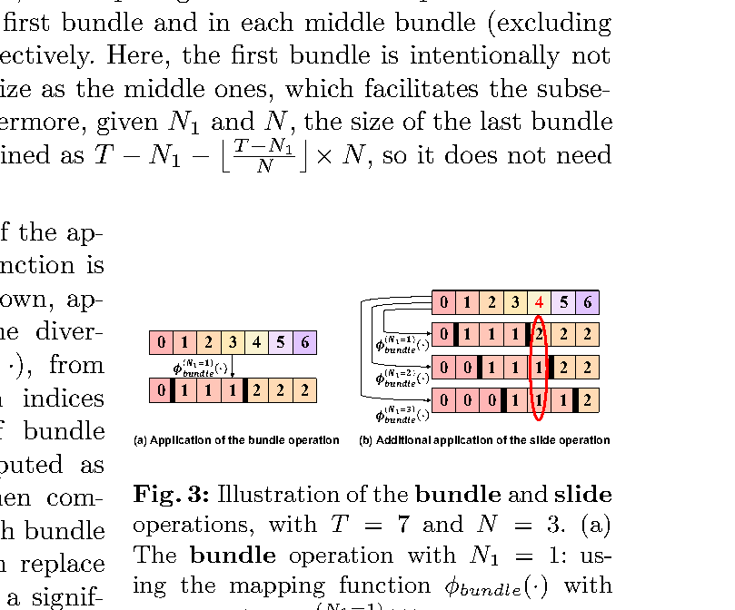

图中左侧将连续 token 映射为更少的 bundle 索引；右侧显示第一个 bundle 大小变化后，边界向右滑动。不同滑动映射的结果共同给出 token 的唯一表示，正是“先降低位置关系复杂度、再恢复细节”的关键。

#### 4.3.3 官方 FLUX 代码中的位置 ID 生成

官方实现澄清了一个容易误解的细节：SPA **不生成新的可学习位置 token 向量**。它生成多组替代性的二维图像位置 ID，送入 FLUX 原有的 RoPE 模块，再平均多组注意力输出。[`spa.py`](https://github.com/zylwithxy/HRDiT/blob/master/hrdit/spa.py) 中图像位置 ID 形状为图像 token 数乘以 3；第 1、2 列分别是行、列坐标，第 0 列保持不变。

实现先以 `group_num` 计算横纵 bundle 边长，再复制原位置 ID，只替换行和列：基准映射同时保持原始首行、首列 bundle 大小；其余变体分别仅滑动行边界或仅滑动列边界。因此变体总数为横向 bundle 边长加纵向 bundle 边长减 1，而不是行、列滑动组合的笛卡尔积。

随后，[`transformer.py`](https://github.com/zylwithxy/HRDiT/blob/master/hrdit/transformer.py) 将每组图像 ID 与不变的文本 ID 拼接，调用原始 `pos_embed` 获得一组 RoPE 频率，并显式设置 `ntk_factor=1.0`。官方注释的理由是压缩后的 bundle ID 处于训练时位置编码分布内。

在 [`attention.py`](https://github.com/zylwithxy/HRDiT/blob/master/hrdit/attention.py) 中，同一份查询、键分别接受每组 RoPE 旋转，逐组执行注意力，再平均输出：

$$
\mathbf{o}^{SPA}=\frac{1}{V}\sum_{v=1}^{V}\operatorname{Attention}(\operatorname{RoPE}(\mathbf{Q},\mathbf{p}^{(v)}),\operatorname{RoPE}(\mathbf{K},\mathbf{p}^{(v)}),\mathbf{V})
$$

该式说明平均的是每个位置变体的注意力输出，而不是直接平均位置 ID、RoPE 张量或完整 attention map。代码注释指出，平均输出与平均 attention map 后再乘 value 在代数上等价，但前者不需要保存巨大的多变体 attention map。

### 4.4 HAP：Head-adaptive Attention Pruning

高分辨率下注意力是主要耗时。统一局部窗口虽然能节省计算，但会错误地删除承担长距离关系的头。HAP 假定不同头有不同且较稳定的有效注意范围：局部纹理头可用小窗口，全局布局头需要更大窗口。

#### 4.4.1 准备阶段 1：候选窗口的质量与成本

对每个头，论文设置多个候选范围。候选范围只保留当前位置周围一定比例的 token，计算成本按参与注意力计算的 token 总数统计。质量退化通过一次完整注意力前向的注意力矩阵和最终图像损失梯度估计：

$$
I_q(n_{\text{head}},n_{\text{scope}})\approx\sum_{(u,v)\in S^{(n_{\text{scope}})}_{\text{omit}}}\Big(\frac{\partial L}{\partial A(u,v)}(-A(u,v))+\sum_{w\ne v}\frac{\partial L}{\partial A(u,w)}\frac{A(u,w)A(u,v)}{1-A(u,v)}\Big)
$$

该式估计删除窗口外注意力连接带来的最终图像损失增量。第一部分是移除该连接的直接一阶影响，第二部分补偿 softmax 重新归一化对保留连接的影响。论文对 30 条与评测集不重合的 LAION-5B 提示词取平均，作为每个“头—窗口”组合的质量代价。

#### 4.4.2 准备阶段 2：逐头分配窗口

HAP 在总注意力预算下选择每个头的窗口，使预测质量损失之和最小：

$$
\mathop{\arg\min}_{(n_{\text{scope}}^{(1)},\dots,n_{\text{scope}}^{(N_{\text{head}})})}\sum_{n_{\text{head}}=1}^{N_{\text{head}}}I_q(n_{\text{head}},n_{\text{scope}}^{(n_{\text{head}})})
$$

该目标函数在所有头间分配窗口，以优先把计算预算留给对质量最敏感的头。

$$
\sum_{n_{\text{head}}=1}^{N_{\text{head}}}I_c(n_{\text{head}},n_{\text{scope}}^{(n_{\text{head}})})\leq r_c\sum_{n_{\text{head}}=1}^{N_{\text{head}}}I_c(n_{\text{head}},N_{\text{scope}})
$$

该约束将剪枝后的总注意力成本限制为完整注意力成本的指定比例。实验设定为 0.1。论文将该离散选择问题转成整数规划，用线性求解器求解，并将所得逐头窗口预编译为 GPU 内核。

### 4.5 关键流程与实现参数

1. 针对目标分辨率，以 30 条提示词执行一次 HAP 准备，估计各头、各窗口的质量—成本关系。
2. 在总成本比例为 0.1 的约束下求解逐头窗口计划。
3. 对每个输入提示执行级联采样。FLUX 在 1K、2K、4K、8K 分别使用 30、16、10、8 步；SD3 分别使用 28、8、6、5 步。
4. 每个注意力块都使用 SPA 位置变体；每个头则按 HAP 计划执行相应范围的稀疏注意力。
5. 论文推荐按测试分辨率独立准备 HAP 计划。FLUX 4K 的准备阶段约 48 分钟，其中质量估计约 45 分钟，规划求解约 3 分钟。

## 五、图表分析

### 5.1 问题证据与效率瓶颈

**图 1：直接外推和 I-Max 的 4K 结果。**

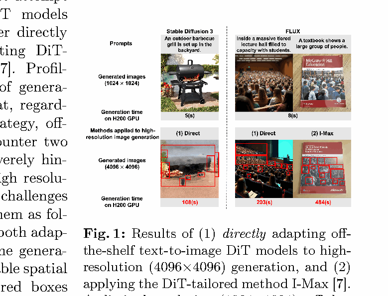

红框展示对象局部结构错误或重复；红字展示高分辨率推理耗时。该图说明单纯接受更大噪声尺寸并不能保持空间一致性。

**图 2：注意力耗时占比。**

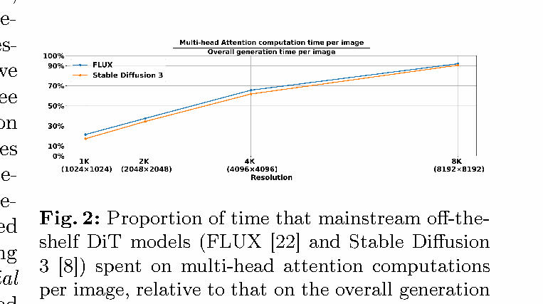

随分辨率增大，FLUX 和 SD3 的多头注意力时间比例逼近并超过 90%。图直接支持 HAP 的目标：主要压缩注意力，而非随机削减网络层。

### 5.2 主结果和质量对比

**表 1：2K 与 4K 主结果。**

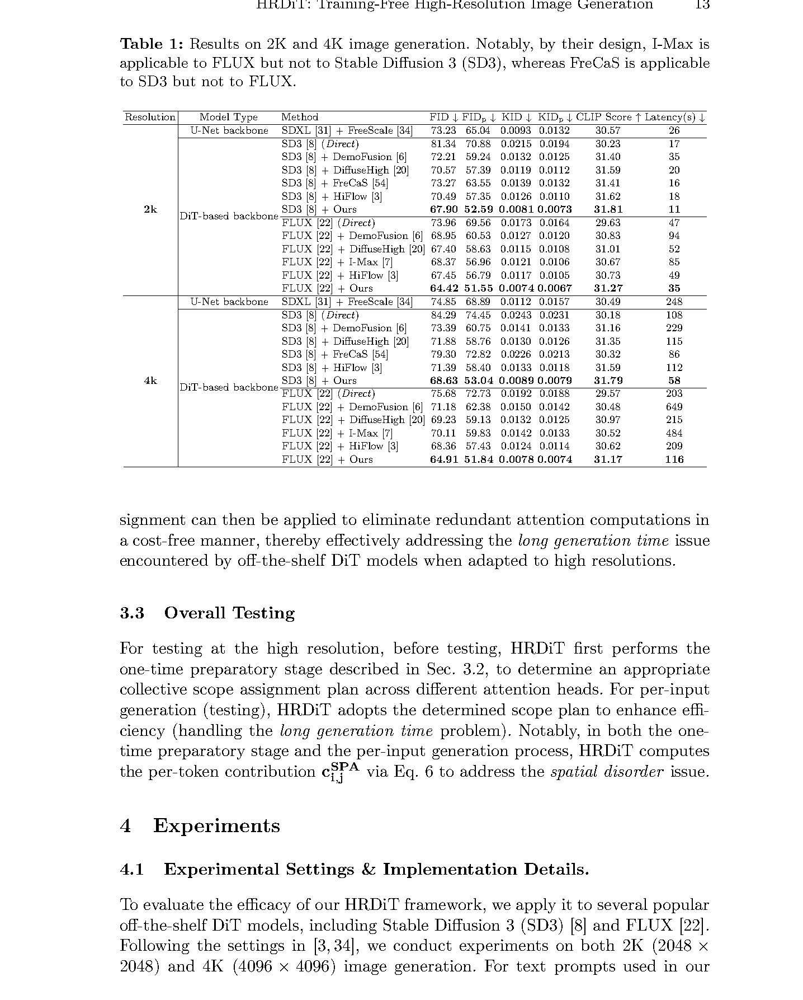

HRDiT 在两种 DiT 骨干、两种分辨率中均取得最优质量指标。4K FLUX 下，HRDiT 的 FID 为 64.91、延迟为 116 秒；直接外推为 75.68、203 秒，HiFlow 为 68.36、209 秒。

**图 4：4K 定性比较。**

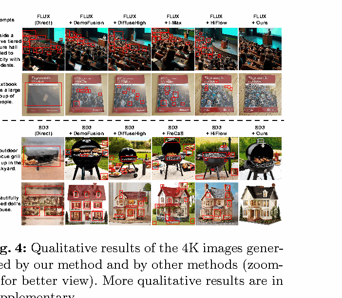

对比方法在复杂对象、密集纹理和重复结构处更易出现错位；HRDiT 的结果显示更连贯的布局与对象边界。

**表 3：8K 结果。**

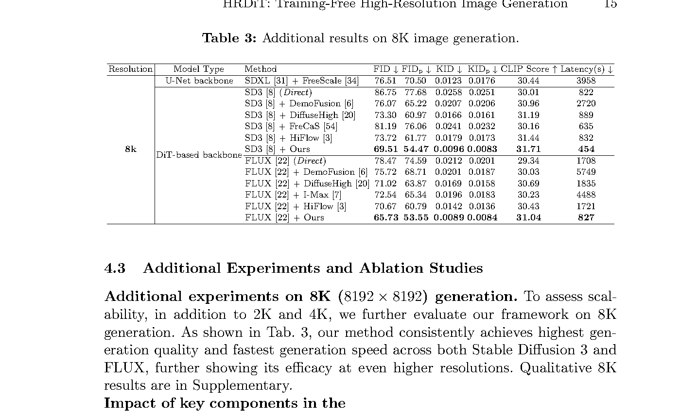

8K FLUX 下，HRDiT 的 FID 为 65.73，延迟 827 秒；在论文列出的比较方法中兼具最低 FID 与最低同骨干延迟。8K 仍耗时较长，说明方法显著改善但未消除超高分辨率生成的工程成本。

### 5.3 SPA 与 HAP 消融

**表 2：核心组件消融。**

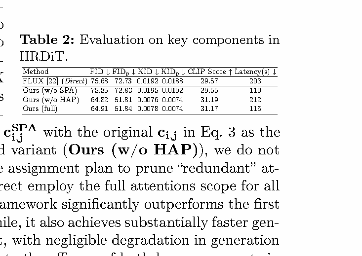

仅使用 SPA，即关闭 HAP、保留完整注意力时，FLUX 4K 的 FID 从直接外推的 75.68 降至 64.82，局部 FID 从 72.73 降至 51.81，CLIP 从 29.57 升至 31.19；延迟仅从 203 秒增至 212 秒。因此 SPA 单独带来约 14.4% 的 FID 相对改善与约 28.8% 的局部 FID 相对改善，主要负责质量提升。完整 HRDiT 将延迟进一步降至 116 秒，表明 HAP 主要负责加速。

**表 4：SPA 内部消融。**

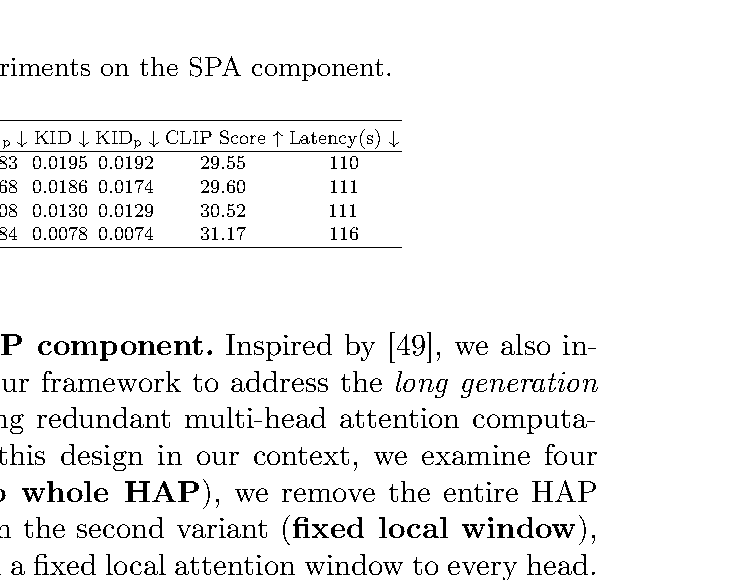

移除整个 SPA 或只保留 Bundle 都明显降低质量；简单将坐标按训练分辨率比例缩小也不够有效。结果支持论文的设计取舍：Bundle 用于减少位置关系数量，Slide 用于恢复 bundle 内位置辨别，缺一不可。

**表 5：HAP 内部消融。**

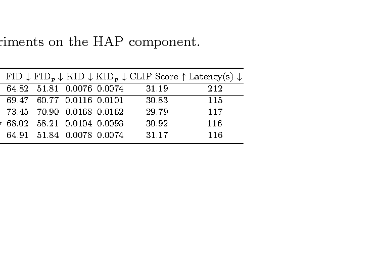

固定窗口、随机窗口和中间特征损失引导的窗口都能加速，但会造成较大质量下降。逐头、以最终生成质量敏感度估计窗口的 HAP 在接近 116 秒延迟下保持了最优质量。

### 5.4 人工评测、参数与准备成本

**表 6：人工评测。**

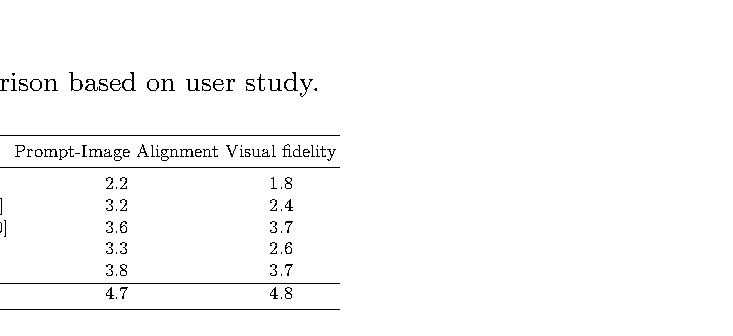

五位参与者对 100 个 4K FLUX 结果评分；HRDiT 的提示词一致性为 4.7、视觉保真度为 4.8，均为最高。

**表 7：准备时间。**

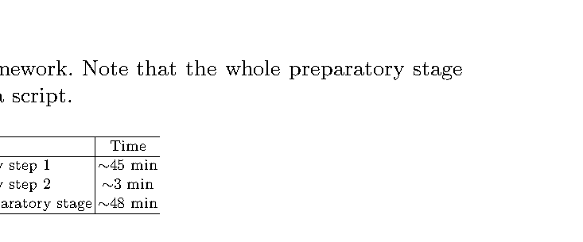

FLUX 4K 的一次性 HAP 准备约 48 分钟。该时间不计入单张图的延迟，却是实际部署应考虑的前置成本。

**表 8：候选窗口数。**

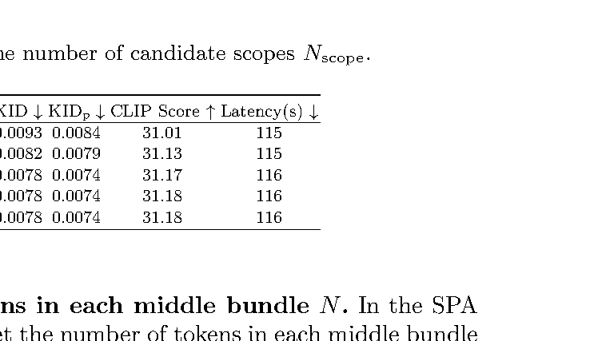

候选窗口数由 10 增至 50 时质量逐步提升；超过 50 后基本饱和，故取 50。

**表 9：SPA bundle 大小。**

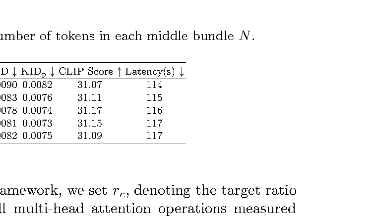

4K 下中间 bundle 大小为 5 或 6 时质量最好，论文选取 5。

**表 10：注意力预算比例。**

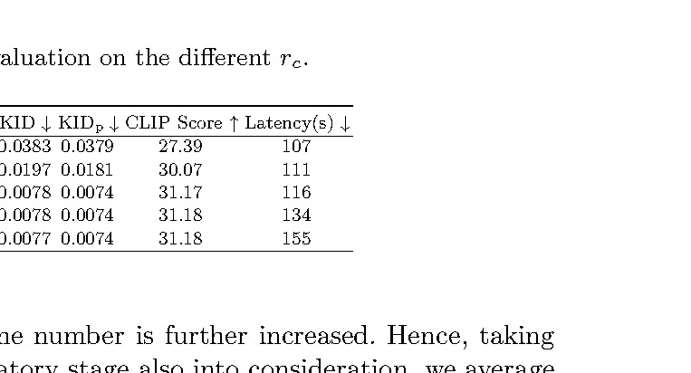

预算从 0.01 到 0.1 可显著改善质量；超过 0.1 后质量几乎不再改善而延迟继续增加，因此取 0.1。

**表 11：估计阶段提示词数量。**

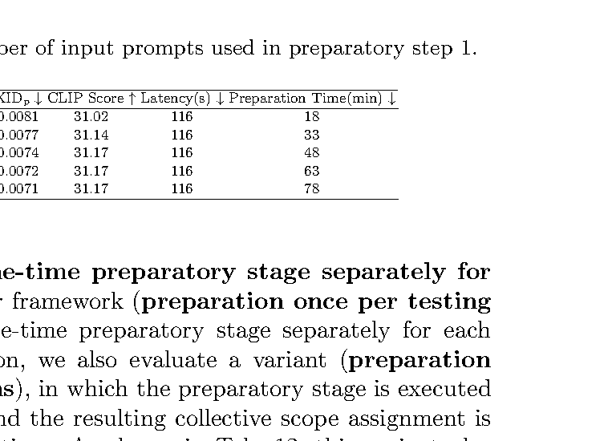

从 10 增至 30 条提示词能稳定提升窗口计划质量；更多提示词增益很小，但准备时间继续上升。

### 5.5 计划复用与补充比较

**表 12：分辨率专属计划。**

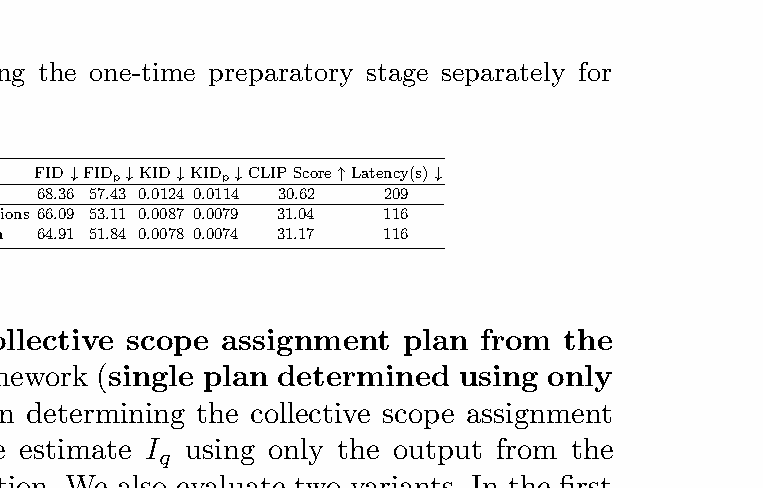

在所有分辨率复用一次 1K 准备计划仍优于 HiFlow，但按分辨率独立准备可进一步降低 FID，说明注意力头的最优范围与分辨率有关。

**表 13：去噪步计划。**

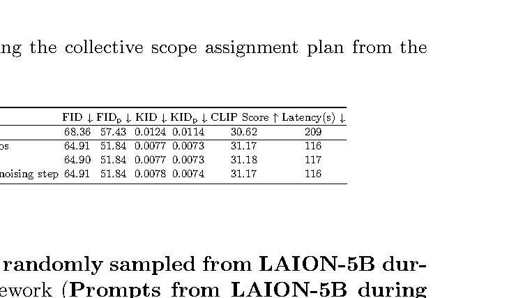

仅按最终去噪步确定单一计划，与按全部步平均或逐步单独计划的表现近似，支持作者“注意范围跨去噪步较稳定”的经验结论。

**表 14：准备提示词来源。**

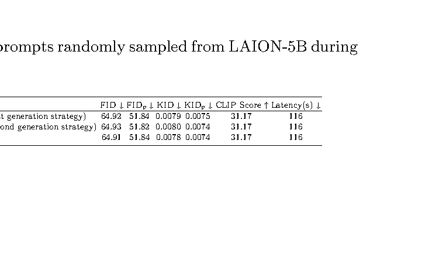

论文还比较了不同提示词来源；随机 LAION-5B 提示词在该准备过程上表现可靠。

**表 15：与高分辨率方法的补充比较。**

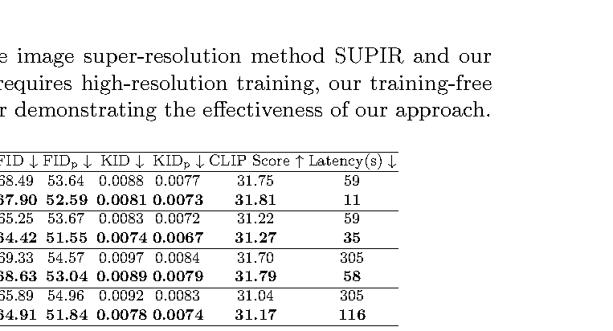

该补充表延续了质量—效率权衡的验证：HRDiT 的优势来自免训练位置修正与逐头稀疏注意力的组合，而不是仅依赖增加采样步骤。

### 5.6 补充定性结果

**图 5：2K 结果。**

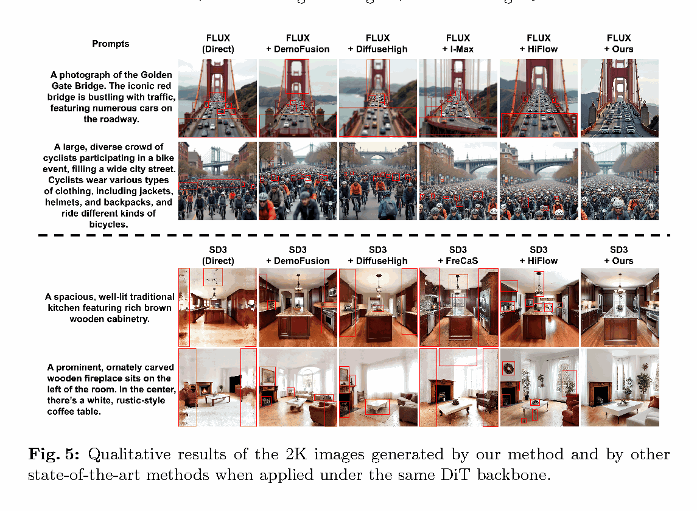

**图 6：4K 补充结果。**

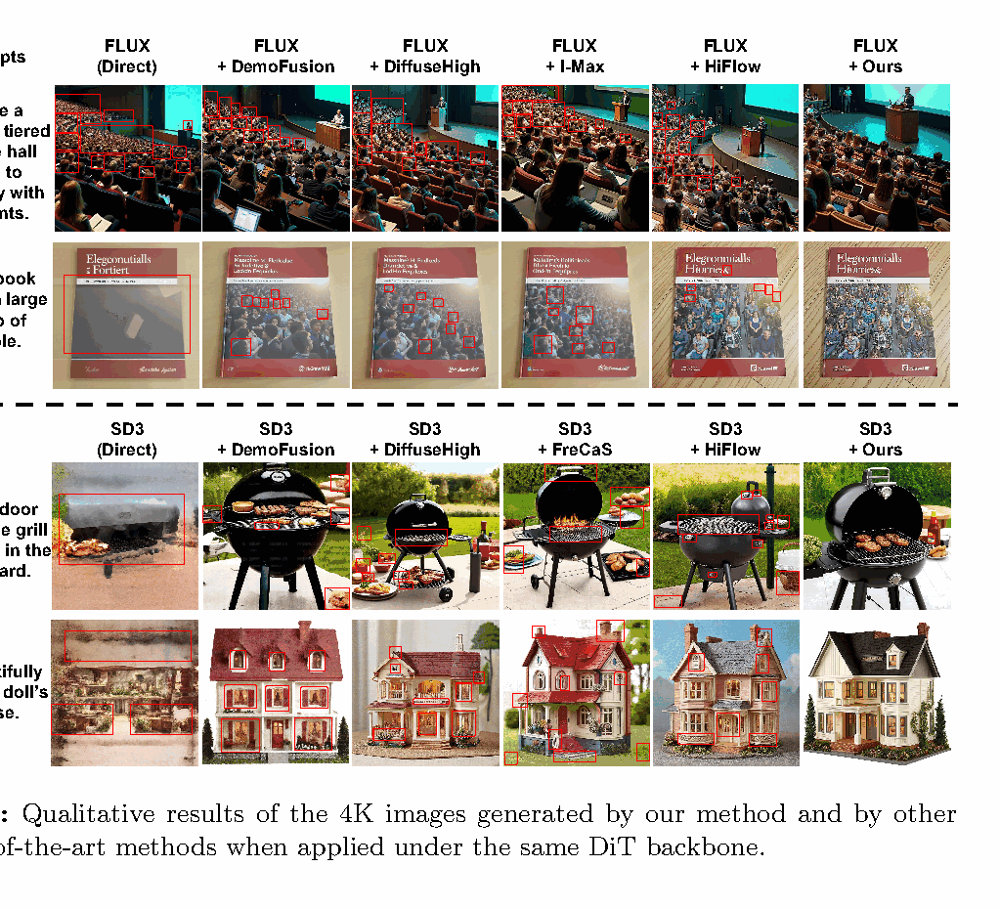

**图 7：8K 结果。**

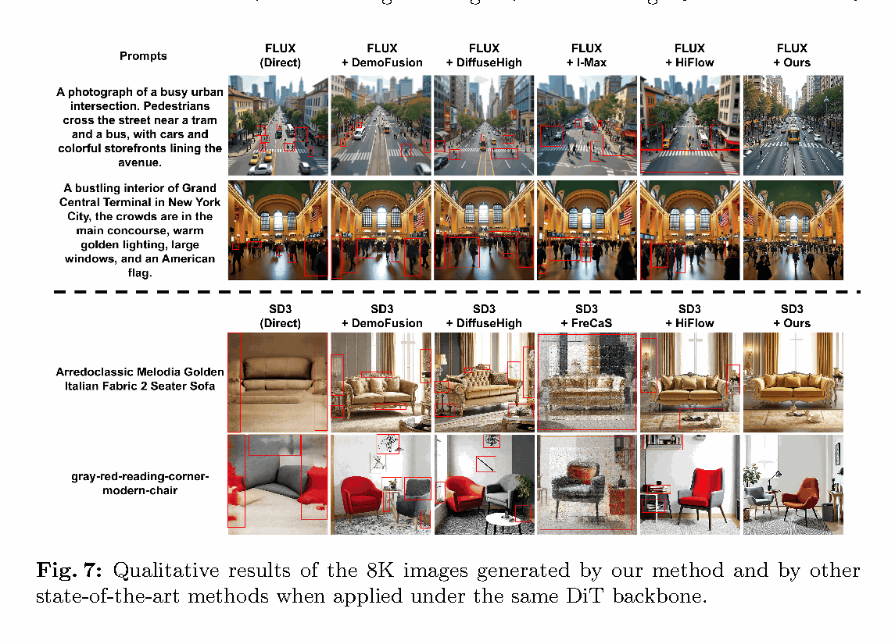

三组补充图在不同分辨率下均显示：对比方法更易在局部物体、重复纹理或长距离布局上出错；HRDiT 的改进不是只发生在某一个分辨率。

## 六、主要发现

- 高分辨率 DiT 的空间错误可由位置编码外推能力不足解释，SPA 能在不训练的前提下显著改善空间和局部质量。
- SPA 单独使用时，FLUX 4K FID 为 64.82，优于直接外推的 75.68；其速度代价约 9 秒。
- HAP 以很小的质量损失换取大幅提速，使 FLUX 4K 从仅 SPA 的 212 秒降至 116 秒。
- 2K、4K、8K 及人工评测均支持 HRDiT 的质量与效率优势。

## 七、核心贡献

1. 将 DiT 高分辨率外推的核心障碍拆分为位置表达与注意力成本两个问题。
2. 提出仅修改位置 ID、兼容原位置编码的 SPA。
3. 提出依据最终图像质量敏感度进行逐头窗口分配的 HAP。
4. 在 FLUX 与 SD3 的多个分辨率中展示了免训练高分辨率生成的质量—效率改进。

## 八、研究局限

- 免训练不代表无前置成本：HAP 对每个目标分辨率的准备可能需数十分钟。
- 验证只覆盖 FLUX.1-dev、SD3 Medium 和 LAION 风格提示词，跨模型、跨领域泛化未充分报告。
- HAP 的质量代价来自一阶近似，可能遗漏不同剪枝决策之间的高阶耦合。
- 8K 生成仍需数百秒，工程可用性依赖更强硬件与进一步系统优化。
- SPA 多变体注意力会产生额外计算；其变体数量和不同长宽比下的最优分组策略仍值得研究。

## 九、论文总结

HRDiT 的核心价值是把高分辨率 DiT 外推从“直接放大 token 网格”的问题，变为可分别处理的位置辨别和计算预算问题。SPA 通过多组 bundle-slide 位置 ID 使原 RoPE 在高分辨率下保持更稳定的空间区分；HAP 则保留不同注意力头真正需要的范围。该框架特别适合已有 FLUX 或 SD3 权重、希望避免重新训练但需要提升输出分辨率的应用。其主要工程权衡是一次性的分辨率专属准备时间。

