# Refusion: Enabling Large-Size Realistic Image Restoration with Latent-Space Diffusion Models

## 一、论文基本信息

- **论文类型**：扩散模型 / 真实图像恢复。
- **发表信息**：CVPR Workshops 2023；arXiv:2304.08291，2023 年 4 月 17 日提交。
- **作者**：Ziwei Luo、Fredrik K. Gustafsson、Zheng Zhao、Jens Sjölund、Thomas B. Schön。
- **作者单位**：Uppsala University, Sweden。
- **论文链接**：[arXiv](https://arxiv.org/abs/2304.08291)
- **代码仓库**：[Algolzw/image-restoration-sde](https://github.com/Algolzw/image-restoration-sde)
- **关联工作**：本文建立在作者的 IR-SDE 上。IR-SDE 提出均值回归 SDE 和最大似然反向轨迹训练；Refusion 保留该扩散框架，重点解决真实复杂退化与大尺寸输入下的效率和感知质量问题。

## 二、摘要总结

真实图像恢复中的阴影、非均匀雾、镜头散景差异和双目低分辨率并不易由显式退化模型描述。尽管扩散模型可生成更自然的纹理，直接在整幅高分辨率图像上反复去噪十分昂贵，且不同网络和训练超参数会显著影响复原结果。本文提出 Refusion，以均值回归随机微分方程将清晰图像逐步变换到低质量观测，再用反向过程恢复清晰结果。作者以时间条件化的 NAFNet 替换原有噪声预测 U-Net，并系统比较噪声尺度、去噪步数、训练 patch 和优化器。

针对 2K 至 6K 图像，论文提出基于 U-Net 的潜空间扩散。编码器把低质量图像压缩为低分辨率 latent，扩散仅在其中运行；与此同时，低质量图像的多尺度隐藏特征经跳连提供给解码器，避免传统 VAE-GAN 潜变量压缩丢失细节。该 U-Net 先通过 latent-replacing 目标预训练，再冻结并训练 latent-space 扩散网络。Refusion 被验证于真实去阴影、立体超分、散景转换和 6000×4000 非均匀去雾；其在 NTIRE 2023 Shadow Removal Challenge 总榜第 2，且取得最佳 LPIPS 和 MOS。

## 三、研究背景

### 3.1 已有研究进展

CNN、Transformer 等直接复原网络一般以像素级 L1/L2 损失优化，擅长提高 PSNR/SSIM，但会在不确定纹理区域产生过平滑结果。预训练扩散先验可以产生更逼真的图像，但很多方法依赖 ImageNet、FFHQ 等专门预训练集，或需要已知退化参数，在真实场景中适用性有限。

IR-SDE 用低质量图像作为均值回归目标，可以用成对的高/低质量数据隐式学习复杂退化，而无需手工指定噪声或雾模型。其不足是：仍需在全分辨率空间执行多步反向扩散，原始噪声网络也较重，因此难以处理完整的大尺寸图像。

### 3.2 具体科学问题

本文要解决的是：如何在不显式建模真实退化的前提下，保持扩散模型的感知质量；以及如何将多步扩散扩展到完整的 6000×4000 图像。论文的策略是把“昂贵的随机生成过程”移到低分辨率 latent，把“输入结构和局部细节”保留在 U-Net 跳连中。

## 四、研究方法

### 4.1 数据来源和适用范围

| 任务 | 训练 / 验证数据 | 任务条件 |
| --- | --- | --- |
| 去阴影 | NTIRE 2023 Shadow Removal：1,000 对训练图，100 张验证图 | 阴影图到无阴影图 |
| 立体超分 | NTIRE 2023 Stereo SR，Flickr1024：800 对训练、112 对验证 | 双目左右低分辨率图；由 bicubic 生成 |
| 散景转换 | NTIRE 2023 Bokeh：10,000 对合成训练图、500 张验证图 | 源/目标镜头信息；保护清晰前景 |
| HR 非均匀去雾 | NTIRE 2023 HR Dehazing：40 对训练图、10 张验证/测试图 | 图像为 6000×4000；验证/测试清晰真值不可得，因此仅定性评估 |

图 1 给出这四类任务的实例。它们共同特点是退化复杂且分辨率高，因此不能简单视为标准高斯去噪。

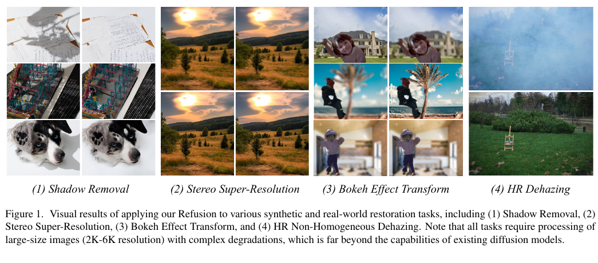

### 4.2 均值回归 SDE：将清晰图像扩散到低质量条件

Refusion 采用 IR-SDE。其前向过程让状态由高质量图像向低质量图像的均值回归：

$$
dx=\theta_t(\mu-x)dt+\sigma_tdw
$$

这里，初始状态是高质量图像；均值项是对应的低质量图像；时间相关的回归速度控制向低质量观测靠近的快慢，随机项注入噪声。该构造不要求预先给出阴影、雾或镜头模糊的解析退化模型。

当噪声和回归速度满足论文的比例约束时，任意时间的边缘分布为：

$$
p_t(x)=\mathcal{N}(x(t)\mid m_t,v_t)
$$

其中，均值从高质量初始图像逐渐迁移至低质量观测，方差由固定噪声尺度控制。训练可从该闭式分布采样中间状态并获得监督所需的真实 score。

反向 SDE 为：

$$
dx=[\theta_t(\mu-x)-\sigma_t^2\nabla_x\log p_t(x)]dt+\sigma_td\hat{w}
$$

第一项保持低质量条件约束，网络估计的 score 项则使状态沿高质量图像分布反向演化。推理时从低质量条件的带噪状态开始，反复执行该反向更新得到复原结果。

#### 4.2.1 Maximum-Likelihood 反向一步损失

IR-SDE 没有简单地以最终复原图和高质量真值计算重建损失，也没有只让网络拟合某一时刻注入的瞬时噪声。训练时先从前向闭式分布随机采样一个带噪状态；由于对应的高质量初始图像和低质量均值条件均已知，论文可以由条件高斯后验解析计算该状态的最优反向一步落点。网络预测噪声或 score 后，经反向 SDE 漂移项得到预测落点，并用下式监督：

$$
\mathcal{L}_{\mathrm{ML}}=\mathbb{E}\left[\left\lVert\hat{x}_{i-1}^{\mathrm{reverse}}-x_{i-1}^{*}\right\rVert\right]
$$

预测项是网络根据当前带噪状态、低质量条件和时间步计算的反向一步均值；目标项是结合高质量真值解析得到的最优后验状态。该式直接约束推理时真正执行的反向转移，因此比仅拟合瞬时噪声更接近复原轨迹。所谓“轨迹损失”不表示训练时展开完整的 100 步并反向传播：每次只随机抽取一个时间步，监督该时间步的局部落点，所有时间步共同塑造完整轨迹。

在原始 IR-SDE 中，上述状态与图像同尺寸，因而损失数值是在图像状态空间逐像素、逐通道计算；在 Latent Refusion 第二阶段，完全相同的反向一步目标被移到 latent 空间。它与直接图像 L1/L2 的区别在于监督对象：后者比较单次前馈的最终输出和高质量真值，前者比较随机扩散时刻的预测反向落点与解析最优落点。

严格的高斯负对数似然会产生带后验方差权重的二次项；论文将训练目标写为范数形式，开源配置默认以 L1 实现这一落点距离。因此，“Maximum-Likelihood”指目标由条件后验似然推导而来，并不意味着代码必须使用 L2。L1 对真实配对中的局部异常值和轻微错位更稳健；L2 与高斯负对数似然的形式更直接，但会放大少量大误差。

#### 4.2.2 与 FLUX.2 Flow Matching 速度损失的区别

FLUX.2 属于 latent flow matching 模型。标准 Flow Matching 在随机噪声 latent 与真实图像 latent 之间采样连续中间状态，网络直接预测该处的瞬时速度：

$$
z_t=(1-t)z_0+t z_1
$$

这里，起点是随机噪声 latent，终点是真实图像 latent；该插值只用于构造训练状态。条件可以是文本，在编辑模型中还可以包含参考图像。

$$
\mathcal{L}_{\mathrm{FM}}=\mathbb{E}\left[\left\lVert v_{\theta}(z_t,t,c)-(z_1-z_0)\right\rVert_2^2\right]
$$

网络输出的是连续向量场的局部导数，推理时对该速度场积分得到整条生成轨迹。相比之下，IR-SDE 网络虽然先预测噪声或 score，但损失直接评价离散反向一步最终落在哪里。两者都会通过局部监督决定完整轨迹，不过直接优化量分别是“速度”和“一步落点”。

| 维度 | FLUX.2 Flow Matching | IR-SDE Maximum-Likelihood |
| --- | --- | --- |
| 直接监督量 | 连续时间的瞬时速度 | 离散反向一步后的状态 |
| 路径端点 | 随机噪声 latent 与数据 latent | 高质量图像与以低质量图像为均值的噪声状态 |
| 条件 | 文本、参考图等生成条件 | 与高质量真值配对的低质量图像 |
| 常用距离 | 速度 MSE/L2 | 后验落点范数；仓库默认 L1 |
| 优点 | 目标简单平滑、适合大规模数据、无需成对退化图、生成多样性强 | 训练与反向复原步骤一致、充分利用 LQ/HQ 对、保真约束强、复杂退化下更稳定 |
| 局限 | 不直接保证指定输入的像素保真，积分误差可能累积，欠约束复原中可能产生合理但错误的细节 | 依赖严格配对数据和线性高斯均值回归假设；对离散步数、噪声日程敏感，多样性较弱 |

因此，Flow Matching 更适合学习“怎样从噪声流向整个条件图像分布”，IR-SDE 更适合学习“给定这张退化图，当前反向一步怎样回到其对应清晰图”。若将两者用于生成式图像恢复，Flow Matching 通常还需要数据一致性或重建约束以减少幻觉；IR-SDE 则需要处理真实配对误差和前向过程假设带来的偏差。

图 2 左侧说明不同任务都可共享这一“HQ 到 LQ 的前向、LQ 到 HQ 的反向”框架。

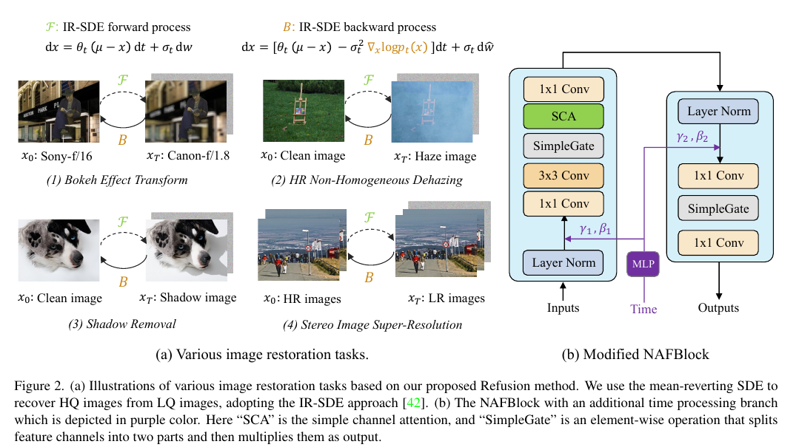

### 4.3 U-Net 潜空间扩散

全分辨率的多步扩散是本文的主要瓶颈。作者以预训练 U-Net 取代传统 latent diffusion 中的 VAE-GAN：编码器把低质量输入压缩为 latent，IR-SDE 在低分辨率 latent 上把低质量 latent 反演为高质量 latent，解码器再输出高质量图像。

更重要的是，编码器的多尺度 hidden feature 沿跳连直接送入解码器。扩散只修改中间 latent；跳连携带低质量图像的结构、布局和局部细节，帮助解码器输出空间上准确的图像。图 3 中灰色块是执行扩散的 latent，蓝色虚线表示跨编码器—解码器的隐藏连接。

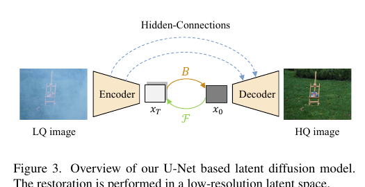

### 4.4 latent-replacing 预训练

潜 U-Net 需要同时做到两件事：低质量 latent 包含退化相关信息，解码器又能利用“已变换的 latent + 原输入 hidden feature”重建高质量结果。作者因此先独立训练该 U-Net：

1. 编码低质量图像，并用低质量 latent 和低质量 hidden feature 重建低质量图像；
2. 编码对应高质量图像；保持低质量 hidden feature 不变，但将解码器输入 latent 换成高质量 latent，并要求输出高质量图像；
3. 两条分支均使用 L1 重建损失。论文不使用 GAN 或对抗损失，也未在正文给出两项损失的权重。

这使解码器在第二阶段见到“经扩散恢复的高质量 latent”时，仍能和低质量输入的 skip feature 正确融合。

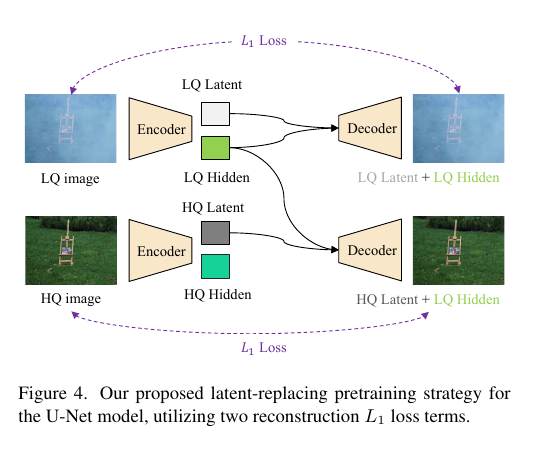

### 4.5 时间条件化 NAFNet 噪声网络

原始 IR-SDE 的噪声预测网络为带残差块与注意力的 U-Net。Refusion 改用 NAFNet 风格的 Conditional NAFNet：SimpleGate 将通道分为两部分后逐元素相乘；SCA 是简单通道注意力。作者额外用 MLP 将扩散时间嵌入映射为通道级缩放和偏移参数，并在注意力/前馈子层中调制特征。该网络的输入是当前噪声状态和低质量条件，输出噪声或等价的 score 估计。

散景任务还融合镜头条件；立体超分使用双输入。图 2 右侧的紫色支路就是时间条件支路。相比 U-Net 主干，改造 NAFNet 的学习曲线更好。

### 4.6 训练策略与实现细节

作者在去阴影任务上比较四组训练因素：

- **噪声水平**：比较 10、30、50、70；50 或 70 比 10 更稳定，正式实验固定为 50。
- **去噪步数**：比较 100 与 1,000；从头训练的 IR-SDE 在 100 步下达到相当甚至更好的结果，因此正式实验使用 100 步。
- **训练 patch**：256×256 优于 128×128。
- **优化器与调度器**：AdamW + cosine 和 Lion + cosine 略优于 Adam + multi-step；正式实验选 Lion。

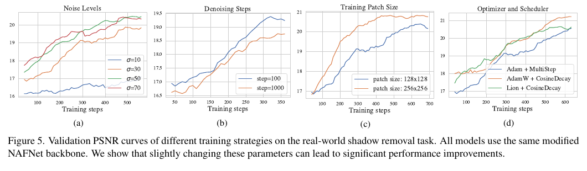

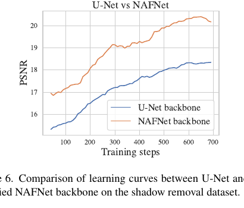

所有实验使用 batch size 8、256×256 训练 patch、随机水平翻转和 90 度旋转。优化器为 Lion，两个 beta 参数为 0.9、0.99；初始学习率为 3×10^-5，经 cosine schedule 衰减至 10^-7。模型在单张 A100 上训练约三天。去阴影和立体超分以普通扩散训练 500,000 iteration；去雾和散景采用两阶段 latent 方案：先训练 U-Net 300,000 iteration，再基于该 U-Net 训练 Refusion 400,000 iteration。此阶段原始输入裁为 1024×1024，压缩到 128×128 latent。

### 4.7 训练与推理流程

**普通 Refusion**：对配对 LQ/HQ 图像采样随机时间和前向噪声状态；以 LQ 为均值条件，NAFNet 预测 score；最大似然反向一步目标约束预测反向均值接近由 HQ 导出的最优反向均值；推理时迭代 100 步得到输出。

**Latent Refusion**：先完成第 4.4 节的 U-Net 预训练。第二阶段冻结 U-Net；编码 LQ 得到低质量 latent 和 hidden feature，编码 HQ 得到训练目标 latent；在 latent 上训练 NAFNet。推理时只编码 LQ 一次，在 latent 空间完成反向 SDE，再用恢复 latent 与原 LQ hidden feature 解码。这是其能处理 6K 图像的直接原因。

## 五、图表分析

### 5.1 立体超分、去阴影与散景的定量结果

表 1 显示，立体超分中 NAFSSR 有最高 PSNR/SSIM，但 Refusion 的 LPIPS 为 0.155、FID 为 22.43，均优于 NAFSSR 和 IR-SDE，说明其感知质量更好。表 2 的去阴影结果中，Refusion 在 PSNR、RMSE、LPIPS、FID 上整体最佳，并把相对 IR-SDE 的运行时间从 175.8 秒降至 38.4 秒。表 3 中，全分辨率 Refusion 的 FID 最佳；Latent Refusion 的 LPIPS 最佳且推理 6.9 秒，明显快于全分辨率 Refusion 的 36.0 秒。

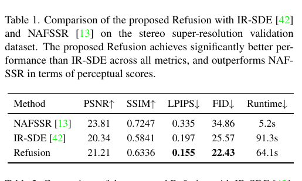

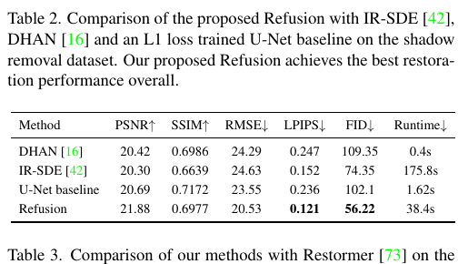

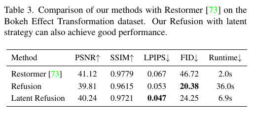

### 5.2 去阴影与立体超分可视化

图 7 的三行分别为输入、直接 L1 训练 U-Net、Refusion。作者指出训练对中存在轻微位置偏移和亮度差，直接 L1 回归会把偏移或亮度也当作学习目标；扩散结果更能去除阴影而保留物体结构。图 8 则显示 Refusion 相比 NAFSSR 产生更锐利、清晰的超分细节。

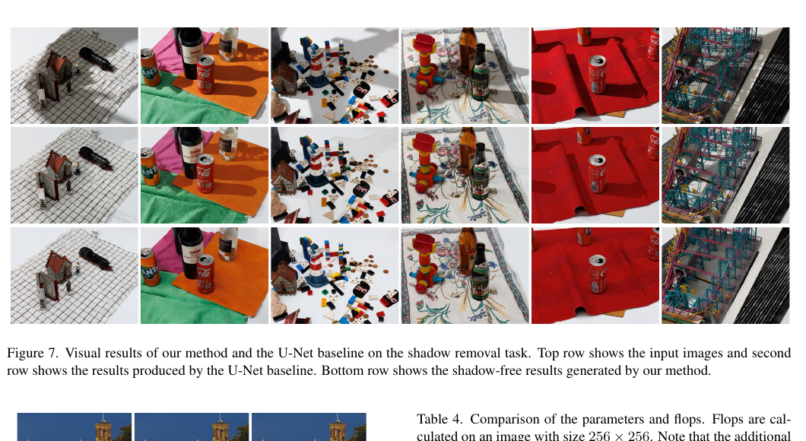

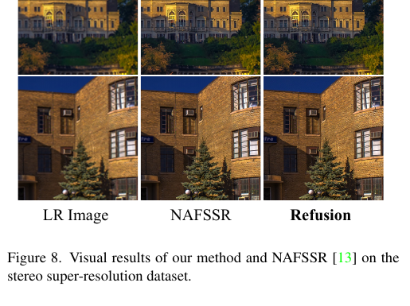

### 5.3 散景、去雾与复杂度

图 9 表明在由模糊散景转为清晰散景的困难方向，Refusion 比 Restormer 保留了更锐利的边缘。图 10 展示完整 6000×4000 图像的非均匀去雾输入/输出；这是普通 IR-SDE 和全分辨率 Refusion 无法完整处理的情形。

表 4 的 FLOPs 在 256×256 上测得：IR-SDE 为 119.1G，Refusion 为 63.4G，Latent Refusion 的扩散网络仅 4.0G。后者还需要一次 6M 参数、70G FLOPs 的潜 U-Net 前后处理，但该 U-Net 推理时只执行一次，而不是每个扩散步重复执行。

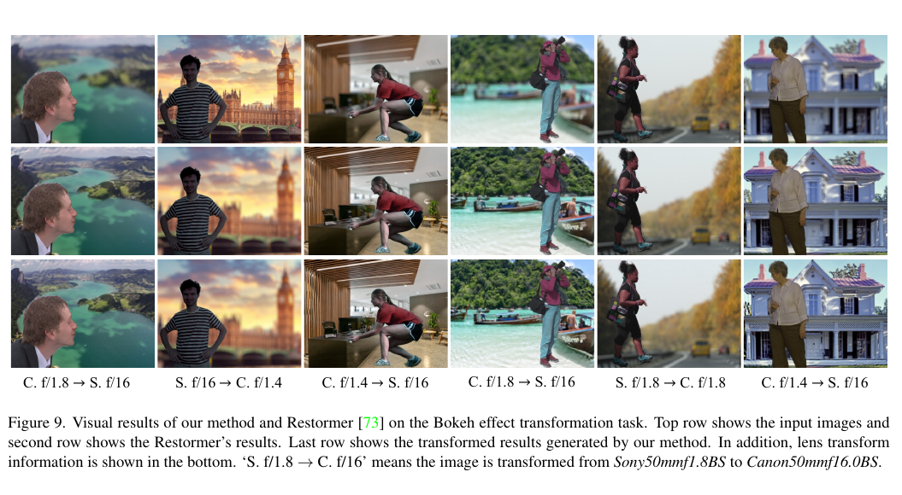

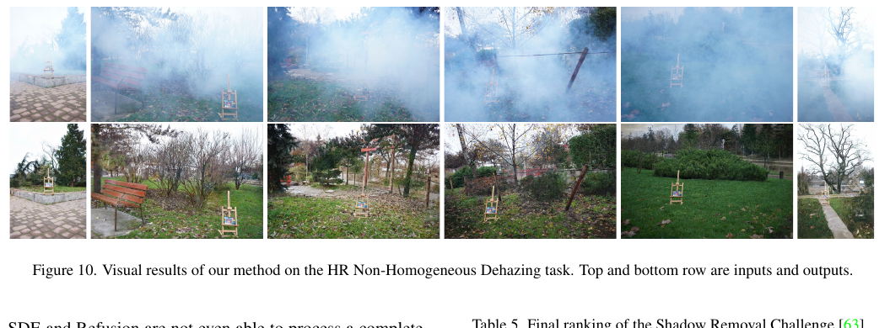

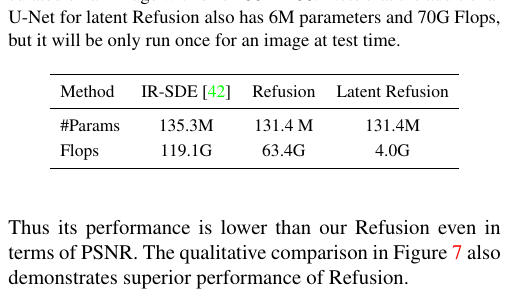

### 5.4 挑战赛结果

论文参加四项 NTIRE 2023 挑战。去阴影总榜中，作者方法为第 2 名；其 PSNR/SSIM 不是最高，但 LPIPS 为 0.149、MOS 为 8.94，均为表中最佳。这与论文将感知真实性置于单纯像素指标之前的主张一致。

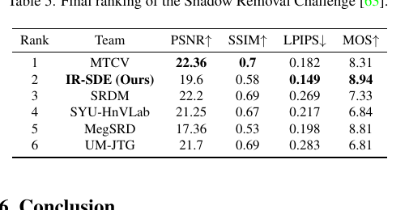

## 六、主要发现

1. 在复杂真实退化中，调优扩散的噪声尺度、步数、patch 和优化器能带来显著提升，不能只把网络结构视为决定因素。
2. NAFNet 式噪声网络同时改善计算效率和训练性能；Refusion 在去阴影中整体优于 IR-SDE 与直接 L1 回归基线。
3. 潜空间扩散显著降低每个反向去噪步骤的计算，并借助 U-Net hidden connection 缓解低维压缩损失。
4. 感知指标和像素指标存在取舍：立体超分中 Refusion 未取得最高 PSNR，但得到更低 LPIPS/FID；去阴影挑战中也以更优感知质量获得强主观评分。

## 七、核心贡献

1. 将均值回归扩散改造为面向真实图像复原的高效 Refusion 系统，并覆盖四类异质任务。
2. 提出 U-Net latent diffusion：在低分辨率 latent 执行扩散，保留输入的多尺度 hidden feature 给解码器。
3. 提出不依赖 GAN 的 latent-replacing 预训练，使潜编码器的训练更稳定。
4. 以时间调制 NAFBlock 替换原始噪声 U-Net，并给出噪声水平、步数、patch 和优化器的实证规律。
5. 展示完整 6000×4000 图像上的潜空间扩散复原能力。

## 八、研究局限

- 去雾数据仅有 40 对训练图，验证/测试清晰图像不可获得，论文只能提供定性结果，缺少客观泛化评估。
- Latent Refusion 虽然快很多，但散景实验中 FID 略高于全分辨率 Refusion，说明压缩仍可能损失部分感知分布细节。
- 去阴影、散景、去雾等任务主要集中于 NTIRE 2023 数据，跨数据集、跨传感器或跨真实采集条件的泛化尚未系统验证。
- Maximum-Likelihood 反向落点依赖成对 LQ/HQ 和预设的线性高斯均值回归过程；当训练对错位或真实退化显著偏离该过程时，解析最优落点未必等同于物理上真实的反向路径。
- 与 Flow Matching 的分布生成目标相比，IR-SDE 对单一配对真值的约束更强，适合保真复原但可能抑制严重欠定任务中的合理多样性。
- 论文没有完整公开 latent-replacing 两项 L1 损失的权重、不同任务条件编码的全部实现细节；复现时需要结合代码仓库。
- 相对直接前馈网络，100 步扩散仍有明显推理开销；Latent Refusion 的高效率不等同于实时处理。

## 九、论文总结

Refusion 不是重写 IR-SDE 的理论基础，而是把它变为更适合真实高分辨率复原的系统。其关键设计是把迭代且昂贵的扩散移动到低分辨率 latent，同时让低质量输入的多尺度特征绕过瓶颈直达解码器。对于工程实现，这说明可将“全局生成与不确定性建模”放进压缩空间，而把“位置、边界和局部纹理保真”交给跳连条件；这种分工是本文在大图复原中最具实践价值的启发。
