# Resfusion: Denoising Diffusion Probabilistic Models for Image Restoration Based on Prior Residual Noise

## 一、论文基本信息

| 项目 | 内容 |
| --- | --- |
| 论文类型 | 扩散模型 |
| 发表信息 | NeurIPS 2024；arXiv 初稿于 2023 年 11 月提交，本文依据 2024 年 10 月的 v4 版本 |
| 作者 | Zhenning Shi、Haoshuai Zheng、Chen Xu、Changsheng Dong、Bin Pan、Xueshuo Xie、Along He、Tao Li、Huazhu Fu |
| 作者单位 | 南开大学、海河实验室、A*STAR 等 |
| 论文链接 | [arXiv 摘要](https://arxiv.org/abs/2311.14900) · [arXiv 全文](https://arxiv.org/html/2311.14900v4) |
| 代码与模型 | [nkicsl/Resfusion](https://github.com/nkicsl/Resfusion) |

## 二、摘要总结

传统条件扩散模型通常从高斯白噪声生成干净图像，仅将退化图像作为网络条件。然而，去阴影、低光增强和去雨滴等任务的输入已包含场景结构及部分纹理信息，从白噪声重新形成这些内容会增加采样成本。Resfusion 因此把退化图像与干净真值的残差直接引入前向扩散，使反向过程可以从加噪退化图像对应的中间状态开始。作者进一步从前向后验均值推导出残差与高斯噪声的时间步权重，将二者合并为单一预测目标 resnoise；这样一个 U-Net 就能完成预测，反向更新仍保持 DDPM 的形式。针对测试时无法获得干净真值的问题，论文用“平滑等价变换”寻找真实前向状态与仅凭退化图像可构造状态最接近的时间步，并通过截断噪声日程降低离散时间步造成的偏差。实验在 ISTD、LOL 和 Raindrop 上以五步恢复取得有竞争力的结果，消融实验支持联合预测残差与噪声的设计。框架还被用于图像生成和翻译，但这些扩展实验采用不同的采样步数。论文展示了低步数恢复的潜力；其相对优势仍取决于数据集、分辨率、评价指标及基线选择。[来源：论文全文](https://arxiv.org/html/2311.14900v4)

## 三、研究背景

### 3.1 已有研究进展

传统扩散式恢复沿用从高斯噪声开始的反向链，把退化图像作为条件送入网络。这一做法没有充分利用输入图像已保留的结构。InDI、IR-SDE、I²SB、Resshift 和 RDDM 等工作尝试在退化图像与目标图像之间直接建模。作者特别指出，RDDM 分别预测残差与噪声，没有给出二者的明确时间步权重，并需要专门设计噪声日程。这里对已有方法的评价是论文作者的比较观点，具体优劣仍须结合各方法实验设置判断。

### 3.2 具体科学问题

训练时可以使用成对的退化图像与真值，测试时却只能使用退化图像。若扩散中间状态依赖未知真值，就不能直接把它作为推理起点。本文要同时解决：如何构建与退化输入相关的前向过程；如何推导一个可由单网预测且符合反向后验的目标；如何选择测试时可构造的中间起点，并控制离散噪声日程带来的初始化偏差。

## 四、研究方法

### 4.1 数据来源和范围

| 任务 | 数据集与规模 | 输入、真值及条件 |
| --- | --- | --- |
| 去阴影 | ISTD：1,330 组训练三元组，540 组评价三元组 | 阴影图、阴影掩码与无阴影图；网络条件包含阴影图和掩码 |
| 低光增强 | LOL：485 对训练图像，15 对评价图像 | 低光图与正常曝光图；不使用 GT-mean、直方图均衡等前后处理 |
| 去雨滴 | Raindrop：861 对训练图像，58 对 Raindrop-A 评价图像 | 带雨滴图与目标图；附加视觉测试包括更困难的 Raindrop-B |
| 额外低光验证 | LOL-v2-real：689 对训练图像，100 对评价图像 | 与 LOL 使用相同实验设置，含噪声及偏色等退化 |
| 扩展任务 | CIFAR-10、CelebA-HQ、AFHQV2 | 分别用于图像生成和图像翻译 |

三项主要恢复任务训练时使用 256 × 256 图像块，依赖退化图像与目标图像配对。论文未报告无配对恢复训练。不同表格分别使用缩放后与原始分辨率评价，且 LOL、Raindrop 的色彩空间设置有差异，不能跨设置直接比较数值。

### 4.2 研究方法和模型

#### 4.2.1 总体流程与图 1

**图 1：Resfusion 整体流程。** 图中从退化图像经蓝色箭头构造中间状态，再经反向扩散得到干净输出；橙色箭头表示引入残差后的前向转移。样例图像展示中间状态先具有显著噪声，随后逐步恢复结构与细节。图注还说明，将输入设为零可把框架扩展到生成任务。

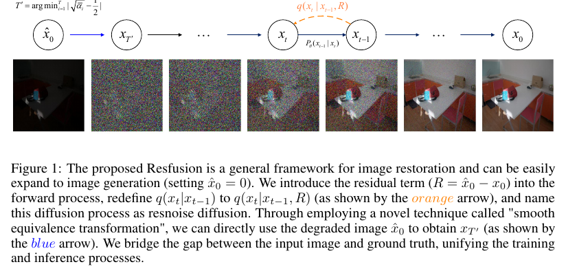

模型训练时从成对图像构造残差、带残差的扩散状态和 resnoise 监督值。测试时不显式求残差，而是从一个仅需退化图像和随机噪声的时间步开始，用单个 U-Net 逐步预测 resnoise。

#### 4.2.2 残差定义与前向转移

先定义训练时可计算的退化残差：

$$
R=\hat{x}_0-x_0
$$

式中，R 是退化残差，x̂₀ 对应退化图像，x₀ 对应干净真值。训练时用成对图像计算 R；推理时没有 x₀，所以 R 不能直接作为已知输入。后续网络通过 resnoise 预测隐式处理这一未知残差。

沿用 DDPM 的噪声日程定义：

$$
\alpha_t=1-\beta_t,\qquad\bar{\alpha}_t=\prod_{s=1}^{t}\alpha_s
$$

式中，βₜ 控制第 t 步的噪声方差，αₜ 是该步信号保留系数，ᾱₜ 是截至该步的累计系数。它们既用于构造训练状态，也用于后面选择推理起点；求和或连乘的下标范围不影响本文方法理解的关键差别。

论文把 R 注入逐步前向高斯分布的均值：

$$
q(x_t\mid x_{t-1},R)=\mathcal{N}\!(x_t;\sqrt{\alpha_t}x_{t-1}+(1-\sqrt{\alpha_t})R,\beta_t I)
$$

式中，xₜ₋₁ 是上一状态，xₜ 是当前状态，R 决定额外的均值偏移，βₜI 是高斯协方差。普通 DDPM 仅从上一状态加噪；这里还沿残差方向移动，因此前向状态同时携带目标信息、退化差异和随机噪声。

为推导闭式状态，可把当前状态减去同一个残差；以下变量只是推导工具，并非新网络模块：

$$
y_t=x_t-R,\qquad y_0=x_0-R
$$

式中，yₜ、y₀ 是平移后的状态。由于转移均值中的残差恰好抵消，yₜ 的一步过程恢复为标准 DDPM；因此标准 DDPM 的累计均值和方差推导仍适用。

平移后的一步采样式为：

$$
y_t=\sqrt{\alpha_t}y_{t-1}+\sqrt{\beta_t}\epsilon_t,\qquad\epsilon_t\sim\mathcal{N}(0,I)
$$

式中，yₜ₋₁ 和 yₜ 是相邻平移状态，εₜ 是本步标准高斯噪声。此式不再含显式 R，说明 Resfusion 的后验可以通过标准 DDPM 的后验再平移得到。

把累计过程平移回原变量，就得到直接采样任意训练时间步的公式：

$$
x_t=\sqrt{\bar{\alpha}_t}x_0+(1-\sqrt{\bar{\alpha}_t})R+\sqrt{1-\bar{\alpha}_t}\epsilon
$$

式中，xₜ 是 U-Net 的当前状态输入，x₀ 是干净真值，R 是退化残差，ε 是累计后的标准高斯噪声。训练算法用此式直接构造 xₜ，无需逐步模拟前向链；其中残差的累计系数是 1−√ᾱₜ。这也解释了图 2 中残差箭头的时间步权重。[原文第 2.1 节](https://arxiv.org/html/2311.14900v4)

#### 4.2.3 图 2 与后验均值推导

**图 2：状态轨迹的几何解释。** 图中的绿色与灰色方向分别指向干净图像和退化图像，橙色箭头表示残差方向，蓝色箭头表示当前扩散状态，紫色方向对应 resnoise 引导的反向过程。红点标记两条路径接近相交的加速时间步；它是“可从退化输入构造中间状态”的直观解释。

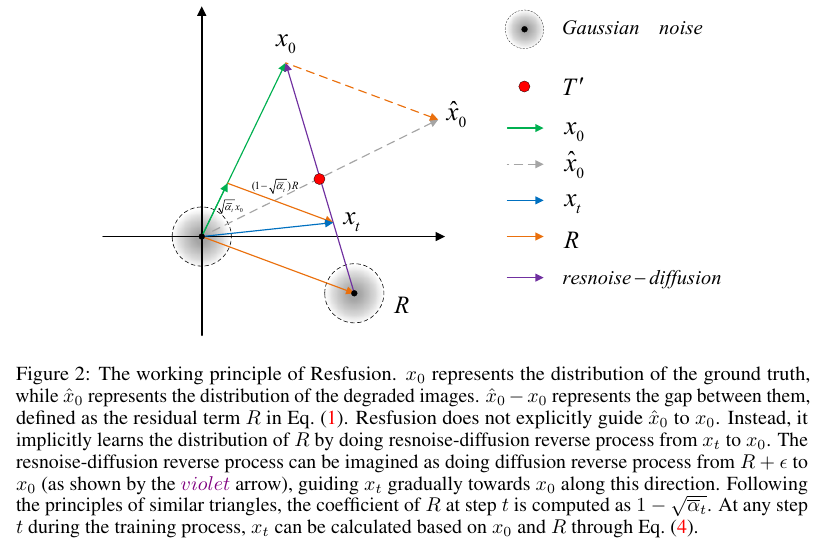

平移后的过程与 DDPM 同形，因此真实一步后验采用下列方差：

$$
\tilde{\beta}_t=\frac{1-\bar{\alpha}_{t-1}}{1-\bar{\alpha}_t}\beta_t
$$

式中，β̃ₜ 是给定当前状态和初始状态时，上一步状态的后验方差；βₜ 与相邻累计系数共同决定它。论文把反向模型方差固定为该值，使网络主要预测均值所需的目标。

将标准 DDPM 后验均值平移回 x 的坐标：

$$
\tilde{\mu}_t=\frac{\sqrt{\bar{\alpha}_{t-1}}\beta_t}{1-\bar{\alpha}_t}(x_0-R)+\frac{\sqrt{\alpha_t}(1-\bar{\alpha}_{t-1})}{1-\bar{\alpha}_t}(x_t-R)+R
$$

式中，μ̃ₜ 是真实后验对 xₜ₋₁ 的均值，x₀−R 和 xₜ−R 是上一小节的平移变量。该式仍依赖推理时未知的 x₀ 与 R，因此接下来要用前向闭式关系消去 x₀−R。

把前向闭式关系移项：

$$
x_t-R=\sqrt{\bar{\alpha}_t}(x_0-R)+\sqrt{1-\bar{\alpha}_t}\epsilon
$$

式中，xₜ−R 是当前平移状态，x₀−R 是初始平移状态，ε 是累计噪声。它把后验均值中的未知初始状态与当前状态和噪声关联起来，供下一步代入。

代入并整理后，真实后验均值可写为：

$$
\tilde{\mu}_t=\frac{1}{\sqrt{\alpha_t}}[x_t-(1-\sqrt{\alpha_t})R-\frac{\beta_t}{\sqrt{1-\bar{\alpha}_t}}\epsilon]
$$

式中，μ̃ₜ 是上一状态的真实后验均值，xₜ 是当前状态；括号中后两项分别是残差修正与噪声修正。它们的系数来自前向分布，而非人工调权。Resfusion 正是从这两个修正项推出单一预测目标。

#### 4.2.4 resnoise 与训练损失

将后验均值中的残差修正并入噪声修正，定义 resnoise：

$$
\operatorname{res}\epsilon=\epsilon+\frac{(1-\sqrt{\alpha_t})\sqrt{1-\bar{\alpha}_t}}{\beta_t}R
$$

式中，resε 是网络的目标，ε 是累计高斯噪声，R 是退化残差。分式给出二者在第 t 步的明确权重；它恰好让上一条后验均值中的两项合并为一次减法。单个 U-Net 因而能同时学习退化状态变化与噪声细节恢复。

把 resnoise 代回真实后验均值：

$$
\tilde{\mu}_t=\frac{1}{\sqrt{\alpha_t}}(x_t-\frac{\beta_t}{\sqrt{1-\bar{\alpha}_t}}\operatorname{res}\epsilon)
$$

式中，μ̃ₜ 使用真实 resε 计算，xₜ 是当前状态。公式与 DDPM 的噪声预测均值同形；推理时只需用网络输出替换真实 resnoise。[原文第 2.1 节与附录 A.1](https://arxiv.org/html/2311.14900v4)

若把反向方差固定，对真实后验与模型反向分布做均值匹配，分步变分目标包含：

$$
L_{t-1}-C=\mathbb{E}[\frac{1}{2\sigma_t^2}\|\tilde{\mu}_t-\mu_\theta(x_t,t)\|^2]
$$

式中，Lₜ₋₁ 是该步变分目标，C 是与待学习均值无关的项，σₜ² 是固定方差，μ̃ₜ 是真实后验均值，μθ 是模型均值。训练希望两种均值接近；首步的重建边界项需要单独看待，不能把所有步都直接视为同一个高斯 KL。

将真实和模型均值都写成 resnoise 形式，其差为：

$$
\tilde{\mu}_t-\mu_\theta(x_t,t)=\frac{\beta_t}{\sqrt{\alpha_t}\sqrt{1-\bar{\alpha}_t}}(\operatorname{res}\epsilon_\theta-\operatorname{res}\epsilon)
$$

式中，resεθ 是网络预测，resε 是可由成对训练图像计算的真值。该式说明 resnoise 预测误差直接决定反向均值误差；前面的系数是严格变分目标的时间步权重来源。

论文实际优化的是简化 MSE：

$$
\mathcal{L}_{\mathrm{simple}}=\mathbb{E}_{x_0,\epsilon,t}[\|\operatorname{res}\epsilon-\operatorname{res}\epsilon_\theta(x_t,\hat{x}_0,t)\|^2]
$$

式中，Lsimple 是优化目标，resε 是监督值，resεθ 接收 xₜ、退化条件 x̂₀ 和时间步 t。简化 MSE 没有显式保留上一式的时间步权重，因此与严格的分步变分目标方向一致，但不能视为数值完全相等。去阴影任务还把阴影掩码拼接进条件。

作者没有在正文逐层列出 U-Net 的全部结构参数；附录说明恢复任务采用与 RDDM 相同的 U-Net，并沿通道维拼接当前状态、退化图像以及需要时的阴影掩码。优化器为 AdamW，恢复任务批量大小为 32，学习率为 1.1×10⁻⁴，表 6 将训练轮数写为 5k。损失为常规 MSE，未提出额外的感知损失或任务专用物理约束。

#### 4.2.5 平滑等价变换：确定推理起点

将最初的残差定义代入前向闭式状态：

$$
x_t=(2\sqrt{\bar{\alpha}_t}-1)x_0+(1-\sqrt{\bar{\alpha}_t})\hat{x}_0+\sqrt{1-\bar{\alpha}_t}\epsilon
$$

式中，xₜ 是真实前向状态，x₀ 是测试时未知的真值，x̂₀ 是可获得的退化输入。关键是 x₀ 的系数 2√ᾱₜ−1：当累计信号系数的平方根接近二分之一时，xₜ 对未知 x₀ 的依赖接近零。

论文同时构造从退化图像普通加噪得到的状态，并在比较两种状态时使用同一个高斯噪声：

$$
\hat{x}_t=\sqrt{\bar{\alpha}_t}\hat{x}_0+\sqrt{1-\bar{\alpha}_t}\epsilon
$$

式中，x̂ₜ 仅需已知的 x̂₀、噪声日程及可采样的 ε，因此测试时可计算。它与 xₜ 使用同一个 ε，使二者的差仅由残差和系数失配决定。

相减并利用残差定义，得到：

$$
x_t-\hat{x}_t=(1-2\sqrt{\bar{\alpha}_t})R
$$

式中，xₜ−x̂ₜ 是真实训练状态与可计算状态之间的差，R 是退化残差。比较两种状态构造时使用同一个 ε，因此随机噪声项抵消。右侧说明，二者的差只由残差 R 和系数 1−2√ᾱₜ 决定；若 √ᾱₜ 恰为二分之一，差值就是零。下面将这一结论展开，区分逐样本相同与分布相同。

**为什么未知真值会消失？** 训练状态展开式中，x₀ 的系数是 2√ᾱₜ−1。当 √ᾱₜ 为二分之一时，该系数为零；同时，退化图像 x̂₀ 的系数为二分之一，高斯噪声 ε 的系数为 √3/2。两种构造因此都变成：

$$
x_t=\hat{x}_t=\frac{1}{2}\hat{x}_0+\frac{\sqrt{3}}{2}\epsilon
$$

式中，xₜ 是原本需要 x₀ 和 R 的训练状态，x̂ₜ 是仅凭退化图像构造的状态，x̂₀ 是已知测试输入，ε 是两种构造共享的噪声。当系数恰好满足二分之一条件时，x₀ 的贡献完全抵消；使用相同 x̂₀ 和 ε 会得到数值完全相同的两个状态。这使测试阶段能够复现该时间步的训练状态，而不必获得真值。

**为什么均值与方差也一致？** 固定一张退化图像 x̂₀，让 ε 按标准高斯分布随机采样。噪声均值为零，因此上述状态的均值是 x̂₀ 的一半；噪声系数 √3/2 的平方为 3/4，因此协方差为 3I/4。此时两种状态都服从：

$$
x_t,\hat{x}_t\sim\mathcal{N}\!\left(\frac{1}{2}\hat{x}_0,\frac{3}{4}I\right)
$$

式中，xₜ 与 x̂ₜ 表示两种状态构造的随机变量，x̂₀ 是固定的退化图像，I 是单位矩阵。对训练构造，即使再固定 x₀，它也不出现在这个时间步的均值中；对测试构造，仅需固定 x̂₀ 即可。由于两种构造都是高斯分布，均值与协方差一致就意味着条件分布一致。这里等价的对象是两种带噪中间状态。

需要区分两个层次：使用同一个 ε 时，xₜ 与 x̂ₜ 的具体数值完全相同；若两次分别独立采样噪声，具体状态通常不同，但服从同一个条件分布。推理初始化只需要与训练对应状态的分布一致，无须复用某次训练所用的噪声样本。

**这一等价怎样帮助恢复？** 训练时，网络学习从这个中间状态及退化条件恢复干净目标；测试时，只凭 x̂₀ 就能采样相同分布的中间状态，再交给已训练网络反向恢复。虽然起点表达式中的 x₀ 被抵消，训练的 resnoise 监督仍包含残差 R，也就是仍含干净目标的信息。起点可计算与恢复过程需要学习，是公式链中相互衔接的两个环节。

离散日程中选最接近二分之一的时间步：

$$
T'=\arg\min_{1\leq i\leq T}|\sqrt{\bar{\alpha}_i}-\frac{1}{2}|
$$

式中，T 是基础日程的总步数，T′ 是实际训练和推理使用的加速起点。训练仅从第 1 步到 T′ 抽样；推理也从 T′ 开始，因此后续时间步无需执行，但这依赖下一式的近似初始化成立。

测试时的起点为：

$$
x_{T'}\approx\sqrt{\bar{\alpha}_{T'}}\hat{x}_0+\sqrt{1-\bar{\alpha}_{T'}}\epsilon
$$

式中，xT′ 是反向链的初始状态，x̂₀ 是测试退化图像，ε 是新采样的高斯噪声。该状态是加噪的退化图像，不是未经处理的输入；近似号表示有限离散时间步通常不能精确满足二分之一条件。[原文第 2.2 节](https://arxiv.org/html/2311.14900v4)

#### 4.2.6 截断噪声日程与图 10–11

论文明确写出理想训练状态与实际推理起点的偏差：

$$
\|x_{T'}-\hat{x}_{T'}\|=\|(1-2\sqrt{\bar{\alpha}_{T'}})R\|
$$

式中，左侧比较 xT′ 与 x̂T′；右侧表明偏差由离二分之一的系数误差和残差 R 共同决定。T 较小时日程更稀疏，该偏差可能较大。Truncated Schedule 在累计信号系数首次低于二分之一且偏差超过默认阈值 0.01 时，将该位置改为二分之一，并截去之后不参与扩散的日程。

为了明确偏差如何随退化程度变化，同一范数下可将标量系数提出：

$$
\|x_{T'}-\hat{x}_{T'}\|=|1-2\sqrt{\bar{\alpha}_{T'}}|\|R\|
$$

式中，xT′ 与 x̂T′ 使用相同噪声，R 是退化残差。系数 √ᾱT′ 越接近二分之一，状态偏差越小；在相同系数误差下，残差范数越大，偏差也越大。因此有限离散日程中的等价通常是近似的，截断调整的直接目的就是减小这一初始化失配。

**图 10：偏差与视觉消融。** 子图 (a) 展示系数误差随总步数变化；子图 (b) 对比截断与原始日程，原始日程的恢复结果可能留下阴影。图像只支持这些示例中的视觉判断，不等于所有误差均已被消除。

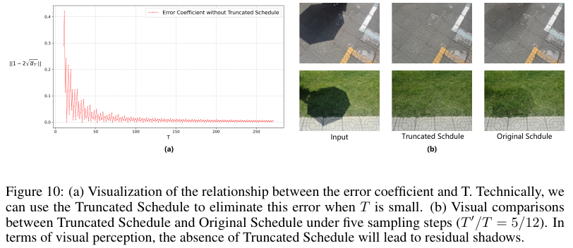

**图 11：截断线性日程示意。** 左侧显示截断后的前十个时间步，右侧把它与总步数 25 的线性日程对照，标出靠近二分之一的加速点及局部调整位置。

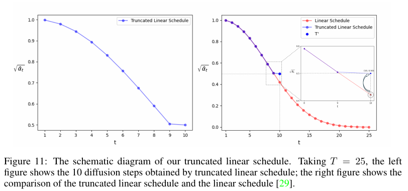

#### 4.2.7 网络条件、训练设置与表 6

**表 6：训练设置。** 表中区分三项五步图像恢复实验、CIFAR-10 图像生成以及 CelebA-HQ/AFHQV2 图像翻译。恢复任务均用 256 图像块、批量大小 32、学习率 1.1×10⁻⁴；生成与翻译使用批量大小 128、学习率 2×10⁻⁴，采样步数分别为 10–100 与 50。因此“五步”只适用于论文列出的主要恢复实验。

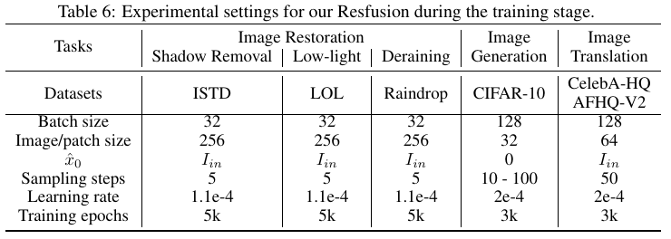

恢复任务统一使用单个 U-Net、截断线性日程及 MSE。去阴影的条件包括阴影图和掩码；其他两项恢复任务只使用退化图像。网络通过通道拼接融合当前状态与条件，论文指出这是简单实现，也将更复杂的融合列为未来方向。实验可在 8 张 NVIDIA RTX A6000 上完成，但原文未给出每个恢复任务的完整训练时长。

#### 4.2.8 分量机制、预测目标与图 5–6

**图 5：残差与噪声分量消融。** 图中两行 LOL 样例依次比较输入、仅去噪、仅去加权残差、联合去除 resnoise 与真值。仅去噪时亮度状态仍接近低光输入；仅处理残差时亮度变化明显但细节差；联合预测兼顾两者。这是论文的经验观察，不是各分量在所有数据上的严格独立分解定理。

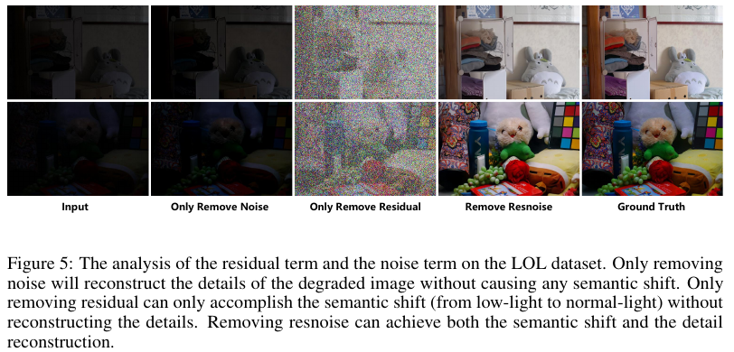

**图 6：等价预测目标的视觉比较。** 上下两行分别给出去雨滴与低光样例；列对应输入、预测干净图像、预测残差、预测 resnoise 及真值。resnoise 样例在进行状态变换的同时保留更多细节。论文说明，在截断起点下直接预测普通高斯噪声并不是等价目标，因退化输入已作为条件，网络可能只学到过于简单的关系。

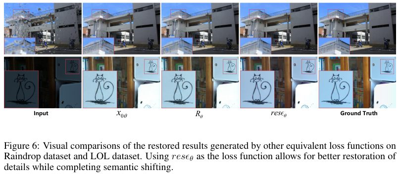

#### 4.2.9 图像生成与图像翻译扩展

图像生成没有退化输入，论文把输入设为零矩阵，于是：

$$
R=-x_0
$$

式中，R 是零输入与生成目标 x₀ 的差。把该 R 代入相同的前向状态与 resnoise 定义即可开展生成实验；这说明公式形式可扩展，但实验仍需单独训练，且并非五步采样。

图像翻译把源域图像作为输入、目标域图像作为真值。作者在 CelebA-HQ 与 AFHQV2 的 64 × 64 图像上使用 50 步，并为了增加输出多样性，不将翻译输入继续作为 U-Net 的条件。**图 9** 的四组样例分别为狗到猫、男性到猫、男性到女性、女性到男性；每对图像左边是生成结果、右边是目标域图像。结果说明该框架能产生跨域变化，但图 9 主要提供视觉证据，未给出这些翻译任务的完整定量基准比较。

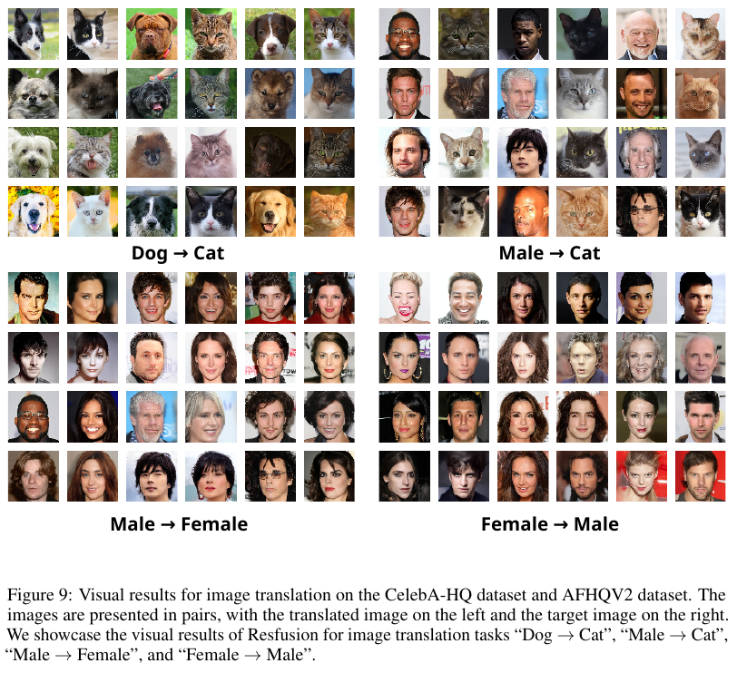

### 4.3 关键分析步骤

1. **准备日程。** 根据基础噪声日程计算累计系数，选择最接近二分之一的起点，并在需要时截断调整。这一步输出训练与推理共用的最大时间步。
2. **构造训练样本。** 抽取退化图与真值，计算残差；从允许的时间步中随机抽取一步及高斯噪声，直接计算当前状态与 resnoise 真值。
3. **训练单个网络。** 将当前状态、退化条件与时间步输入 U-Net，以预测 resnoise 的 MSE 更新参数。去阴影还提供掩码。
4. **推理初始化。** 仅使用测试退化图像和新采样噪声构造中间状态；不需要测试真值或显式残差。
5. **执行反向链。** 每步预测 resnoise，计算 DDPM 形式的均值，并在非最终步加入后验方差控制的随机噪声；最后一步返回均值。

推理均值具体为：

$$
\mu_\theta(x_t,t)=\frac{1}{\sqrt{\alpha_t}}(x_t-\frac{\beta_t}{\sqrt{1-\bar{\alpha}_t}}\operatorname{res}\epsilon_\theta(x_t,\hat{x}_0,t))
$$

式中，μθ 是下一状态的条件均值，xₜ 是当前状态，resεθ 是网络预测，x̂₀ 是退化条件。它是上一小节真实后验均值的可执行版本，使用预测量替代训练时可算的真值目标。

随机采样步骤为：

$$
x_{t-1}=\mu_\theta(x_t,t)+\sqrt{\tilde{\beta}_t}z,\qquad z\sim\mathcal{N}(0,I)
$$

式中，xₜ₋₁ 是更新后的状态，β̃ₜ 是固定后验方差，z 是新采样的标准高斯噪声。最终一步直接返回均值，不再加 z。[附录算法 1–2](https://arxiv.org/html/2311.14900v4)

**图 8：五步采样可视化。** 图中上方展示 LOL 网络测试集和 Raindrop-B 的输入与结果，下方虚线框展示从带噪中间状态逐步清晰的五步过程；蓝色箭头表示初始化变换，红框表示反向过程。这些集合在图示中用于观察泛化与过程，图注指出 LOL 网络测试集没有真值，不能从图中推导其定量提升。

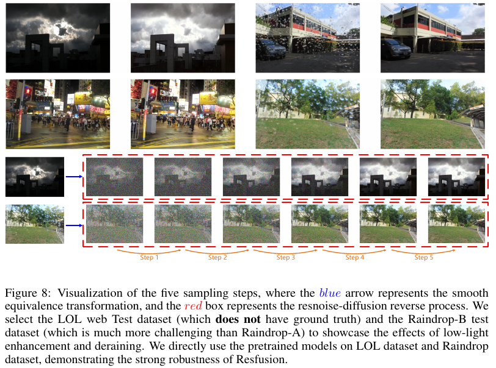

## 五、图表分析

本节只讨论第四节未嵌入的其余编号图与表。

### 5.1 ISTD 去阴影：图 3、表 1

**图 3：去阴影视觉比较。** 两行场景依次展示输入、DSC、DHAN、DMTN、Resfusion 和真值。图中需要关注阴影边界与原有材质的保持，而非只看整体亮度；Resfusion 的列与真值更接近，但个别局部误差仍可能存在。

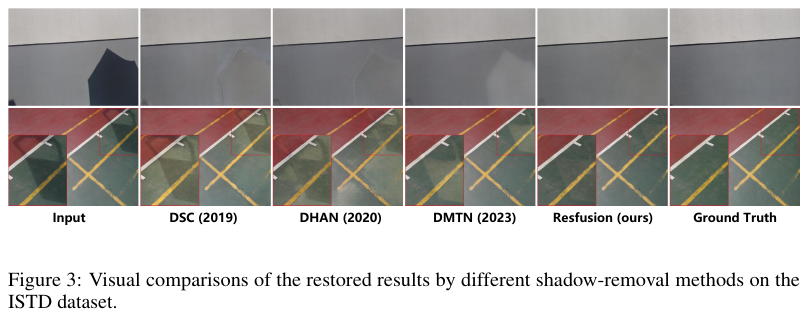

**表 1：ISTD 分区域指标。** 表格分阴影区域、非阴影区域和全图，又分别给出缩放至 256 × 256 与原始分辨率的比较。256 × 256 设置下，Resfusion 全图 PSNR/SSIM/MAE 为 31.81/0.965/4.81，RDDM 为 30.91/0.962/4.67；Resfusion 的前两项更好，但全图 MAE 并非最优。原始分辨率下，Resfusion 全图为 30.09/0.932/5.34。作者正文中“所有指标都显著领先”的概括与表内个别单项指标不完全一致。

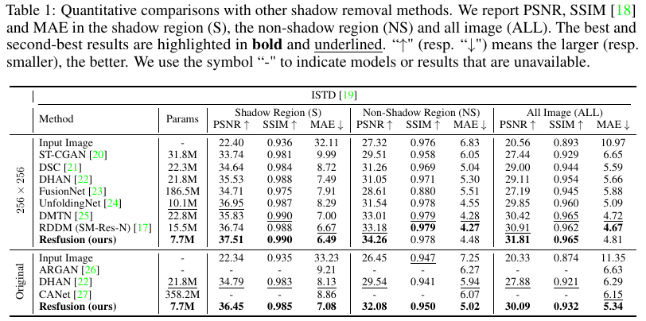

### 5.2 LOL 与 Raindrop：图 4、表 2–3

**图 4：两项恢复任务的视觉比较。** 上排是低光增强，下排是去雨滴；局部放大框便于观察纹理、色彩和雨滴遮挡区域。图像支持 Resfusion 在这些示例中的视觉质量，但不同方法的画面感知不能替代同一协议下的定量评价。

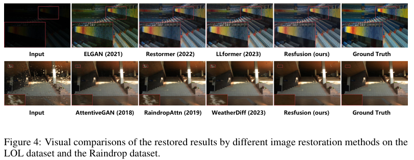

**表 2：LOL。** 在 256 × 256、YCbCr 设置下，Resfusion 为 30.02 PSNR、0.954 SSIM、0.070 LPIPS；同参数量的 RDDM SM-Res 为 25.39、0.937、0.116。原始分辨率 RGB 设置下，Resfusion 为 24.63、0.860、0.107。两个设置的色彩空间与尺寸不同，不宜横向比较绝对数值。

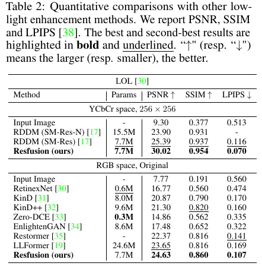

**表 3：Raindrop。** 在 256 × 256 设置下，Resfusion 为 34.40 PSNR、0.975 SSIM，RDDM 为 32.51、0.956。原始分辨率设置下，Resfusion 为 32.61、0.938；表中其他方法采用相同列的设置进行比较。该任务主要使用 YCbCr 的亮度通道评价。

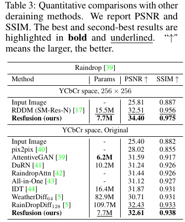

### 5.3 预测目标消融：表 4

**表 4：预测干净图像、残差、resnoise。** 在原始分辨率和五步采样下，resnoise 在三个数据集的 PSNR、SSIM 均为三种目标中最好。例如 LOL 的 PSNR 分别是 23.10、22.87、24.63；但 ISTD 的 MAE 分别为 5.35、5.26、5.34，预测残差略低。这支持联合目标通常更好，而不是所有单项指标均最优。

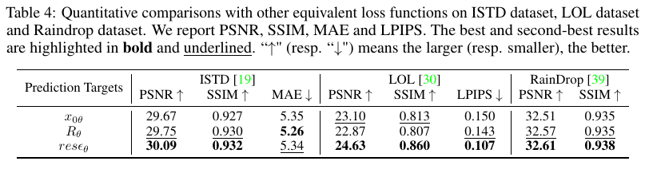

### 5.4 CIFAR-10 生成：图 7、表 5

**图 7：同采样步数下的生成样本。** 上排为 DDPM，下排为 Resfusion，均按 10、20、50、100 步排列。作者认为同一步数下 Resfusion 的语义内容和细节更完整；这一视觉判断可由表 5 的 FID 进一步核对。

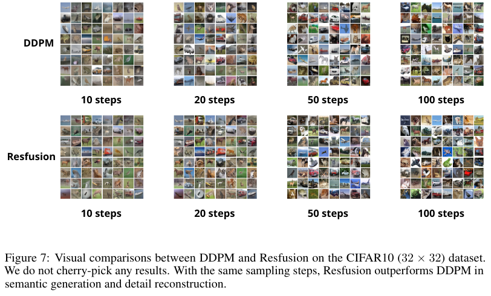

**表 5：FID。** 20 步时，DDPM、Resfusion、DDIM 分别为 24.88、15.46、10.93；50 步时分别为 14.02、7.96、7.39。Resfusion 优于同采样步数的 DDPM，但在这组结果中没有超过确定性 DDIM。因此实验支持相对 DDPM 的加速效果，不支持“生成任务全面最优”的说法。

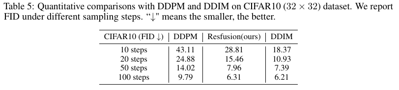

### 5.5 效率与额外低光验证：表 7–8、图 12

**表 7：资源效率。** Resfusion 为 7.7M 参数；表中在 256 × 256 输入上测得五步总推理时间约 0.135 秒。ISTD 对照中的 Shadow Diffusion 为 55.5M 参数、25 步、约 0.600 秒；但其 PSNR/SSIM 是 32.33/0.969，优于 Resfusion 的 31.81/0.965。效率和质量需一并阅读，且运行时间受硬件、实现和输入尺寸影响。

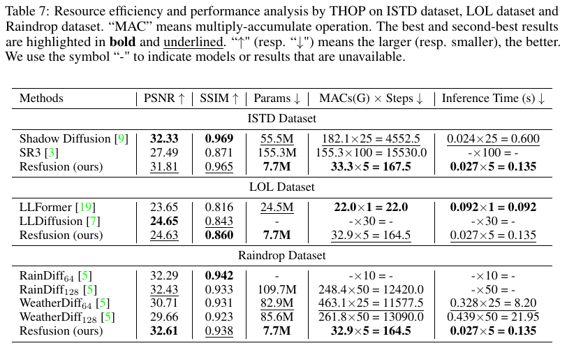

**表 8：LOL-v2-real。** Resfusion 的 PSNR/SSIM/LPIPS 为 22.06/0.839/0.175，在表列的 Restormer 与 LLFormer 对照中表现最好。该补充实验覆盖更明显的噪声与偏色情况，但仍基于特定数据集。

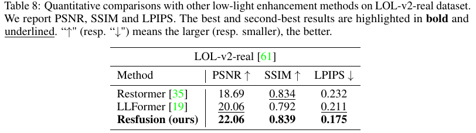

**图 12：LOL-v2-real 视觉比较。** 两行图像展示输入、直方图均衡、SNR-aware、Restormer、Resfusion 与真值。直方图均衡放大了噪声与偏色，Resfusion 示例在提亮的同时较好地控制噪声和颜色偏移。

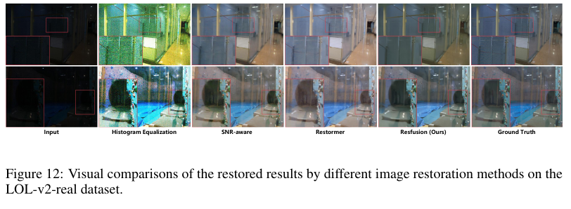

### 5.6 更多样例与失败情形：图 13–17

**图 13：ISTD 更多去阴影结果。** 四行样例包含路面与卡通画等不同纹理，列为输入、多种基线、Resfusion 和真值。它补充了图 3 的视觉覆盖，说明阴影移除时仍需检查边界与材质纹理。

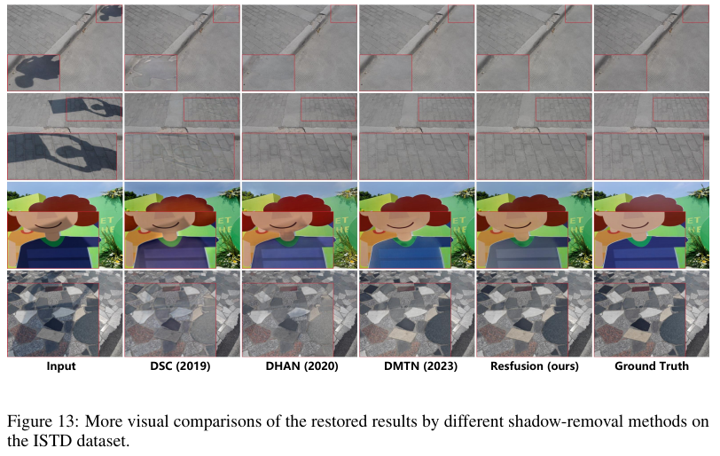

**图 14：LOL 更多低光结果。** 四行图像比较暗室、物体和彩色区域的提亮效果；局部框帮助观察噪声和颜色。此图用于展示样例多样性，不提供新的量化评价。

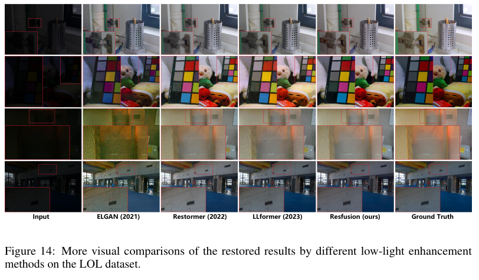

**图 15：Raindrop 更多去雨滴结果。** 四行样例覆盖建筑、车辆及室内文字等场景；放大框突出去雨滴后容易出现的细节缺失。它补充图 4 的视觉对比。

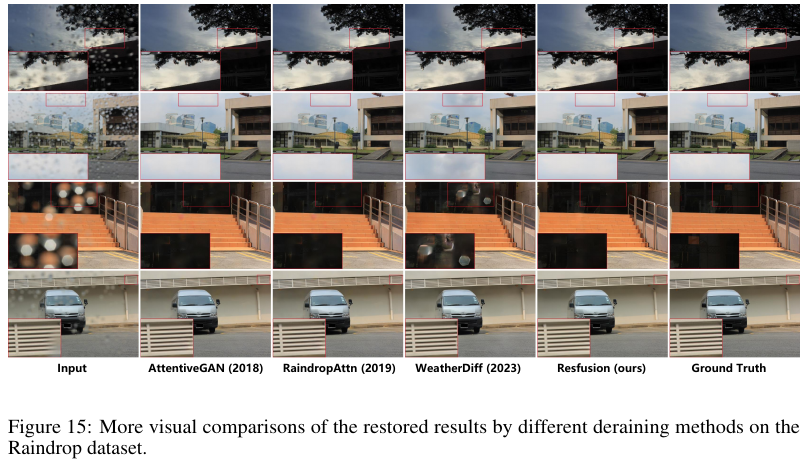

**图 16：ISTD 失败样例。** 两行阴影场景显示 Resfusion 仍可能留下色调或边界差异。作者将其明确作为失败情形给出，因此不能用前面的平均指标推断每张图都恢复成功。

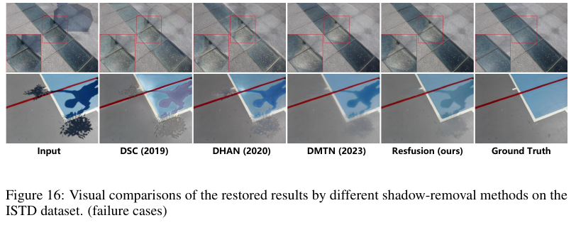

**图 17：Raindrop 失败样例。** 车辆和室内文字等场景显示遮挡恢复可能不完整，或在细节处与真值不同。它提示去雨滴性能仍受局部纹理和遮挡复杂度影响。

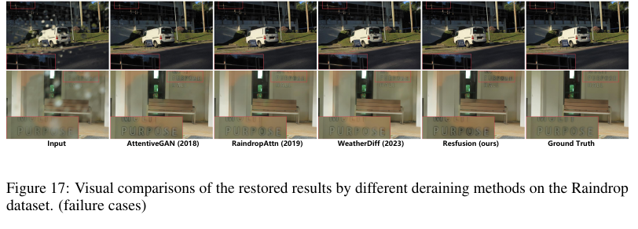

## 六、主要发现

1. 三项主要恢复任务在五步采样下取得较强结果，尤其在所列 PSNR、SSIM 和部分感知指标上具有竞争力；但某些 ISTD MAE 指标及部分专用方法的质量结果构成例外。
2. resnoise 把退化残差与高斯噪声按后验推导出的比例合并，使单个网络同时参与状态变化与细节恢复。图 5–6 和表 4 为这一机制提供了实验支持。
3. 通过选取可由退化输入构造的中间起点，训练与推理覆盖相同时间区间；截断日程降低离散时间步带来的起点失配。
4. CIFAR-10 结果支持相对 DDPM 的少步生成优势，但 DDIM 在所列 FID 设置下仍更好。图像翻译验证了方法形式的适用性，其证据主要是视觉样例。

## 七、核心贡献

- **方法创新：**在 DDPM 前向转移中加入退化图像与真值之间的残差，将恢复任务已有的信息纳入扩散状态。
- **推导贡献：**明确给出残差与噪声的时间步权重，形成单一 resnoise 目标，并保留 DDPM 形式的反向均值。
- **采样设计：**推导可从退化图像初始化的中间时间步，并针对离散日程误差提出截断调整。
- **工程价值：**在多项恢复任务中使用单个基础 U-Net 和统一损失，报告较少采样步数与较小参数量。论文没有提出新数据集。

## 八、研究局限

1. **训练数据：**残差真值依赖成对图像；论文未验证无配对恢复训练。
2. **起点近似：**有限离散日程一般不能精确满足二分之一条件，偏差还随残差大小变化。截断调整针对该问题，但不能保证所有输入成功。
3. **网络与融合：**作者指出，通用 U-Net 和简单通道拼接可能不及任务专用主干、物理先验或更强的特征融合策略。
4. **计算空间：**扩散在 RGB 像素空间进行；作者提出探索潜空间实现，以进一步降低成本。
5. **泛化证据：**主要结论来自有限数据集、评价协议和样例。对未知相机、复合真实退化及其他分布的效果仍需额外验证；这是根据实验范围作出的分析推断。

## 九、论文总结

Resfusion 的关键价值在于把“退化输入已经含有可用图像信息”落实为一组彼此衔接的设计：残差引导的前向分布、由后验推导的 resnoise 预测目标，以及可在测试时计算的中间采样起点。它展示了低步数扩散恢复的可行性，同时提醒工程实现者，减少采样步数必须检查起点状态、训练分布和噪声日程是否对齐。对后续研究，值得重点检验更复杂真实退化中的残差建模、条件融合方式和潜空间加速，而不能只依据单一数据集或单一指标判断方法优劣。
