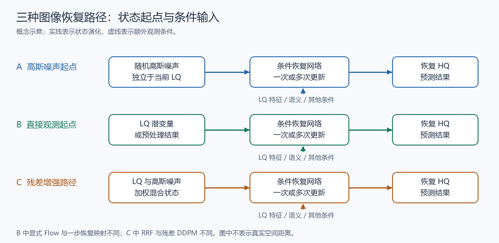
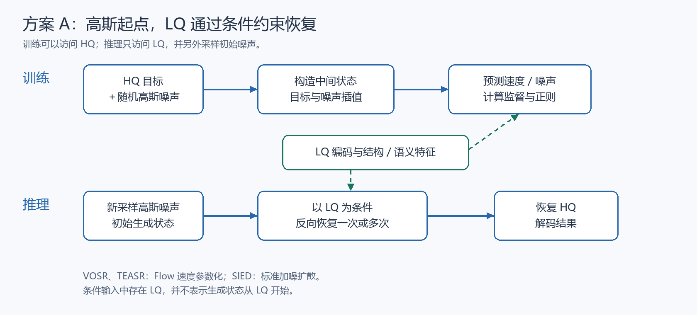
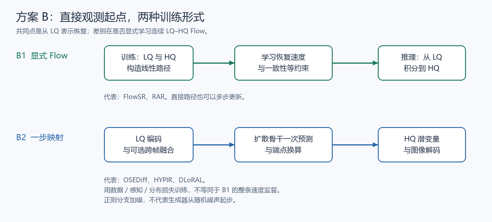
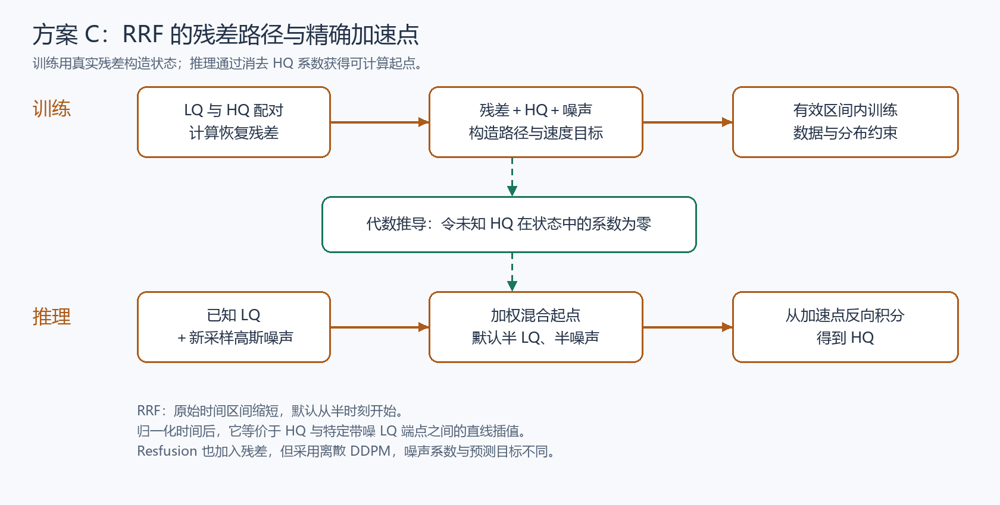

# 图像恢复的三种扩散与流匹配方案对照

> 整理日期：2026-10-09。范围：当前项目已阅读的图像恢复、超分、RAW 低光恢复论文，以及本会话讨论的 OSEDiff。本文是跨论文方法专题，不是某篇论文的完整阅读报告；示意图为重新绘制的概念图。数学推导统一使用连续时间从 HQ 指向退化／噪声端点的约定，个别论文的时间方向相反，已在对应小节说明。

## 一、分类标准与总览

比较的核心是：**正在被更新的生成状态从哪里出发，训练时如何构造状态，网络预测什么量。** 是否使用 LoRA、DMD、GAN 或一步推理，是另外的分类维度。

| 方案 | 推理起点 | LQ 的作用 | 代表论文 |
| --- | --- | --- | --- |
| A：高斯噪声起点 | 独立采样的高斯噪声 | 通过潜变量、视觉特征、文本等提供条件 | VOSR、TEASR、SIED |
| B：直接 LQ→HQ | LQ 潜变量或其预处理结果 | 既提供恢复状态，也可提供其他条件 | 严格 Flow：FlowSR、RAR；一步映射：OSEDiff、HYPIR、DLoRAL |
| C：残差增强的随机路径 | 可由 LQ 与高斯噪声构造的混合状态 | 进入前向路径及推理初始状态，同时可作为网络条件 | 连续 RF：ScaleResfusion；离散 DDPM：Resfusion |

“标准 RF”是 A 的一种实现，不代表所有高斯起点方法都使用 RF；“直接恢复”是 B 的共同特点，不代表所有 B 方法都训练 LQ→HQ 速度场；C 中的 Resfusion 也不是 RRF。

**图 1 解读：**实线是恢复状态的演化，虚线是额外条件输入。A 中 LQ 不直接决定初始状态；B 中初始状态就是观测表示；C 中初始状态既保留观测信息又保留采样随机性。真实网络可以有更复杂的条件支路，图中只保留区分路径所需的要素。

### 1.1 三种“噪声”不能混淆

- **观测噪声：**传感器、曝光、读出及压缩等产生的真实退化。RAW 中常涉及信号相关的泊松噪声与读出噪声。
- **扩散噪声：**为构造训练路径或采样起点而人为采样的随机变量，通常采用标准高斯分布。
- **残差：**LQ 与 HQ 在共同表示空间中的差异，可能同时包含噪声、模糊、颜色偏差和缺失细节，不一定是某种独立噪声。

因此，给含泊松噪声的 LQ 再加入高斯扩散噪声，不是在声称真实退化服从高斯分布；它是在定义一种恢复传输过程。该过程是否有利，需要实验验证。

## 二、统一符号与监督对象

| 符号 | 含义 |
| --- | --- |
| x₀ | HQ 目标在共同图像或潜空间中的表示 |
| y | LQ 观测在同一表示空间中的表示 |
| R | 观测与目标的恢复残差 |
| ε | 独立采样的标准高斯噪声 |
| t | 前向时间；本文 RF 约定干净目标位于零时刻 |
| xₜ | 时刻 t 的传输状态 |
| c(y) | 从 LQ 提取的结构、语义或文本条件 |
| uθ | 网络预测的前向速度 |
| γ | RRF 的正值残差权重 |

首先定义残差：

$$
R=y-x_0
$$

R 是 LQ 表示 y 减去 HQ 表示 x₀。此定义只是一种代数参数化：知道 y 和 R 就能恢复 x₀。对于 RAW→sRGB 等跨域任务，必须先定义共同表示，不能直接将不同通道或不同物理意义的像素相减。

本专题以线性条件 Flow Matching 为主线。一般路径可以写成：

$$
x_t=x_0+t b
$$

xₜ 从目标 x₀ 沿样本对应的方向 b 变化；b 的定义决定 A、B、C 三种路径。每个训练样本的路径是直线，但网络在多个样本之间学习的条件平均速度场不一定形成全局直线。

沿时间求导得到样本级目标速度：

$$
u_t=\frac{d x_t}{dt}=b
$$

uₜ 是路径的时间导数，与 b 相等。训练用已知配对图像和采样噪声构造 b；推理时没有真实 HQ，需要用网络预测 uθ 代替它。

以 MSE 回归速度的通用目标为：

$$
\mathcal{L}_{\mathrm{FM}}=\mathbb{E}_{x_0,y,\epsilon,t}\left[\|u_\theta(x_t,t,c(y))-u_t\|_2^2\right]
$$

𝓛_FM 约束速度预测 uθ 接近真实样本速度 uₜ；c(y) 提供观测条件。期望中的 ε 对确定性直接 Flow 可以省略。此式描述基本流训练，实际论文还可能加入一致性、图像重建、DMD/VSD 或 GAN 等损失，不能将全部方法都简化为这个 MSE。

## 三、方案 A：从高斯噪声恢复，LQ 作为条件

### 3.1 为什么采用这一方案？

它保留常规生成模型的噪声到图像结构，容易使用标准扩散／RF 训练方法；模型通过观测条件学习“给定这张 LQ，哪些 HQ 结果合理”。保留随机输入允许表达同一观测对应的多个候选细节，但不保证生成细节就是实际拍摄时存在的细节。

**图 2 解读：**训练上支路用 HQ 与随机噪声构造中间状态，LQ 另行提供条件；推理下支路没有 HQ，从新采样噪声开始更新状态。将 LQ 与当前状态拼接进入网络，仍属于“条件输入”，不能因此称为“LQ 起点”。

### 3.2 标准 RF 路径与速度推导

在目标和高斯噪声之间线性插值：

$$
x_t=(1-t)x_0+t\epsilon
$$

xₜ 是中间状态，x₀ 是目标，ε 是高斯端点。零时刻对应 HQ，一时刻对应纯噪声。y 未出现在插值中，但可通过 c(y) 进入网络。VOSR 属于这一结构。

将路径整理为“起点加时间乘方向”：

$$
x_t=x_0+t(\epsilon-x_0)
$$

x₀ 是初始端点，ε−x₀ 是每个训练样本的路径方向。与第二节通式对应，b 就是 ε−x₀。

因此目标速度为：

$$
u_t=\epsilon-x_0
$$

uₜ 从目标指向高斯端点。推理逆向积分，所以用该前向速度的反方向更新当前状态。

在 MSE 条件下，理想回归解是条件平均速度：

$$
u^*(x_t,t,c)=\mathbb{E}[\epsilon-x_0\mid x_t,t,c]
$$

u* 表示理想最优回归函数；c 表示条件信息。该式是平方损失回归的数学结论，不是某篇论文额外提出的模块。它说明网络通常不能逐样本识别真实配对端点，而是在当前状态和条件下预测平均方向。

### 3.3 推理更新与干净结果换算

对任意线性路径，使用预测速度回推干净端点：

$$
x_0^{\mathrm{pred}}=x_t-t\,u_\theta(x_t,t,c(y))
$$

x₀ᵖʳᵉᵈ 是网络预测的干净端点；xₜ 是当前状态；t 是剩余前向跨度。若 uθ 等于样本真实速度，该式精确得到 x₀；实际预测有误差，单步端点换算不保证精确。

采用反向 Euler 积分时：

$$
x_{t_{k+1}}=x_{t_k}-(t_k-t_{k+1})u_\theta(x_{t_k},t_k,c(y))
$$

tₖ₊₁ 小于 tₖ，因而从噪声端向零时刻移动。xₜₖ 是当前状态，uθ 给出当前速度，时间差控制更新幅度。多次调用会重新评估速度，而不是简单重复减去同一个残差。

### 3.4 DDPM 版本：SIED

SIED 使用标准加噪形式，而不是上述线性 RF：

$$
x_t=\sqrt{\bar\alpha_t}x_0+\sqrt{1-\bar\alpha_t}\epsilon
$$

xₜ 是带噪目标潜变量，ᾱₜ 是累计信号系数，ε 是采样噪声。网络学习噪声估计，并在推理时从高斯状态反向恢复。RAW 特征经过曝光校正模块后成为条件；它不是这里的 ε，也不是初始生成状态。

### 3.5 结果层面的优点与风险

- 可以表达条件多解性，适合信息缺失严重的超分与极低光恢复。
- 观测一致性依赖条件注入、训练数据和损失，不能仅靠高斯起点保证。
- 随机种子可能改变局部纹理；条件过弱时可能出现结构或语义偏移。
- 不能因起点是噪声就断言保真度低：VOSR 的视觉条件及恢复 guidance 就是在加强输入约束。

## 四、方案 B：直接从 LQ 恢复 HQ

### 4.1 B1：显式 LQ→HQ Flow

动机是让网络处理观测中已存在的结构，直接学习退化修正。FlowSR 和 RAR 都显式连接退化与清晰分布。

**图 3 解读：**上支路 B1 训练连续的 LQ–HQ 路径；下支路 B2 使用扩散骨干实现一次潜变量转换，没有必要训练整条直接 Flow。两个子类都直接利用观测状态，但不可交换其监督公式。

采用本文统一时间方向，路径为：

$$
x_t=(1-t)x_0+t y
$$

xₜ 在 HQ 目标 x₀ 和 LQ 观测 y 之间插值。一时刻状态就是 y，因此推理直接从观测开始。FlowSR 使用这一时间方向；RAR 原文从退化零时刻指向 HQ 一时刻，与本文方向相反。

将路径写成残差形式：

$$
x_t=x_0+tR
$$

R 是前文定义的 y−x₀。这里的残差是直接 Flow 的方向，不包含额外采样的高斯项。

于是速度目标为：

$$
u_t=R=y-x_0
$$

uₜ 是 HQ→LQ 的前向速度。推理时使用反向更新去除该修正项。虽然网络预测的也是残差，**它并不属于 RRF**：状态构造、随机端点和有效时间区间均不同。

一步恢复为：

$$
x_0^{\mathrm{pred}}=y-u_\theta(y,1,c(y))
$$

x₀ᵖʳᵉᵈ 是预测 HQ，y 是观测起点，uθ 是一时刻预测的退化方向。此式允许一步执行，但是否一步就能获得良好细节，取决于训练；FlowSR 进一步引入一致性学习及 HQ 正则化。

### 4.2 为什么要加入一致性和 HQ 监督？

使用端点函数把不同时间状态映射到同一个目标：

$$
f_\theta(x_t,t)=x_t-t u_\theta(x_t,t)
$$

fθ 是由速度换算得到的端点预测，不是独立的物理过程。FlowSR 约束不同时间的 fθ 一致，但仅一致并不能保证终点正确。

用简化表达说明一致性约束：

$$
\mathcal{L}_{\mathrm{cons}}=\mathbb{E}[d(f_\theta(x_{t'},t'),f_{\theta^-}(\tilde x_t,t))]
$$

𝓛_cons 比较较晚状态 xₜ′ 的学生端点预测与教师更新得到的状态 x̃ₜ 的目标网络预测；θ⁻ 是目标网络参数，d 是距离。该式用于解释一致性机制，具体时间采样和教师更新遵循 FlowSR 原文。

加入真实 HQ 的端点约束：

$$
\mathcal{L}_{\mathrm{HQ}}=\mathbb{E}[d(f_\theta(\tilde x_t,t),x_0)]
$$

𝓛_HQ 将扰动中间状态 x̃ₜ 的预测拉回真实 x₀，避免不同预测一致地落到错误终点。这是对 FlowSR HQ 正则化机制的拆分解释，不代表论文将其作为独立命名的新算法。

### 4.3 B2：OSEDiff 式的一步潜变量恢复

OSEDiff 将 LQ 潜变量直接当作固定扩散时刻的输入，用噪声预测形式参数化恢复：

$$
\hat z_H=\frac{z_L-\beta_T\epsilon_\theta(z_L;T,c)}{\alpha_T}
$$

z_L 是 LQ 潜变量，ẑ_H 是预测 HQ 潜变量，εθ 是网络输出，T 是固定时刻，α_T 和 β_T 是该时刻的系数，c 是文本条件。OSEDiff 直接输入 z_L，没有在生成器起点额外注入标准扩散噪声。VSD 正则分支训练时给输出加噪，不等于生成器从噪声起步。

若要求该映射在训练样本上精确恢复目标，将上式移项可得：

$$
\epsilon_{\mathrm{req}}=\frac{z_L-\alpha_T z_H}{\beta_T}
$$

ε_req 是为达到目标 z_H 所需的网络输出，**这是根据参数化得到的代数解释，不是 OSEDiff 原文声明使用的监督标签**。它通常并非真实传感器噪声，也并非独立采样的标准高斯噪声；OSEDiff 实际通过数据损失和 VSD 训练恢复映射。

DLoRAL 使用接近 PiSA-SR 的潜变量修正形式：

$$
z_{HQ}=z_{LQ}-\epsilon_\theta(z_{LQ})
$$

z_HQ 是恢复目标，z_LQ 是低质潜变量，εθ 在这里表示预测修正。DLoRAL 还将跨帧检索融合后的潜变量送入网络。输出名含 ε 不意味着该修正服从高斯分布；也不能仅因减去残差就把它归入 RRF。

### 4.4 确定性是否必然导致过平滑？

**不会。** 确定性限制的是固定输入下的采样变化，不直接限定结果锐度。如果只使用像素 MSE，在目标存在多解性时，最优解容易接近条件均值：

$$
G^*(y)=\mathbb{E}[x_0\mid y]
$$

G* 是只优化平方重建损失时的最优确定性回归函数，y 是观测，x₀ 是目标。平均不同可能细节可能降低锐度；但 GAN、VSD/DMD、感知及一致性设计会改变优化目标，不能将此结论推广到所有直接映射方法。

## 五、方案 C：残差增强的随机恢复路径

### 5.1 为什么同时引入观测与随机性？

观测用于锚定结构，随机变量保留多解采样。RRF 的特殊性在于：它给出了一个残差增强路径，并能精确找到不依赖未知 HQ 的中间起点。该构造比一般“把 LQ 加噪后输入模型”更具体。

**图 4 解读：**训练可使用真实残差；推理不能获得残差，因此通过代数消去 HQ 系数，构造 LQ 与噪声的混合状态。图中只表示依赖关系和过程方向，不表示真实数据空间的距离或曲率。

### 5.2 RRF 路径与速度推导

标准 RF 上加入加权残差：

$$
x_t=(1-t)x_0+t\gamma R+t\epsilon
$$

xₜ 是 RRF 状态，γ 是残差权重，R 是恢复残差，ε 是高斯噪声。完整定义域可为零到一，但实际恢复训练和采样只使用后文得到的有效区间。

对时间求导：

$$
u_t=\gamma R+\epsilon-x_0
$$

uₜ 是 RRF 的残差速度目标，比标准 RF 多 γR。此式不等于“网络只预测 γR”；实际网络预测完整速度，并适应新的输入状态分布。图像残差结构简单也不构成参数更新低秩的证明。

代入 R 的定义：

$$
x_t=[1-(1+\gamma)t]x_0+t\gamma y+t\epsilon
$$

x₀ 是推理时未知的 HQ；y 和 ε 可获得。为了构造推理状态，令 x₀ 的系数消失，而不是在推理时估计真实 R。

消去未知目标的条件为：

$$
1-(1+\gamma)t^\star=0
$$

t★ 是满足目标系数为零的时刻，γ 是残差权重。这个条件来自上一式，不是经验指定的截断位置。

解得：

$$
t^\star=\frac{1}{1+\gamma}
$$

t★ 确定实际需要学习和积分的时间区间。γ 增大时有效区间缩短，但时间缩短不自动保证恢复误差降低。

在该时刻的状态为：

$$
x_{t^\star}=\frac{\gamma}{1+\gamma}y+\frac{1}{1+\gamma}\epsilon
$$

xₜ★ 只依赖观测 y 和噪声 ε；γ 同时控制观测与随机项的幅度。默认 γ＝1 时，推理从半观测、半噪声状态开始，不需要真实 HQ 或真实残差。

条件初始分布为：

$$
p(x_{t^\star}\mid y)=\mathcal{N}\left(\frac{\gamma}{1+\gamma}y,\frac{1}{(1+\gamma)^2}I\right)
$$

p 是给定 y 后的起始状态分布，I 是单位协方差。有限正 γ 下分布非退化，保留条件随机性；这本身不证明最后的输出分布更准确。

### 5.3 RRF 的训练目标与推理

基本速度回归只覆盖有效区间：

$$
\mathcal{L}_{\mathrm{RRF}}=\int_0^{t^\star}\mathbb{E}\left[\|u_\theta(x_t,t,c(y))-(\gamma R+\epsilon-x_0)\|_2^2\right]dt
$$

𝓛_RRF 回归样本速度；xₜ 用已知训练对构造，c(y) 是观测条件。ScaleResfusion 实际还用预测端点计算数据损失与 DMD，不能将算法中的基本速度目标视为完整工程训练循环。

恢复端点可由相同的线性端点换算得到：

$$
x_0^{\mathrm{pred}}=x_t-t u_\theta(x_t,t,c(y))
$$

x₀ᵖʳᵉᵈ 是预测的干净结果；若预测速度完全准确，残差与噪声项在换算中消去。训练时解码结果计算 MSE／LPIPS，DMD 则约束其输出分布。

反向恢复求解：

$$
x_0=x_{t^\star}+\int_{t^\star}^{0}u_\theta(x_\tau,\tau,c(y))d\tau
$$

xₜ★ 是可计算的初始状态，uθ 是学习得到的速度场，τ 是积分时间。等式表示模型 ODE 的终端输出；它不意味着学习误差及数值误差消失，或终端输出必然等于对应真实 HQ。

### 5.4 一个重要等价关系：RRF 也是带噪 LQ→HQ 的直线

用有效区间内的归一化时间重写：

$$
s=(1+\gamma)t
$$

s 将原有效区间归一化到零至一。它只改变时间坐标，不改变样本状态。

定义可计算随机端点：

$$
a_\gamma=\frac{\gamma y+\epsilon}{1+\gamma}
$$

aγ 就是 xₜ★，由观测 y 和噪声 ε 构成。此定义便于将路径写成常规两端点插值。

于是有效 RRF 路径可写成：

$$
x_s=(1-s)x_0+s a_\gamma
$$

x_s 是归一化时间下的同一状态。这是根据 RRF 公式得到的**代数等价推导**：有效 RRF 本质上是一条 HQ 与特定带噪 LQ 端点之间的线性路径。它不是仅凭起点就完全不同于所有带噪 LQ Flow。

对应归一化速度为：

$$
\frac{dx_s}{ds}=a_\gamma-x_0=\frac{u_t}{1+\gamma}
$$

归一化导数改变了速度尺度；uₜ 是原时间下的速度。相同状态路径配合不同时间坐标，需要同时调整时间条件和速度参数化，不能直接交换模型权重。

这意味着评估 RRF 的价值时，应同时关注：特定端点构造、对预训练 RF 的适配、训练时间分布、条件注入及正则化。不能仅用“路径中写了残差”推出不可替代的性能优势。

### 5.5 权重的极限与设计取舍

小权重极限为：

$$
\lim_{\gamma\to0^+}a_\gamma=\epsilon
$$

aγ 趋近纯高斯端点，RRF 归一化路径趋近标准 RF。此极限说明 A 与 C 在端点构造上连续相接，不等于不同训练模型的性能连续变化。

大权重极限为：

$$
\lim_{\gamma\to\infty}a_\gamma=y
$$

aγ 趋近观测 y，归一化路径趋近直接 LQ→HQ Flow，随机幅度消失。原始时间区间同时缩短、速度尺度改变，因此讨论该极限必须结合上一节归一化形式。

γ 控制的是幅度比例；若按功率定义信噪比，还需要计入平方系数与信号方差。不存在仅由残差低能量就能推出的通用最优 γ。

### 5.6 Resfusion：离散残差 DDPM

Resfusion 将残差加入离散前向过程：

$$
x_t=\sqrt{\bar\alpha_t}x_0+(1-\sqrt{\bar\alpha_t})R+\sqrt{1-\bar\alpha_t}\epsilon
$$

xₜ 是 DDPM 中间状态，ᾱₜ 是累计系数；R 的累计权重为 1−√ᾱₜ。此式使用噪声日程系数，区别于 RRF 的连续线性时间权重。

代入残差后：

$$
x_t=(2\sqrt{\bar\alpha_t}-1)x_0+(1-\sqrt{\bar\alpha_t})y+\sqrt{1-\bar\alpha_t}\epsilon
$$

x₀ 的系数在 √ᾱₜ 接近二分之一时接近零，因此可以找到由 y 与 ε 构造的中间起点。离散日程未必精确命中该系数，论文通过平滑等价变换及截断日程处理偏差。

理想命中时，起点为：

$$
x_{T'}=\frac{1}{2}y+\frac{\sqrt{3}}{2}\epsilon
$$

T′ 是满足理想系数条件的离散时刻，x_T′ 由观测与噪声组成。这里噪声系数为 √3／2，**与默认 RRF 的一半噪声不同**，不能将两者初始分布混为一谈。

Resfusion 预测的是残差与噪声的时间加权混合目标 resnoise，反向更新采用 DDPM 结构；RRF 预测连续速度。二者都属于“残差增强随机恢复”这一宽类，而不属于同一个算法。

## 六、监督与分布正则是另一个维度

在预测干净结果之后，可组合数据和分布损失：

$$
\mathcal{L}_{\mathrm{data}}=\lambda_{\mathrm{mse}}\|\hat I-I_{HQ}\|_2^2+\lambda_{\mathrm{lpips}}\operatorname{LPIPS}(\hat I,I_{HQ})
$$

Ĩ 是解码恢复图，I_HQ 是配对目标，两个 λ 控制像素与特征距离的权重。数据约束限制输出内容，但不保证不可观测细节的唯一性。

一般联合目标可以表示为：

$$
\mathcal{L}=\lambda_v\mathcal{L}_v+\mathcal{L}_{\mathrm{data}}+\lambda_d\mathcal{L}_{\mathrm{dist}}+\lambda_c\mathcal{L}_{\mathrm{cons}}+\lambda_g\mathcal{L}_{\mathrm{GAN}}
$$

𝓛_v 是速度／路径监督，𝓛_dist 是分布正则，𝓛_cons 是一致性，𝓛_GAN 是对抗目标；λ 控制各项。**此式是跨方法的概念模板，不是任何一篇论文的完整损失，也不代表每篇论文都使用全部项。**

| 方法 | 与结果相关的主要训练设计 |
| --- | --- |
| VOSR | Flow Matching、视觉语义条件、保留弱观测条件的恢复 guidance；一步版本采用蒸馏 |
| TEASR | Flow Matching、自一致性、自对抗蒸馏、时间相关修正与图像数据损失 |
| FlowSR | 直接 SR Flow、HQ 正则化一致性、感知／对抗／质量对齐 |
| RAR | 直接退化→HQ 的 Flow Matching、动态质量评估与条件反馈 |
| OSEDiff | 数据损失＋VSD；独立可训练 fake regularizer |
| HYPIR | 扩散骨干初始化＋GAN／MSE／LPIPS 后训练 |
| DLoRAL | 跨帧检索，交替训练时间一致性和细节 LoRA；细节阶段加入 CSD |
| ScaleResfusion | 残差速度适配＋数据损失＋DMD，可选 GAN 微调 |
| Resfusion | 时间加权的 resnoise 回归，按残差 DDPM 反向更新 |

使用 DMD/VSD 不决定生成起点：对恢复结果加噪并训练 fake 网络，是学习输出分布；生成器本身可以来自 A、B 或 C。

## 七、已有受控实验如何解读？

### 7.1 ScaleResfusion 表 IV

固定 FLUX2-Klein 4B、训练数据、条件、蒸馏框架及四次生成器调用，分别训练标准 RF、直接 Flow 和 RRF。三种路径同时改变状态分布、速度目标和积分区间；四步相同不等于时间区间相同。RRF 默认从半时刻开始，其他两条 RF 路径从一时刻开始。

| 数据集 | 路径 | PSNR ↑ | LPIPS ↓ | FID ↓ | MUSIQ ↑ |
| --- | --- | ---: | ---: | ---: | ---: |
| DRealSR | 标准 RF | 26.83 | 0.35 | 137.58 | 58.40 |
| DRealSR | 直接 Flow | 28.03 | 0.31 | 131.61 | 55.64 |
| DRealSR | RRF | 29.77 | 0.25 | 118.18 | 62.42 |
| RealSR | 标准 RF | 25.61 | 0.25 | 109.64 | 65.22 |
| RealSR | 直接 Flow | 25.28 | 0.30 | 113.83 | 60.96 |
| RealSR | RRF | 27.05 | 0.24 | 104.74 | 67.25 |
| DIV2K-Val | 标准 RF | 22.60 | 0.35 | 37.58 | 64.48 |
| DIV2K-Val | 直接 Flow | 23.29 | 0.33 | 38.17 | 58.70 |
| DIV2K-Val | RRF | 24.90 | 0.27 | 22.90 | 66.10 |

来源：[ScaleResfusion 第五节、表 IV](https://arxiv.org/html/2607.25275v2#S5)。表中支持 RRF 在此框架内有更好的综合表现；并非所有指标最优，直接 Flow 的 NIQE 在三个测试集上更低。作者将直接 Flow 的低 MUSIQ 解释为过平滑，但没有在此表直接测量条件多样性，也没有把噪声、时间尺度及路径变化逐项拆开。

### 7.2 FlowSR 表 2 给出了不同结果

FlowSR 也在自身框架内比较噪声→HR、带噪 LR→HR 与直接 SR Flow。

| 步数 | 路径 | RealSR PSNR ↑ | RealSR MUSIQ ↑ | DRealSR PSNR ↑ | DRealSR MUSIQ ↑ |
| --- | --- | ---: | ---: | ---: | ---: |
| 1 | 噪声→HR | 24.82 | 65.17 | 28.07 | 59.34 |
| 1 | 带噪 LR→HR | 24.67 | 65.25 | 28.03 | 60.64 |
| 1 | 直接 SR Flow | 25.51 | 67.40 | 28.65 | 62.53 |

来源：项目中的 FlowSR 原始 PDF 第 7 页、表 2；可经第八节的解读报告继续查看。该实验支持其训练配置下直接 Flow 更有效。其带噪 LR 基线不能直接当作完整 RRF 复现，二者的噪声系数、时间参数化与训练框架不同。

两组结果并不构成逻辑矛盾：不同框架可以有不同最优路径。它们共同表明，应在相同骨干、数据、监督、条件和采样配置下检验路径，而不是将单篇消融提升为普遍定律。

### 7.3 评价结果时要同时看什么？

- PSNR／SSIM：参考像素与结构一致性。
- LPIPS／DISTS：与参考的特征／感知相似度。
- FID：数据集层面的分布差异，不直接评价每个输入的对应细节是否正确。
- MUSIQ／NIQE／MANIQA：无参考感知指标，可能偏好锐度或对比度，不能独立证明真实性。
- 同一输入的多次采样：用于检查条件随机性、结构稳定性和细节变化，不应只报告总体样本 FID。

## 八、对应论文、链接与逐篇解读

下表中的独立报告仅链接实际存在的 Markdown。TEASR、SIED、RAR 目前只有本地 PDF；它们的本专题解读就在下方，不虚构独立报告文件。OSEDiff 是本会话讨论过的补充论文，目前未发现本地独立报告。

| 分类 | 论文名称 | 原文链接 | 独立解读报告／本专题解读 |
| --- | --- | --- | --- |
| A：标准 RF | VOSR: A Vision-Only Generative Model for Image Super-Resolution | [原文](https://arxiv.org/abs/2604.03225) | [独立解读报告](../../%E5%9B%BE%E5%83%8F%E8%B6%85%E5%88%86/VOSR-%20A%20Vision-Only%20Generative%20Model%20for%20Image%20Super-Resolution_CVPR2026/VOSR-%20A%20Vision-Only%20Generative%20Model%20for%20Image%20Super-Resolution_CVPR2026.md) · [专题解读](#paper-vosr) |
| A：条件 Flow | TEASR: Training-Efficient Any-Step Diffusion Transformer for Real-World Image Super-Resolution | [原文](https://arxiv.org/abs/2606.16188) | [专题解读](#paper-teasr)，尚无独立 Markdown |
| A：标准扩散 | Learning to See in the Extremely Dark | [原文](https://arxiv.org/abs/2506.21132) | [专题解读](#paper-sied)，尚无独立 Markdown |
| B1：直接 Flow | Fast Image Super-Resolution via Consistency Rectified Flow | [CVF 原文](https://openaccess.thecvf.com/content/ICCV2025/html/Xu_Fast_Image_Super-Resolution_via_Consistency_Rectified_Flow_ICCV_2025_paper.html) | [独立解读报告](../../%E5%9B%BE%E5%83%8F%E8%B6%85%E5%88%86/Fast%20Image%20Super-Resolution%20via%20Consistency%20Rectified%20Flow_ICCV2025/Fast%20Image%20Super-Resolution%20via%20Consistency%20Rectified%20Flow_ICCV2025.md) · [专题解读](#paper-flowsr) |
| B1：直接 Flow | Restore, Assess, Repeat: A Unified Framework for Iterative Image Restoration | [原文](https://arxiv.org/abs/2603.26385) | [专题解读](#paper-rar)，尚无独立 Markdown |
| B2：一步映射 | One-Step Effective Diffusion Network for Real-World Image Super-Resolution | [原文](https://arxiv.org/abs/2406.08177) | [专题解读](#paper-osediff)，尚无独立 Markdown |
| B2：一步映射 | Harnessing Diffusion-Yielded Score Priors for Image Restoration | [原文](https://arxiv.org/abs/2507.20590) | [独立解读报告](../../%E5%9B%BE%E5%83%8F%E6%81%A2%E5%A4%8D/Harnessing%20Diffusion-Yielded%20Score%20Priors%20for%20Image%20Restoration_arXiv/Harnessing%20Diffusion-Yielded%20Score%20Priors%20for%20Image%20Restoration_arXiv.md) · [专题解读](#paper-hypir) |
| B2：一步映射 | One-Step Diffusion for Detail-Rich and Temporally Consistent Video Super-Resolution | [原文](https://arxiv.org/abs/2506.15591) | [独立解读报告](../../%E5%9B%BE%E5%83%8F%E6%81%A2%E5%A4%8D/One-Step%20Diffusion%20for%20Detail-Rich%20and%20Temporally%20Consistent%20Video%20Super-Resolution_NeurIPS2025/One-Step%20Diffusion%20for%20Detail-Rich%20and%20Temporally%20Consistent%20Video%20Super-Resolution_NeurIPS2025.md) · [专题解读](#paper-dloral) |
| C：连续 RRF | ScaleResfusion: Residual Rectified Flow based on Residual Vector Field | [原文](https://arxiv.org/abs/2607.25275) | [独立解读报告](../ScaleResfusion-%20Residual%20Rectified%20Flow%20based%20on%20Residual%20Vector%20Field_arXiv/ScaleResfusion-%20Residual%20Rectified%20Flow%20based%20on%20Residual%20Vector%20Field_arXiv.md) · [专题解读](#paper-scaleresfusion) |
| C：残差 DDPM | Resfusion: Denoising Diffusion Probabilistic Models for Image Restoration Based on Prior Residual Noise | [原文](https://arxiv.org/abs/2311.14900) | [独立解读报告](../Resfusion-%20Denoising%20Diffusion%20Probabilistic%20Models%20for%20Image%20Restoration%20Based%20on%20Prior%20Residual%20Noise_NeurIPS2024/Resfusion-%20Denoising%20Diffusion%20Probabilistic%20Models%20for%20Image%20Restoration%20Based%20on%20Prior%20Residual%20Noise_NeurIPS2024.md) · [专题解读](#paper-resfusion) |

### 8.1 VOSR：强观测条件，而非 LQ 初始状态

VOSR 的生成骨干在恢复配对数据上训练，视觉语义来自 DINO。结构潜变量与高层视觉语义共同进入网络。其 guidance 用“弱结构、无语义”的分支代替完全无条件分支，使调节方向仍与观测关联。多步教师使用标准高斯到 HQ 的 Flow；一步蒸馏保持条件接口，改变跨时间预测能力。官方代码的单步／多步采样均初始化高斯状态，再拼接 LQ，因此归 A。[原文方法](https://arxiv.org/html/2604.03225v1#S3) · [官方代码](https://github.com/cswry/VOSR/blob/main/vosr.py)

### 8.2 TEASR：高斯起点不等于需要多步

TEASR 在条件 Flow 框架内加入自一致性与自对抗蒸馏，用同一模型处理真实轨迹和生成结果的轨迹，并用时间相关修正提供分布反馈。双分支分别感知当前时间与目标时间。其方法第 3.1 节明确用纯噪声得到一步生成结果，LQ 潜变量作为条件。因此无论一、四或更多步，都归 A；“任意步数”是采样能力维度。[官方论文](https://arxiv.org/abs/2606.16188) · [官方仓库](https://github.com/MediaX-SJTU/TEASR)

### 8.3 SIED：RAW 是观测条件，目标是 sRGB 潜变量

该方法先用两个编码器处理 RAW 与目标 sRGB；AICM 校正 RAW 特征的曝光，目标 sRGB 潜变量按标准过程加噪。推理从随机高斯状态开始，利用校正 RAW 特征生成恢复的 sRGB 潜变量，最后解码。颜色一致性约束用于减少跨域颜色误差。它属于 A 的 DDPM 型实现；不是直接在 RAW 像素上用 RRF 预测残差。[官方论文](https://arxiv.org/abs/2506.21132) · [官方仓库](https://github.com/JianghaiSCU/SIED)

### 8.4 FlowSR：严格的直接 SR Flow

FlowSR 显式以 LR 和 HR 为两端点，通过速度学习、HQ 正则化一致性、快慢时间调度以及图像空间损失实现一步／少步恢复。其核心贡献之一就是避免噪声或带噪 LR 起点对观测结构的破坏。它是 B1 最明确的例子；其论文中的受控实验结果也提醒我们：直接确定性 Flow 配合适当训练，并不必然过平滑。[官方论文页面](https://openaccess.thecvf.com/content/ICCV2025/html/Xu_Fast_Image_Super-Resolution_via_Consistency_Rectified_Flow_ICCV_2025_paper.html)

### 8.5 RAR：直接 Flow 配合动态质量反馈

RAR 把质量评估与恢复整合进潜空间，选择直接连接退化与 HQ 的 Flow，避免每轮状态中额外噪声妨碍质量判断。恢复中重新评估潜变量并更新条件，达到停止标准后结束。其时间方向与本文不同，但端点与是否包含随机起点的判据相同，归 B1。它说明直接路径也可以支持多轮恢复，不等于只能一步执行。[原文](https://arxiv.org/abs/2603.26385) · [官方仓库](https://github.com/saic-fi/RAR)

### 8.6 OSEDiff：噪声预测参数化的一步直接恢复

OSEDiff 用 LQ 潜变量作为固定扩散时刻输入，微调 VAE 编码器及生成 U-Net 的 LoRA，保持解码器冻结。MSE／LPIPS 保持配对一致性，VSD 利用冻结自然图像 regularizer 和跟随输出分布的可训练 regularizer 提供先验约束。它没有训练本专题 B1 的完整 LQ–HQ 线性 Flow，因此归 B2。正则分支的加噪不能混同生成器的输入路径。[原文方法](https://arxiv.org/html/2406.08177#S3) · [官方仓库](https://github.com/cswry/OSEDiff)

### 8.7 HYPIR：将扩散先验转为恢复 GAN

HYPIR 把预训练扩散网络的 score prior 用作恢复生成器初始化，再进行 GAN、MSE、LPIPS 后训练。项目中核对的 SD2 实现把 LQ 潜变量直接作为固定时刻的 U-Net 输入并执行一次 scheduler 更新，归 B2。论文还讨论加噪可控恢复，但这不等于建立 RRF。论文的退化预处理编码器叙述与公开实现存在差异，复现时应以对应版本核对。[原文](https://arxiv.org/abs/2507.20590) · [官方仓库](https://github.com/XPixelGroup/HYPIR)

### 8.8 DLoRAL：跨帧观测融合后的一步恢复

DLoRAL 先用光流对齐及跨帧检索融合相邻 LQ 潜变量，再采用直接残差修正恢复当前帧。两个 LoRA 分支交替学习时间一致性与空间细节，推理同时启用。训练关注重建、感知、光流及细节阶段的 CSD。其残差是网络输出的恢复修正，不是加入前向扩散的 RRF 残差项，因此归 B2。[原文](https://arxiv.org/abs/2506.15591) · [官方仓库](https://github.com/yjsunnn/DLoRAL)

### 8.9 ScaleResfusion：RRF 路径与预训练骨干适配

ScaleResfusion 是 C 的连续 Flow 实例：从精确加速点的混合状态恢复，用 LoRA 适配冻结骨干，观测条件和 DAPE 辅助保真，数据损失和 DMD 约束输出。默认四步与 γ＝1；论文同时讨论一步／两步独立训练模型及可选 GAN 后训练。表 IV 支持其框架下 RRF 有效，但不能证明条件随机性本身是全部增益来源。[原文](https://arxiv.org/abs/2607.25275) · [官方仓库](https://github.com/YukinoshitaLove/ScaleResfusion)

### 8.10 Resfusion：残差噪声目标与离散加速点

Resfusion 把残差放进 DDPM 的前向均值，依据后验结构推导混合预测目标 resnoise。其加速点由累计信号系数确定，并需处理离散日程没有精确命中时的初始化偏差。该方法归 C 的残差 DDPM 子类，用于去阴影、低光增强、去雨滴等任务。它不是标准 RF，也不能直接套用 RRF 的 γ 权重解释。[原文](https://arxiv.org/abs/2311.14900) · [官方仓库](https://github.com/nkicsl/Resfusion)

## 九、归类边界与对去噪研究的启发

Refusion、DA-CLIP 和 Photo-Realistic Image Restoration in the Wild with Controlled Vision-Language Models 使用以 LQ 为均值的恢复 SDE。它们起点也可能是带噪 LQ，但没有采用本专题 C 的残差增强公式，故不强行纳入三类。非扩散去噪网络、噪声合成方法和卷积设计也按要求略过。

针对 RAW 泊松—高斯去噪，优先验证物理噪声、观测一致性与弱纹理保留，再判断是否需要随机生成。VST 可以作为变换域前处理实验，但不能先验断定它使 RRF 更容易拟合；低计数近似、逆变换偏差、跨通道关系和潜编码都会影响结果。

如果研究目标是比较路径本身，推荐保持同一表示空间、骨干、数据、条件和损失，分别训练 A、B1、C，并统一网络调用预算；另外比较归一化时间和速度尺度，报告多个训练／采样种子的变化。对于可观测的真实去噪，结构错误和残余噪声比单纯纹理丰富度更重要。

**核心结论：路径规定模型怎样利用观测与随机性；条件和损失规定最终结果怎样被约束。三种路径没有脱离训练设置的绝对排序。**
